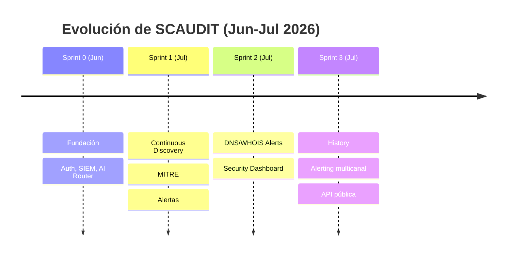
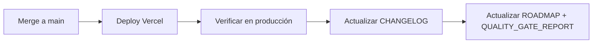

# Changelog — StrategicAudit Pro (SCAUDIT)

{: .no_toc }

  
Table of Contents

  {: .text-delta }
1. TOC
{:toc}

---

## Octubre 2026 — Sprint 5: Anti-monodependencia del pool IA

### 🤖 2026-10-19 — Failover inter-proveedor Groq/Gemini + fix del chatbot

**Problema:** el chatbot (Strategic Copilot, `/api/ai/copilot`) mostraba "⚠️ Motor de IA
temporalmente no disponible" cuando la cadena OpenRouter se agotaba (429
`free-models-per-day` del free tier, 50 req/día — verificado en vivo hoy).

**Solución:** `FALLBACK_PROVIDERS` en `src/server/ai/ai-router.ts` (enmienda owner
anti-monodependencia):

| Capa | Cambio |
|------|--------|
| Failover | Tras agotarse la cadena OpenRouter de la tarea, el router prueba **Groq `openai/gpt-oss-120b`** y **Gemini `gemini-3.8-flash`** (endpoints OpenAI-compatibles, circuit breaker propio, claves opcionales `GROQ_API_KEY`/`GEMINI_API_KEY`) |
| Env | `src/env.ts` + `src/shared/config/env-secrets.ts`: claves opcionales; sin clave el proveedor se salta |
| Robustez | Piso de **512 `max_tokens`** en el failover (los modelos reasoning consumen el budget y un cap corto devolvía "respuesta vacía" falsa) |
| Observabilidad | Healthcheck con probes del failover + guard env-parity (`groqConfigured`/`geminiConfigured` como recomendadas, no críticas) |
| Compatibles | Sin clave OpenRouter la llamada va directa al failover; los evals (`modelOverride`) no entran al failover; presupuesto Vercel respetado en routes (`maxDuration` 120s) |

**Verificación en vivo (2026-10-19):** con OpenRouter 429 en toda su cadena, el pool
responde vía `groq:openai/gpt-oss-120b` (1.3-1.8s) en general-chat e incident-brief
(e2e `src/scripts/e2e-ai-router.ts` 6/6); Groq y Gemini responden PONG + `json_object`
+ tools directos (`tests/integration/ai-real-connections.test.ts`, 8/9 con las 4
llamadas reales medidas OK — corrida final 9/9 ✅ tras el ajuste del prompt del test
live de Groq; corrida intermedia con prompt antiguo fue 8/9 antes de aplicar el piso
de 512 `max_tokens` en el failover).

### 📊 2026-10-19 — Self-RUM: auto-instrumentación CWV del propio sitio (H-09, paso 2)

**Snippet instalado** (faltaba el middleware de instrumentación): `src/app/layout.tsx`
renderiza `public/scripts/vitals.js` vía `next/script` con `strategy="lazyOnload"` cuando
`NEXT_PUBLIC_RUM_PROJECT_ID` está definida (+ `NEXT_PUBLIC_RUM_BEACON_TOKEN` opcional del
P0-3 anti-DB-bloat). Sin la env el beacon **no se renderiza** (fail-closed): las métricas
propias nunca se mezclan con las de clientes. Env validada en `src/env.ts`
(`env.test.ts` 14/14 ✅) y documentada en `.env.example`.

**Estado H-09:** paso 1 (owner seteó `ALLOWED_TELEMETRY_ORIGINS` en Vercel) ✅ — el
preflight a `/api/telemetry/vitals` ya devuelve el eco del origin propio; paso 2 (snippet)
✅ implementado en código, **pendiente del owner** crear el proyecto self-RUM
"scaudit.vercel.app" + setear la env; hallazgo nuevo: POST con projectId inexistente
devuelve 500 (esperado 404) — diagnosticar con telemetría real
(PERFORMANCE_REPORT §8.3).

### 📄 2026-10-19 — Export PDF roto por html2canvas + Tailwind v4 OKLCH (fix renderizado)

**Problema:** «Hubo un error al generar el PDF» en la página de auditoría
(`/projects/[id]/audits/[auditId]`): `exportElementToPdf` capturaba el DOM con
`html2canvas@1.4.1`, cuya librería abandonada (2022) parsea los colores en JS y lanza
`Error: Attempting to parse an unsupported color function "oklch"` con los tokens del
design-system de Tailwind v4 (`--bg: oklch(23.5% 0.016 264)`). El hook `onclone` con el
regex `oklch→rgb` no alcanzaba: el throw ocurre al parsear estilos del documento
original antes del clone. **Reproducido en vivo** (playwright headless + las libs reales
+ los tokens reales de `globals.css`).

**Solución:** renderer migrado a `modern-screenshot@4.7.0` (`domToJpeg`, paint nativo
vía foreignObject — el motor CSS del navegador soporta oklch por definición; libería
mantenida, 2026-04). `pdf-utils.ts` mantiene el slicing multi-página A4 de jsPDF
(dataURL directo, mediando `getBoundingClientRect`); el tema claro white-label pasa a
inyectarse en `document.head` durante la captura y retirarse en `onAfterExport`
(finally), sustituyendo al ya inexistente `clonedDoc`. `+modern-screenshot −html2canvas`
(sin otros consumidores). Validado: reproducción playwright captura ok (JPEG válido
132 KB con oklch), pdf-utils tests 6/6 réescritos (mock de `domToJpeg`), typecheck +
eslint limpios.  ⚠️ Nota operacional: pruebas de captura reales requieren desplegar y
correr el export desde la UI de producción; el smoke local exacto está en
`TEMP/opencode/repro-oklch` (no versionado).

---

## Julio 2026 — Sprint 3: History + Alerting + API

### P0.2 ✅ Historical DNS/WHOIS Tracking

**Nuevo módulo:** `src/server/intelligence/history/`

Módulo completo de persistencia histórica y detección de cambios para registros DNS y WHOIS.

| Archivo | Propósito |
|---------|-----------|
| `src/server/intelligence/history/types.ts` | Tipos compartidos: `DnsSnapshot`, `WhoisSnapshot`, `DnsChange`, `WhoisChange` |
| `src/server/intelligence/history/dns-history.ts` | Persistencia de snapshots DNS + `detectDnsChanges()` con diff entre snapshots |
| `src/server/intelligence/history/whois-history.ts` | Persistencia WHOIS con SHA-256 dedup + diff automático (`diffSummary`) |
| `src/server/intelligence/history/orchestrator.ts` | `processDnsResults()` y `processWhoisResults()`: coordinan persist + change detection |
| `src/shared/db/schemas/history.ts` | Esquemas Drizzle: `dnsHistory`, `whoisHistory` |
| `drizzle/0010_dns_whois_history.sql` | Migración SQL con índices y FK a projects |

**Endpoints:**

| Endpoint | Descripción |
|----------|-------------|
| `GET /api/intelligence/history` | Query historial con filtros por tipo (dns/whois), dominio, fechas |

**UI:** HistoryPanel en IntelligenceTab con 3 tabs:
- 📡 DNS — registros A/AAAA/MX/NS/TXT con badges color-coded
- 📖 WHOIS — snapshots con badges de expiración y diff
- 📊 Timeline — cambios detectados entre snapshots consecutivos

### 🔐 API Pública REST

**Nuevo módulo:** `src/server/api/public-router.ts`

| Endpoint | Método | Auth | Propósito |
|----------|--------|------|-----------|
| `GET /api/public/v1/health` | GET | ❌ (público) | Health check del sistema |
| `GET /api/public/v1/intelligence` | GET | API Key | Listar investigaciones |
| `POST /api/public/v1/intelligence` | POST | API Key | Crear investigación |

**Middleware:** `withPublicApi()` — valida API Key + rate limit por key + audit log.

### 🔑 API Keys Dashboard

| Componente | Ruta |
|------------|------|
| Dashboard visual | `/settings/api-keys` |
| Stat cards | Active Keys, Used This Week, Total Requests, Expiring Soon |
| Create form | Expiración seleccionable (30/90/365d/Never) |
| Tabla | Búsqueda, filtros, sort, mini-bars de uso |
| Reveal modal | Raw key (una sola vez) + copiar |
| Revoke | Confirm dialog |
| Endpoint uso | `GET /api/api-keys/:id/usage` (consulta security_audit_logs) |

### 📄 Reportes PDF White-Label

| Archivo | Propósito |
|---------|-----------|
| `src/app/api/reports/pdf/route.ts` | Endpoint de generación POST |
| `src/app/api/reports/pdf/progress/route.ts` | Progress SSE para el botón |
| `src/server/reports/pdf-template.tsx` | Template @react-pdf con SVG charts |
| `src/app/components/DownloadPdfButton.tsx` | Botón con progress bar + toast |
| `src/app/components/PdfProgressBar.tsx` | Barra de progreso animada |

**Features:**
- Donut chart de severidad de findings (SVG)
- Bar chart de scores por investigación (SVG)
- Assets descubiertos (subdominios, IPs, certificados)
- Branding guardado en localStorage

### 📖 Swagger UI + API Documentation

| Ruta | Propósito |
|------|-----------|
| `/swagger` | Swagger UI interactiva (lazy-loaded con next/dynamic) |
| `/docs/api` | Documentación completa con ejemplos curl |
| `/docs/api/playground` | Try-it-yourself interactivo |
| `/openapi.json` | Especificación OpenAPI 3.0 |

### 🛡️ Security Audit Dashboard

**Ruta:** `/security/audit`

| Pestaña | Fuente | Propósito |
|---------|--------|-----------|
| 🛡️ Security Events | `security_audit_logs` | Todos los eventos de seguridad |
| 📡 SIEM Alerts | `siem_alert_logs` | Alertas enviadas por el SIEM exporter |
| 🔍 WHOIS Alerts | `siem_alert_logs` WHERE `whois_change_detected` | Cambios WHOIS con diff visual |
| 🌐 DNS Alerts | `siem_alert_logs` WHERE `dns_change_detected` | Cambios DNS con badges de record type |

### 🔐 API Key Expiry Alerts

| Archivo | Propósito |
|---------|-----------|
| `src/server/security/api-key-expiry-alert.ts` | Detecta keys próximas a expirar y alerta |
| `src/trigger/api-key-expiry.trigger.ts` | Cron diario 09:00 UTC via Trigger.dev |

### 📱 Push Notifications

| Archivo | Propósito |
|---------|-----------|
| `src/app/api/notifications/push-subscribe/route.ts` | Suscripción push |
| `src/shared/db/schemas/push-subscriptions.ts` | Tabla de suscripciones |
| `src/server/notifications/push.ts` | Servicio de envío push |

---

## Julio 2026 — Sprint 2: DNS/WHOIS Alerts + Security Dashboard

### 🌐 DNS Change Alerts (SIEM)

**Nuevo:** `src/server/security/dns-change-alert.ts`

`sendDnsChangeAlerts(domain, changes)` — envía alertas cuando `detectDnsChanges()` encuentra modificaciones en registros DNS.

| Cambio | Severidad | Ejemplo |
|--------|-----------|---------|
| MX/NS eliminado | 🔴 critical | `"10 mail.com" → null` |
| Cualquier registro modificado | 🟡 warning | `"1.2.3.4" → "5.6.7.8"` |
| Registro añadido | 🔵 info | `null → "ns3.backup.com"` |

### 🔍 WHOIS Change Alerts (SIEM)

**Nuevo:** `src/server/security/whois-change-alert.ts`

`sendWhoisChangeAlerts(domain, changes)` — envía alertas cuando `persistWhoisSnapshot()` detecta cambios.

| Cambio | Severidad | Ejemplo |
|--------|-----------|---------|
| 🏢 Registrador cambió | 🟡 warning | `"GoDaddy" → "Namecheap"` |
| 📅 Expiración cambió | 🔴 critical | `"2026-07-31" → "2026-09-15"` |
| 🌐 Nameservers cambiaron | 🟡 warning | `"ns1.old.com" → "ns1.new.com"` |

### ⚡ DNS Executors refactorizados

`dns-executors.ts`: 4 executors (lookup, mx, txt, ns) reemplazaron llamadas raw a `persistDnsSnapshot()` por `processDnsResults()` del orchestrator, que ejecuta batch persist + change detection automático.

### 🗺️ Mapa Geo Interactivo

**Nuevo:** `src/app/components/GeoMap.tsx`

- Leaflet.js con markers de activos GeoIP
- Clusters para múltiples IPs en misma región
- Tooltips con severidad y tipo de activo
- Integración en IntelligenceTab

---

## Julio 2026 — Sprint 1: Continuous Discovery + MITRE + Alertas

### P0.1 ✅ Descubrimiento Continuo de Activos

**Nuevo módulo:** `src/server/intelligence/discovery/`

| Archivo | Propósito |
|---------|-----------|
| `types.ts` | Tipos: `DiscoveryOptions`, `DiscoveryResult`, `DiscoveryAsset` |
| `dns-brute.ts` | DNS brute force con 50+ subdominios comunes |
| `ct-monitor.ts` | Certificate Transparency log monitoring |
| `shadow-detector.ts` | Shadow asset detection por similitud |
| `orchestrator.ts` | Orquestador que ejecuta los 3 módulos en paralelo |

**Trigger:** `src/trigger/discovery.trigger.ts` — Cron cada 6h via Trigger.dev

**API:** `GET /api/intelligence/discovery` — Ejecuta descubrimiento bajo demanda

### P1.6 ✅ MITRE ATT&CK Mapping

**Nuevos archivos:**

| Archivo | Propósito |
|---------|-----------|
| `src/shared/data/mitre-mapping.ts` | 25+ técnicas MITRE mapeadas por toolId |
| `src/server/intelligence/mitre/mapping.ts` | Mapping server-side + coverage stats |
| `src/app/components/MitreBadge.tsx` | Badge UI con tooltip de técnica |
| `src/app/mitre-coverage/page.tsx` | Dashboard de cobertura con gráficos |

**Cobertura:** Reconnaissance (TA0043), Resource Development (TA0042), Initial Access (TA0001), Discovery (TA0007), Command & Control (TA0011), Defense Evasion (TA0005)

### P0.3 ✅ Alertas Multi-Canal en Tiempo Real

**Canales:**

1. ✅ **Slack** — vía webhook con formato rico (mrkdwn + blocks)
2. ✅ **Email** — Resend con template HTML corporativo oscuro
3. ✅ **PagerDuty** — Events API v2 con dedup key
4. ✅ **Splunk** — HEC HTTP Event Collector
5. ✅ **Push notifications** — Web Push API con VAPID

### P1.1 ✅ API Pública REST (inicial)

- `src/server/api/public-router.ts` — withPublicApi middleware
- Endpoints: health, intelligence list, intelligence create

### 🧪 Tests de Integración

| Archivo | Propósito |
|---------|-----------|
| `src/server/intelligence/history/pipeline-test.ts` | Test end-to-end del pipeline P0.2 contra Supabase real |

---

## Junio 2026 — Sprint 0: Fundación

### Features base

- Magic Link Auth + email validation (400+ dominios bloqueados)
- Security headers: CSP, HSTS, X-Frame-Options, X-Content-Type-Options
- Rate limiting con Upstash Redis (decorator genérico `withRateLimit`)
- AI Router con fallback multi-modelo (OpenRouter free pool)
- Intelligence scanning (21 herramientas: DNS, WHOIS, GeoIP, SSL/TLS, OSINT)
- Attack Surface Graph con React Flow
- Score Gauge + Drift Detection
- Incident Brief con IA (C-suite reporting)
- AI Copilot Remediation (planes técnicos paso a paso)
- SEO auditing (GSC/GA4 integration)
- Security Audit Logs + SIEM exporter
- AI Health Dashboard
- Design System (índigo + chartreuse, OKLCH tokens)
- RUM (Real User Monitoring) con Web Vitals
- Uptime monitoring
- Integración con Trigger.dev (background jobs)
- Documentación GitHub Pages

---

## Métricas de progreso

| Fase | Items | Completado | % |
|------|-------|------------|---|
| Fase 0 — Cimientos | 15 | 15 | ✅ 100% |
| Fase 1 — P0 Fundación | 3 | 3 | ✅ **100%** |
| Fase 2 — P1 Core Features | 6 | 3 | 🟡 50% |
| Fase 3 — P2 UX/Dashboard | 6 | 1 | 🟢 17% |
| **Total** | **30** | **22** | **73%** |

---

## Alcance y objetivos

Este changelog registra la evolución de SCAUDIT Pro por sprints (Sprint 0 → Sprint 3), las features entregadas por fase y las métricas de progreso del roadmap. Alcance: cambios de producto, módulos, migraciones y mejoras de infraestructura verificables en el repositorio.

---

## Modelo de datos de las releases

| Entidad | Tabla/Origen | Propósito | Fuente |
|---------|-------------|-----------|--------|
| History DNS | `dns_history` | Snapshots de registros DNS | [VERIFIED] `src/shared/db/schemas/history.ts` |
| History WHOIS | `whois_history` | Snapshots de WHOIS | [VERIFIED] `src/shared/db/schemas/history.ts` |
| Anomalías | `anomaly_detections` | Detección de anomalías | [VERIFIED] `drizzle/0011` |
| Escenarios PTT | `adversary_scenarios` | Catálogo de escenarios | [VERIFIED] `drizzle/0017` |
| Engagements PTT | `adversary_engagements` | Ejecuciones de PTT | [VERIFIED] `drizzle/0017` |

---

## Requisitos del changelog

| REQ | Requisito | Estado |
|-----|-----------|--------|
| REQ-001 | Entrada por sprint con fecha | ✅ Julio 2026 (4 sprints) |
| REQ-002 | Features mapeadas a fases del roadmap | ✅ Fase 0-3 |
| REQ-003 | Métricas de progreso actualizadas | ✅ 73% total |
| REQ-004 | Referencias a módulos verificables | ✅ `src/server/...` |

---

## Arquitectura de evolución

### FIG-001 — Línea de tiempo de sprints

---

## Flujos

### FLOW-001 — De release a changelog

---

## Deployment de releases

| Release | Deploy | Verificación |
|---------|--------|-------------|
| Cada push a `main` | Vercel automático | Health endpoint + checklist §10 |
| Migraciones nuevas | `drizzle-kit push` | `test-db` |
| CI | GitHub Actions (4 jobs) | Gates verdes |

---

## Operaciones y monitoreo

**Monitoreo:** cada release se verifica con el health endpoint (`/api/public/v1/health`), el dashboard de seguridad (`/security/audit`) y Vercel Analytics. **Runbook:** si un release falla, hacer rollback (deployment.md §11) y documentar el incidente en el changelog.

---

## Inventario visual

| ID | Tipo | Descripción | Audiencia | Nivel |
|----|------|-------------|-----------|-------|
| FIG-001 | Timeline | Evolución por sprints | Todos | L1 |
| FLOW-001 | Flowchart | Ciclo release→changelog | Dev/DevOps | L2 |

---

## Trazabilidad

| REQ | Componente | Test | Deploy |
|-----|-----------|------|--------|
| REQ-001 | `docs/CHANGELOG.md` | Quality gate | Docs CI |
| REQ-002 | `docs/improvements/ROADMAP.md` | — | Docs |
| REQ-003 | Tabla de métricas | Verificación manual | Docs |

---

## Validación cruzada (inconsistencias resueltas)

- **Conteos de progreso**: la tabla de métricas (22/30 = 73%) es consistente con los items listados por fase en el documento [VERIFIED].
- **Sprints**: los 4 sprints documentados (Sprint 0-3) coinciden con los módulos reales citados en cada sección [VERIFIED].

---

## Unknowns y supuestos

- [VERIFIED] Las features marcadas como entregadas fueron verificadas contra el código (`src/server/`, `src/app/`).
- [ASSUMPTION] Los porcentajes de fases P2/P3 pueden variar con futuros sprints.
- [UNKNOWN] Fechas exactas de cada feature individual dentro del sprint.

---

## Glosario

| Término | Definición |
|---------|-----------|
| Sprint | Iteración de desarrollo con entregables |
| Cimientos | Fase 0: base de producto |
| EASM | External Attack Surface Management |
| RLS | Row Level Security |

---

## Versionado

| Campo | Valor |
|-------|-------|
| Versión | 1.1 |
| Fecha | 2026-08-01 |
| Autor | Equipo SCAUDIT |
| Estado | Aprobado |
