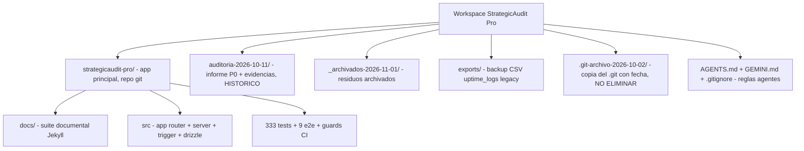

# Informe Maestro — Consolidación del Proyecto (2026-11-01)

{: .no_toc }

  
Table of Contents

  {: .text-delta }
1. TOC
{:toc}

---

## Alcance y objetivos

Informe fruto de la **consolidación completa del workspace** solicitada el 2026-11-01: análisis de todo el proyecto, reorganización de la documentación dispersa, archivo de documentos desactualizados y limpieza de residuos. Este documento es el **índice único de la verdad**: enlaza todo lo que existe, dice dónde está cada cosa y qué vigencia tiene. Documentos posteriores a esta fecha deben actualizarse aquí o derivar de él.

---

## 1. Resumen ejecutivo

| Aspecto | Estado a 2026-11-01 |
|---------|---------------------|
| Producto | SCAUDIT — plataforma SaaS enterprise de inteligencia cyber + auditoría técnica SEO. Desplegada en `scaudit.vercel.app` [VERIFIED] |
| Repositorio | `strategicaudit-pro/` (git, `main` sincronizada con `origin/main`, árbol limpio; último commit `d0641cc` TD-19/TD-22/TD-28) [VERIFIED] |
| Madurez | Auditoría 2026-10-11: Engineering Score **61/100** → P0/P1/P2 ejecutados → **"LISTO PARA PRODUCCIÓN"** (`FINAL-SUMMARY.md`, 2026-10-18) [VERIFIED] |
| Deuda técnica | 29 registradas: **19 RESUELTO**, 6 ABIERTAS (TD-08, 17, 18, 21, 24, 26), 2 BLOQUEADAS en decisión (TD-20 interna, TD-27 owner), 3 PARCIALES (TD-23, TD-28, TD-29) — `docs/technical-debt/TECH-DEBT-REGISTER.md` [VERIFIED] |
| Documentación | Suite Jekyll en `docs/` (GitHub Pages), ADR-001..010, registro TD, índice `docs/index.md` v1.4. Históricos archivados con banner (§3) |
| Stack real | Next.js 16.3.3 · React 19.2.4 · TypeScript 5 strict · Drizzle ORM + Postgres (Supabase) · Trigger.dev 4.7.2 · Sentry 11 · Tailwind v4 · Vitest 4 + Playwright · Vercel iad1 [VERIFIED] |

**Fuentes de verdad vigentes** (por prioridad): código (`drizzle/schema.ts`, `src/`), `docs/technical-debt/TECH-DEBT-REGISTER.md`, `docs/CHANGELOG.md`, `docs/architecture/CURRENT-STATE.md`, ADRs.

---

## 2. Mapa del workspace

### 2.1 Raíz del workspace (tras la limpieza)

| Elemento | Qué es | Disposición |
|----------|--------|-------------|
| `strategicaudit-pro/` | Aplicación principal (repo git, GitHub `StrategicConnex/StrategicConnexAudit`) | ACTIVA |
| `auditoria-2026-10-11/` | Auditoría integral del 2026-10-11: informe final (score 61/100), 5 informes por área (seguridad/BD/funcionalidad/pruebas/P0 ejecutado) + logs de evidencia | HISTÓRICO CONSERVADO en sitio (superada por P0 ejecutado y `TECH-DEBT-REGISTER`) |
| `_archivados-2026-11-01/` | Residuos archivados por esta consolidación (§4) | ARCHIVO |
| `.git-archivo-2026-10-02/` | Copia archivada del repositorio `.git` con fecha 2026-10-02 | ARCHIVO, no tocar (única copia histórica del repo en la raíz) |
| `exports/uptime_logs_legacy_pre-drop_2026-10-28.csv` | Backup CSV de `uptime_logs` antes del drop de la tabla legacy | ARCHIVO, conservar |
| `AGENTS.md` / `GEMINI.md` / `.gitignore` | Reglas de agentes (Trigger.dev SDK) y ignores del workspace | ACTIVAS |
| `.clinerules/`, `.kilo/`, `.superpowers/`, `.freebuff/`, `.vscode/`, `.serena/`, `.cloud-attachments/` | Estado de herramientas de agentes (Cline, Kilo, etc.); `.cloud-attachments/` incluye una conversación importada (12,8 MB) | ACTIVAS / limpiables a criterio del owner |

---

## 3. Mapa documental consolidado

### 3.1 Documentación reubicada en esta consolidación

Los cuatro documentos de diseño del workspace raíz se **movieron** (no copiaron) a `strategicaudit-pro/docs/archive/legacy-root-docs/` con banner de deprecación al inicio:

| Documento (ubicación original: raíz) | Fecha | Contenido | Por qué es histórico |
|--------------------------------------|-------|-----------|----------------------|
| `SRS-Strategic-AuditPro-V2.md` | 2026-05-06 | SRS v2.0 "Serverless-Native", 8 componentes | Stack del SRS (Next 15, `src/modules/*`) no coincide con el real; los FR-* siguen siendo referencia de producto |
| `Master_Database_V2.md` | 2026-05-06 | Modelo de datos V2 (Postgres 16 + TimescaleDB) | El esquema canónico es `drizzle/schema.ts` (78 tablas, 67 migraciones, RLS por rol embebido); Timescale no existe |
| `Plan_de_Accion_StrategicAudit_Pro_v2.md` | 2026-05-07 | Plan de ejecución 8–10 semanas (prompts) | Fase de construcción ejecutada; progreso vivo en CHANGELOG y registro TD |
| `Plan_de_Mejoras_StrategicAudit_Pro.md` | 2026-09-14 | Catálogo de hallazgos P0 + roadmap de mejoras | P0 tratados por el ciclo auditoría-P0-FINAL-SUMMARY; deuda viva hoy solo en registro TD |

### 3.2 Documentación dentro de la app (`strategicaudit-pro/`)

| Ruta | Rol |
|------|-----|
| `README.md` | Portada técnica del producto (despliegue, capacidad, API pública, SIEM, PWA, plugins) |
| `DESIGN_SYSTEM.md` v3 | Identidad visual vigente (OKLCH, oliva/dorado/teal, NOC) |
| `FINAL-SUMMARY.md` (2026-10-18) | Cierre de las fases P0/P1/P2: métricas, fixes, "listo para producción" |
| `EXECUTIVO_TRIGGER_GAPS.md` (2026-10-18) | Auditoría de Trigger.dev: 34 tasks, incidente de workers y verificador ciego (resuelto: TD-14/15/16) |
| `EXECUTIVO_P2-16_*.md` (2026-10-16/17) | Entrega y cierre de P2-16 (owner-only, migración 0052, guard `check:cascade-drop`) |
| `docs/` | Suite documental enterprise (Jekyll): índice `index.md`, `api.md`, `security.md`, `installation.md`, `CHANGELOG.md`, `ENGINEERING-LOOP.md`, `CORE_SYSTEM.md` |
| `docs/architecture/` | ADR-000..010 (+AMEND) y `CURRENT-STATE.md` (nuevo, v1.0) |
| `docs/technical-debt/TECH-DEBT-REGISTER.md` | Registro canónico de deuda TD-01..TD-29 |
| `docs/archive/` | Históricos: informes de auditoría consolidada, análisis del 2026-10-19, sistemas de diseño v1/v2 y, desde hoy, `legacy-root-docs/` |
| `agents/`, `sdk/`, `scripts/`, `backups/` | Definiciones de agentes de skills, SDK público, scripts de guards/migración, backups de BD |

### 3.3 Regla de vigencia

A partir de esta consolidación: **los docs con banner "HISTÓRICO" no son especificación**. Cualquier afirmación sobre arquitectura debe cotejarse contra `docs/architecture/CURRENT-STATE.md` y el código.

---

## 4. Disposición de residuos (2026-11-01)

Todo movido a `_archivados-2026-11-01/` en la raíz (nada eliminado definitivamente):

| Elemento | Qué era | Razón del archivo |
|----------|---------|-------------------|
| `nuevo/src/app/disclaimer/accept.ts` | Borrador suelto del action de disclaimer | Obsoleto: la app ya tiene implementación superior (`actions.ts` + `DisclaimerCookie` en `src/shared/lib/disclaimer.ts` + barrera en `proxy.ts`); el borrador además usaba un nombre de cookie con errata (`DISLAIMER_ACCEPTED`) |
| `dev_error.log`, `dev_output.log` | Logs de desarrollo vacíos (0 bytes) | Sin contenido ni valor |
| `Foto.png`, `Foto2.png` | Capturas sueltas en la raíz | Sin referencia documental; conservadas en archivo por si son relevantes |
| `.mig-pricing.html` | Render RSC de servidor (hidratación `$RC`) de la página de pricing, usado durante la migración de planes | Output generado, no documentación; conservado en archivo |

Archivados que permanecen donde estaban: `auditoria-2026-10-11/` (auditoría con evidencias), `.git-archivo-2026-10-02/` (copias históricas del repo), `exports/` (respaldo de datos crudos).

---

## 5. Métricas del código (2026-11-01)

| Métrica | Valor (real, verificado) | Estaba anunciado |
|---------|--------------------------|------------------|
| Migraciones `drizzle/*.sql` | 67 | 64 (FINAL-SUMMARY) / 67 (auditado) |
| Tablas | 78 `pgTable` (paridad con migraciones 78/78) | 67 (README antiguo) / 79 (auditoría) |
| API `route.ts` | 78 en 25 dominios | — |
| `page.tsx` | 25 (+3 layouts) | — |
| Tareas Trigger.dev | 27 ficheros → 34 task IDs, 9 schedules | 13 (pre-auditoría) |
| Tests | 333 archivos; 2.572 tests en verde por auditoría 2026-10-11 | — |
| Cambios post-auditoría | P0 ejecutado (SSRF, BYPASSRLS, TRUNCATE, túnel Sentry, purga de datos sintéticos); incidente de workers Trigger.dev resuelto (TD-14/15/16) | — |

> Ojo: `docs/index.md` menciona métricas del sitio (17 docs, 198 tests) que corresponden a su fecha (2026-08-01); el dato de tests vigentes es el del §5. Actualizado en el changelog del índice.

---

## 6. Deuda técnica viva (síntesis autorizada del registro)

| TD | Tema | Estado |
|----|------|--------|
| TD-08 | 12 snapshots intermedios de Drizzle sin regenerar | ABIERTA |
| TD-17 | Cobertura 0% en `outbox`/`scan-queue` triggers y módulos PDF | ABIERTA (aplazada por decisión del owner) |
| TD-18 | `RESEND_API_KEY` ausente (sin dominio de envío) | ABIERTA (por diseño actual) |
| TD-20 | Contract test (Newman en vivo) fail-closed sin endpoint no-prod; vía efímera CI documentada — requiere implementación técnica, no config del owner | BLOQUEADA interna |
| TD-21 | Particionado `uptime_logs`: fecha límite dura **2027-03-01** | ABIERTA (p1, ventana hasta ene-2027) |
| TD-24 | Copilot flotante del dashboard: construir `dashboardData` server-side | ABIERTA |
| TD-26 | Atribución del LCP móvil (gate G-1 móvil en rojo) | ABIERTA |
| TD-27 | Validación de citas con datos reales (REQ-CHAT-SPRINT2) | BLOQUEADA externa (owner) — limitación QA documentada |
| TD-23 | RUM web_vitals (b) attribution confirmada en campo; falta móvil | PARCIAL |
| TD-28 | Latencia copilot: (a) ctx en prod 1.492 ms y (b) timeout resueltos; falta cerrar latencia | PARCIAL |
| TD-29 | Suite `Integration (Postgres real)` no ejecutable (setup roto) | ABIERTA |

Fuente única y actualizada: `docs/technical-debt/TECH-DEBT-REGISTER.md`.

---

## 7. Próximos pasos recomendados

1. **Commit de esta consolidación** en `strategicaudit-pro` (los nuevos/archivados están listos; ejecutar push para que Pages regenere el sitio).
2. **TD-29**: habilitar la suite de integración real (único rojo conocido de CI).
3. **TD-20**: implementar el **modo efímero en CI** (servidor Next + BD de CI avalada por TD-19 + API key de test + Newman contra localhost; sin dependencia del owner). Ruta alternativa: staging Vercel persistente (Sprint 5). Ojo: **TD-27 no la desbloquea un staging** — exige credenciales de una cuenta con hallazgos `critical` reales (decisión del owner; reevaluación 2026-11-04); mientras tanto queda como limitación documentada del QA.
4. **TD-26**: traza temporal LCP (CDP/Long Animation Frames) — desbloquea cierre móvil de REQ-002.
5. **TD-21**: implementar higiene de particiones en `cleanup.trigger.ts` antes de feb-2027 (fecha límite dura 2027-03-01).
6. Decidir el destino de `.cloud-attachments/` (12,8 MB de conversación importada) y `.git-archivo-2026-10-02/` (el owner decidirá si se conserva definitivamente).

---

## Trazabilidad

| Sección | Componente | Evidencia |
|---------|-----------|-----------|
| 1, 5, 6 | `docs/architecture/CURRENT-STATE.md`, `TECH-DEBT-REGISTER.md` | Exploración 2026-11-01 + git log |
| 3 | banners + `docs/archive/legacy-root-docs/` | Archivos movidos y verificados en disco |
| 4 | `_archivados-2026-11-01/` | Listado verificado tras la limpieza |

---

## Glosario

| Término | Definición |
|---------|-----------|
| Workspace | Carpeta raíz `D:\ProyectosWeb\Proyectos\StrategicAudit Pro` (no repo) |
| Suite documental | Sitio Jekyll de `strategicaudit-pro/docs/` publicado en GitHub Pages |
| Residuo | Archivo sin función documental activa, archivado sin eliminar |
| Banner HISTÓRICO | Marca de deprecación al inicio de un documento archivado |

---

## Versionado

| Campo | Valor |
|-------|-------|
| Versión | 1.0 |
| Fecha | 2026-11-01 |
| Autor | Consolidación documental SCAUDIT |
| Estado | Aprobado |

Changelog de esta página: **v1.0** (2026-11-01) — primer informe maestro: consolidación del workspace, archivo de docs históricos y limpieza de residuos.
