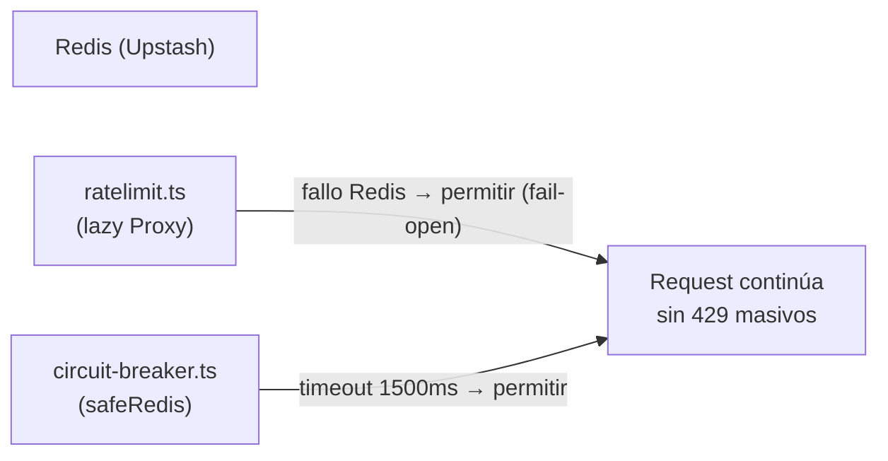

# ADR-002 — Fail-open en circuit breaker; fail-closed acotado en rate limit

{: .warning }
**Enmienda 2026-10-15 (v1.3) — P2-13:** el rate limit **deja de ser
fail-open**. Un fallo del store distribuido ya **no** devuelve `allowed=true`:
se sigue limitando con el sliding window en memoria del proceso más un techo
global por instancia durante una ventana de enfriamiento. **Sólo** el rate
limit cambia: la caché distribuida, el circuit breaker y el sink de app logs
**siguen fail-open**. Ver §16.

{: .warning }
**Enmienda 2026-10-02 (v1.2):** el rate limit pasa a un **store distribuido en
Postgres** (tabla propia `rate_limit_windows`, mismo `DATABASE_URL`, sin
servicios externos ni coste nuevo) en producción; fuera de ella sigue en
memoria. El circuit breaker y la caché IA permanecen **en memoria por
instancia**. El invariante —**nunca bloquear por un fallo del limitador**
(fail-open)— se conserva. Ver §15.

{: .note }
**Enmienda 2026-09-27 (v1.1):** se eliminaron `@upstash/redis` y
`@upstash/ratelimit`: no hay cliente Redis, ni `Proxy` lazy, ni `safeRedis`
con timeout. Ver §14.

{: .no_toc }

<details open markdown="block">
  <summary>Tabla de contenidos</summary>
  {: .text-delta }
1. TOC
{:toc}
</details>

---

## 1. Contexto

El rate limiting y el circuit breaker dependen de **Upstash Redis**. Si Redis cae, un fail-closed convertiría una caída parcial en una **caída total del producto** o, peor, en **429 masivos** para todos los usuarios. **Alcance:** `src/shared/lib/ratelimit.ts` y `src/shared/lib/circuit-breaker.ts` (T01-04).



## 2. Problema

Un fallo de Redis debía **degradar con gracia** (permitir la operación) en lugar de bloquear falsamente a usuarios legítimos o descartar resultados de ejecutores.

## 3. Requisitos que motivan la decisión

| REQ | Requisito | Criterio de aceptación |
|-----|-----------|------------------------|
| REQ-1 | Nunca 429 masivos por caída de Redis | Rate limit hace fail-open |
| REQ-2 | No descartar resultados exitosos por timeout | Circuit breaker hace fail-open |
| REQ-3 | No instanciar Redis en build | Cliente lazy vía `Proxy` |

## 4. Opciones consideradas

| Opción | Descripción | Veredicto |
|--------|-------------|-----------|
| Fail-closed | Ante fallo de Redis, denegar | Descartada (caída total) |
| Fail-open siempre | Permitir siempre | **Adoptada** (degradación graciosa) |
| Cache local como respaldo | TTL local en caso de fallo | Evaluada, no necesaria |

## 5. Decisión

**Decisión:** implementar **fail-open** tanto en el rate limit como en el circuit breaker. El rate limit usa un cliente Redis lazy (`Proxy`) que no se instancia en build; ante fallo permite la operación. El circuit breaker envuelve cada op de Redis con timeout de 1500 ms y, ante error, devuelve el fallback permitiendo la operación.

| Campo | Valor |
|-------|-------|
| Estado | Accepted |
| Fecha | 2026-08-02 |
| Autor | StrategicConnex Engineering |
| Commits | `eda77c4` (ratelimit fail-open) · `d1b8723` (allowlist + 40 req/min) · `d59543a` (circuit-breaker fail-open) |
| Archivos | `src/shared/lib/ratelimit.ts` · `src/shared/lib/circuit-breaker.ts` |
| Relacionado | [SYSTEM-MAP.md](../SYSTEM-MAP.md) §3 · [ENTERPRISE-ARCHITECTURE.md](../ENTERPRISE-ARCHITECTURE.md) |

## 6. Racional

- Cliente Redis lazy: `new Proxy({} as Redis, ...)` evita eager instantiation en build [VERIFIED: `ratelimit.ts:22`].
- Fail-open explícito con comentario: "un outage de Redis jamás debe bloquear ni falsear" [VERIFIED: `circuit-breaker.ts:35-37`].
- `safeRedis` rechaza con `Redis op timeout` a los 1500 ms y retorna el fallback [VERIFIED: `circuit-breaker.ts:23,31`].
- `CircuitState` (CLOSED/OPEN/HALF_OPEN) [VERIFIED: `circuit-breaker.ts:3-6`].
- [ASSUMPTION] En un ataque coordinado, fail-open degrada la protección; se compensa con allowlist y límites en capas de proxy.

## 7. Consecuencias — arquitectura, datos, operaciones y seguridad

**Arquitectura:** `ratelimit.ts` (fan-in 17) y `circuit-breaker.ts` son dependencias compartidas de los route handlers (ver DEPENDENCY-GRAPH.md §5).

**Datos:** sin impacto.

**Operaciones y monitoring:** una caída de Redis genera warnings en consola (`[CircuitBreaker] Redis op failed (fail-open)`) y se observa en los logs; los headers de rate limit siguen emitiéndose cuando Redis responde.

**Seguridad y controles:** los 429 auténticos se mantienen cuando Redis responde; la cabecera de respuesta usa el formato IETF `RateLimit-Limit/Remaining/Reset` + legacy `X-RateLimit-*` [VERIFIED: `ratelimit.ts:127-132`]. La `EMAIL_ALLOWLIST` (incluye `palacios_juan@hotmail.com`) exime a cuentas críticas [VERIFIED: `ratelimit.ts:37`].

## 8. Riesgos y mitigaciones

| Riesgo | Severidad | Mitigación |
|--------|-----------|------------|
| Abuso de tasa durante outage de Redis | MEDIUM | Fail-open acotado al periodo de caída; logs de warning; límite global en capas edge |
| Falsear 429 masivos en login | HIGH | `isEmailAllowlisted()` + 40 req/min (commit `d1b8723`) [VERIFIED] |

- [UNKNOWN] Duración máxima tolerada de un outage de Redis sin degradación de seguridad no está documentada.

## 9. Migración — pasos y flujo de trabajo

```text
N/A — decisión ya aplicada. Los consumidores importan safeRedis/rateLimit sin cambios de firma.
```

## 10. Verificación — quality gate, API y tests

- `node scripts/quality-gate.mjs docs/architecture/ADR/ADR-002-fail-open-rate-limit.md --min 80` → resultado en §13.
- Impacto en API: los endpoints GET/POST afectados (login, `/api/intelligence`) no cambian contrato; solo comportamiento ante fallo de Redis.
- Impacto en tests: suite Vitest pasa (248 tests) y los circuit breakers se ejercitan en tests de ejecutores [VERIFIED]. Los **tests unitarios** de `ratelimit`/`circuit-breaker` corren en CI.
- Deployment/CI/CD: sin cambios de despliegue (Vercel); el cliente lazy evita romper el build, y el pipeline (`ci.yml`) permanece intacto.
- **Cross-check:** SYSTEM-MAP.md §3 (FLOW-101) y DEPENDENCY-GRAPH.md §9 documentan el mismo comportamiento.

## 11. Trazabilidad

**MAT-122 — Trazabilidad del ADR-002**

| ID | Tipo | Qué cubre | Fuente verificada |
|----|------|-----------|-------------------|
| MAT-122 | Tabla | Fail-open rate limit + circuit breaker | `ratelimit.ts` · `circuit-breaker.ts` · commits `eda77c4`/`d1b8723`/`d59543a` |

## 12. Glosario

| Término | Definición |
|---------|------------|
| Fail-open | Permitir la operación cuando un servicio auxiliar falla |
| Lazy Redis | Cliente Redis instanciado bajo demanda vía `Proxy` para no romper el build |

## 13. Versionado y verificación

| Versión | Fecha | Cambios | Estado |
|---------|-------|---------|--------|
| 1.0 | 2026-08-02 | Registro de la decisión fail-open (T01-04) | Aprobado |
| 1.1 | 2026-09-27 | Enmienda: eliminación de Upstash Redis; store en memoria | Aprobado |
| 1.2 | 2026-10-02 | Enmienda: rate limit distribuido en Postgres (`rate_limit_windows`); circuit breaker y caché IA siguen en memoria | Aprobado |
| 1.3 | 2026-10-15 | Enmienda: rate limit pasa a **fail-closed con fallback acotado** (memoria + techo global por instancia); caché, circuit breaker y app-logs siguen fail-open | Aprobado |

**Resultado quality gate:** 100/100 (PASS, `--min 80`, 2026-08-02).

---

## 14. Enmienda (2026-09-27) — fin de la dependencia de Upstash

**Contexto de la enmienda:** `UPSTASH_REDIS_REST_URL/TOKEN` no existían en el
entorno real; la app ya operaba con fallback en memoria y el health público
respondía `503` por `redisConfigured=false`. Se optó por eliminar los paquetes
en lugar de renegociar credenciales.

**Qué cambió:**

| Antes (v1.0) | Ahora (v1.1) |
|--------------|-------------|
| `ratelimit.ts` con `Proxy` lazy + llamadas REST a Upstash | `checkRateLimitInMemory()` puro, sin red |
| `circuit-breaker.ts` con `safeRedis` (timeout 1500 ms) y store remoto | `CircuitBreaker` con store `Map` en memoria + `resetAllCircuits()` |
| Caché IA en 2 niveles (L1 memoria + L2 Upstash) | Solo L1 en memoria |
| Progreso de PDF en claves Redis (`pdf_progress:<user>:<genId>`) | Tabla Postgres `pdf_progress` con RLS por usuario |
| Salida de build: `@upstash/redis` + `@upstash/ratelimit` | Sin dependencias Upstash en `package.json` |

**Qué NO cambió (invariante del ADR):** la operación **nunca** se bloquea por un
fallo del limitador: cualquier error interno devuelve `allowed=true` y el
request continúa. Los 429 auténticos siguen emitiéndose con cabeceras IETF
`RateLimit-Limit/Remaining/Reset` + `X-RateLimit-*`, y `isEmailAllowlisted()`
sigue eximiendo a las cuentas críticas.

**Nuevo trade-off explícito (aceptado):** el rate limit y el circuit breaker
**dejan de estar distribuidos**. Cada instancia serverless cuenta sus propios
intentos, así que el límite efectivo por usuario puede multiplicarse por el
número de instancias calientes. Se compensa con la allowlist, con los límites
por endpoint y con el rate limit perimetral de Vercel. El progreso de PDF, en
cambio, **sí** quedó compartido al pasar a Postgres.

**Verificación (2026-09-27):** `npx tsc --noEmit`, `pnpm lint`, `pnpm test`
(207 archivos / 1901 tests), `pnpm test:coverage` (51.14% stmts · 39.83% branches ·
43.6% funcs · 52.52% lines — por encima del ratchet 45/35/39/46), `pnpm build`,
guards (`contrast-guard`, `guard-client-cdns`, `guard-client-secrets`,
`i18n-parity`), `npx drizzle-kit check` (*Everything's fine*) y
`pnpm db:drift-check` (**sin drift duro**, 70/70 tablas) — todos sin errores.

`pdf_progress` se aplicó a Supabase ejecutando `drizzle/2026-09-27_pdf_progress.sql`
(con `create table if not exists`, índice, RLS `pdf_progress_owner` y `grant` a
`authenticated`). No se usó `drizzle-kit migrate`: la BD no tiene la tabla
`__drizzle_migrations` (se creó históricamente con `db:push`), por lo que
reproducir el journal completo habría sido inseguro.

Nota: el `pnpm-lock.yaml` aún lista `@upstash/redis@1.38.0` como **dependencia
opcional transitiva de `drizzle-orm`** (no es dependencia del proyecto ni se
importa en el código). `@upstash/ratelimit` ya no aparece en el lockfile.

---

## 15. Enmienda (2026-10-02) — rate limit distribuido en Postgres

**Contexto de la enmienda:** la enmienda 14 aceptó el trade-off de "no
distribuido" como transitorio y documentado (§14). Se decide resolverlo de
raíz —sin parche—: el store del rate limit pasa a **Postgres, el mismo
`DATABASE_URL` de la app**, sin servicios externos ni coste nuevo y
conservando el invariante fail-open. El circuit breaker y la caché IA
permanecen en memoria: su estado es de baja consecuencia (un circuito por
instancia y un L1 que sólo afecta a coste, no a seguridad).

**Qué cambió (v1.1 → v1.2):**

| Antes (v1.1) | Ahora (v1.2) |
|--------------|-------------|
| `checkRateLimitInMemory()` único store (Map por instancia) | Dos stores intercambiables con la misma semántica sliding window: `postgres` (producción) y `memory` (dev/test) |
| Límite efectivo = límite × instancias calientes | Recuento **global atómico**: upsert sobre `rate_limit_windows` (PK `prefix, identifier`) |
| Ventana perdida al reciclar la instancia | Ventana persistente compartida por todas las instancias |
| — | Sweep de filas vencidas (una vez por proceso) |

**Diseño:**

- Tabla `public.rate_limit_windows`: `ts bigint[]` (timestamps dentro de la
  ventana) + `expires_at timestamptz`, índice de vencimiento y **RLS
  habilitada sin policies** → sólo el backend accede (dueño vía `directDb`).
  Migración manual `drizzle/2026-10-02_rate_limit_windows.sql` (patrón
  `pdf_progress`, journal idx 45), aplicada directamente a Supabase sin
  `drizzle-kit migrate` — la BD no tiene `__drizzle_migrations` (§14).
- Upsert atómico de una sola sentencia: poda los timestamps fuera de la
  ventana y sólo anexa el actual si `length < limit`; el lock de fila del
  `ON CONFLICT` serializa instancias concurrentes → recuento correcto bajo
  carga distribuida.
- Los valores (IP, usuario, límites) viajan como **parámetros ligados** de
  drizzle; un identificador hostil nunca se concatena en el SQL
  [VERIFIED: test de inyección en `ratelimit-store.test.ts`].
- Selección de store: `RATE_LIMIT_STORE=postgres|memory` (override de
  emergencia) o, sin override, `postgres` sólo si `NODE_ENV=production`
  (dev/test sin I/O: suites rápidas y aisladas).
- Observabilidad: si el store falla → `logger.error` con firma
  `[rate-limit:postgres] ... fail-open (ADR-002)` y `allowed=true`; el health
  público expone `services.rateLimitStore` (y `public/openapi.json`) para
  verificar en producción qué store está activo.

**Qué NO cambió (invariante del ADR):** cualquier fallo del limitador devuelve
`allowed=true` — la operación nunca se bloquea por el store. Siguen intactos
los headers IETF `RateLimit-*` + `X-RateLimit-*`, `isEmailAllowlisted()`, las
cuotas diarias IA y el circuit breaker en memoria.

**Nuevo trade-off explícito (aceptado):** en producción cada comprobación en
un endpoint protegido añade un roundtrip a Postgres (pool `directDb` propio);
ante indisponibilidad de la BD el limitador degrada a fail-open durante el
fallo (el resto de la app depende de la misma BD). En dev/test no hay I/O
(store memoria).

**Verificación (2026-10-02):** `npx tsc --noEmit` (0 errores), `pnpm lint` (0),
`pnpm test` (210 archivos / **1.939 tests en verde** — 12 nuevos en
`ratelimit-store.test.ts`: selección de store, éxito/rechazo sliding window,
fail-open, sweep y parametrización), `pnpm build`, guards (`guard:secrets`,
`guard:cdn`, `guard:i18n` 642/642, `contrast-guard`), `npx drizzle-kit check`
(*Everything's fine*) y `pnpm db:drift-check` (**sin drift duro, 71/71
tablas** — `rate_limit_windows` incluida, con RLS y sin drift).

---

## 16. Enmienda (2026-10-15) — fail-closed acotado en el rate limit (P2-13)

**Contexto de la enmienda:** la enmienda §15 resolvió el problema de "no
distribuido" llevando el contador a Postgres, pero conservó el invariante
fail-open: si el store no respondía, `checkRateLimitPostgres` devolvía
`allowed=true`. Eso convertía un fallo del store en una **ventana de
rate-limit ilimitado**: con `DATABASE_URL` caída o saturada, cualquier
endpoint protegido aceptaba tráfico sin tope mientras durase el fallo. El
invariante era correcto para la caché (un miss sólo cuesta dinero) y para el
circuit breaker (un timeout no debe descartar resultados), pero **no** para
un control de seguridad: degradar a "permitir todo" es precisamente el efecto
que el limitador existe para evitar.

**Decisión:** el rate limit pasa a **fail-closed con fallback acotado**.
Error del store ⇒ se sigue limitando, en dos capas:

| Capa | Comportamiento |
|------|----------------|
| 1. Ventana por identificador | Sliding window en memoria del proceso con el **mismo `limit`/`window` configurados** (misma semántica que el store distribuido) |
| 2. Techo global por instancia | `RATE_LIMIT_FALLBACK_GLOBAL_LIMIT` (600 por defecto) requests en 60 s fijos; superado → 429 |

Detalles de implementación:

- **Ventana de enfriamiento** (`RATE_LIMIT_DEGRADED_COOLDOWN_MS`, 15 s por
defecto): tras el primer fallo no se vuelve a tocar Postgres hasta que
expira, para no castigar con una petición por request a un store que acaba de
fallar. Al expirar, se reintenta; si responde, se sale del modo y se registra
la duración (`logger.info` «Store recuperado tras N ms»).
- **El orden importa:** primero se evalúa el límite por identificador y sólo
después se consume el techo global. Un identificador ya bloqueado consume
**cero** del techo; si se consumiera antes, un atacante machacando un único
identificador agotaría el presupuesto compartido de la instancia y dejaría sin
servicio al resto (amplificación de DoS). Cubierto por test dedicado.
- **Auditoría:** la entrada en degradado emite `rate_limit_degraded`
(`security_audit_logs`, `event_type` es `text` —sin migración—) **una vez por
entrada**, con suelo anti-inundación de 60 s por si el store oscila. El techo
agotado emite `rate_limit_fallback_ceiling` con su propio dedupe.
- **Headers intactos:** se sigue reportando el `limit` **configurado**, no el
del techo, y se mantienen `RateLimit-Limit/Remaining/Reset` + legacy
`X-RateLimit-*`. No se añaden cabeceras nuevas: un cliente no necesita saber
que el backend está degradado.
- **Config:** `RATE_LIMIT_STORE=postgres|memory` sigue siendo el override de
emergencia; `RATE_LIMIT_STORE=memory` no pasa por el techo global (es el store
normal fuera de producción, no una degradación).

**Qué NO cambió:**

- **La caché distribuida sigue fail-open:** un fallo del store es un *miss*
(`get` → `undefined`), el executor se ejecuta y sólo se pierde el ahorro.
- **El circuit breaker sigue fail-open:** un timeout de 1500 ms devuelve el
fallback y nunca descarta un resultado exitoso.
- **El sink de app logs sigue fail-open** (ADR-007): un fallo de inserción se
descarta sin afectar al request.
- La idempotencia mantiene su fail-open en los 5xx.

**Trade-off explícito (aceptado):** durante la degradación el techo es **por
instancia**, no global. Con el store caído el recuento distribuido es
imposible por definición, así que el límite efectivo puede multiplicarse por
el número de instancias serverless calientes. Se acepta porque (a) es
estrictamente mejor que "permitir todo", (b) el techo acota el daño por
instancia y (c) el rate limit perimetral y la `EMAIL_ALLOWLIST` siguen
actuando. **Riesgo residual declarado:** con N instancias simultáneas el techo
efectivo es N×600 req/60 s.

**Nota de nomenclatura:** el archivo y el `permalink` conservan el nombre
`ADR-002-fail-open-rate-limit` por estabilidad de enlaces; el título refleja
el alcance real de la decisión tras esta enmienda.

**Diseño y plan de ejecución:**
[`docs/superpowers/plans/2026-10-15-P2-13-rate-limit-fail-closed.md`](../../superpowers/plans/2026-10-15-P2-13-rate-limit-fail-closed.md)
(10 criterios de aceptación + lotes L1–L5).

---

## 17. Verificación de la enmienda §16 (2026-10-15)

| Gate | Comando | Resultado |
|------|---------|-----------|
| Tipos | `pnpm typecheck` | **exit 0** |
| Lint | `pnpm lint` | **exit 0** (0 errores; 38 warnings preexistentes, ninguno de estos archivos) |
| Tests del limitador | `npx vitest run src/shared/lib/ratelimit` | **47/47 verde** (3 archivos) |
| Tests del store + degradación | `npx vitest run src/shared/lib/ratelimit-store.test.ts` | **19/19 verde** — 7 casos nuevos P2-13 + el fail-open sustituido |
| Formato | `npx prettier --check` sobre 12 de los 13 archivos tocados | Limpio. `audit-log.ts` queda fuera del gate por ser **preexistente**: ya estaba sin formatear antes de esta enmienda (`import 'server-only'` con comillas simples, `catch` de una línea); las 4 líneas añadidas sí cumplen prettier y reformatear el archivo entero habría metido un diff ajeno a P2-13 |
| Suite completa | `pnpm test` | **2738 passed / 2 failed** (284 archivos); los 2 fallos son preexistentes y ajenos (ver abajo) |

**Los tests muerden (mutation check):** invertir el orden de `checkFallback`
(consumir el techo global **antes** del chequeo por identificador) pone en rojo
el caso anti-amplificación de DoS; la mutación se revirtió. El orden correcto
queda así anclado por un test, no sólo por un comentario.

**Los 2 fallos de la suite completa (mismo origen, P2-14):**

- `tests/security/rls-surface-guard.test.ts` — baseline congelado
  `dbSinEnvolver: 77` vs árbol `81` (idéntico al guard de abajo).
- `src/trigger/cleanup.trigger.test.ts` — `No "appLogs" export is defined on the
  "@/shared/db/schemas" mock`: P2-14 añadió el uso de `appLogs` en
  `cleanup.trigger.ts` sin actualizar el mock del test.

Ninguno toca el limitador: ambos provienen de `f3d8eea` (2026-10-14) y sus
archivos están sin modificar en el árbol de trabajo. **No se han tocado**: son
deuda de P2-14, no de esta enmienda.

**Guard RLS (`node scripts/db/rls-surface-guard.mjs`): exit 1 — preexistente y
ajeno.** Salta por `dbSinEnvolver 81 > 77` y `TOTAL 286 > 282`, con el único
delta de archivo en `src/trigger/cleanup.trigger.ts` (`0/4 → 0/8`), introducido
por `f3d8eea` (P2-14, 2026-10-14) **sin actualizar** `.rls-surface-threshold.json`.
Ninguno de los archivos de esta enmienda aparece en el diff del guard: la
superficie cruda añadida por P2-13 es **0**. No se tocó el umbral a propósito
(sería blanquear un drift que no causó esta enmienda); queda como deuda
reportada para P2-14.
