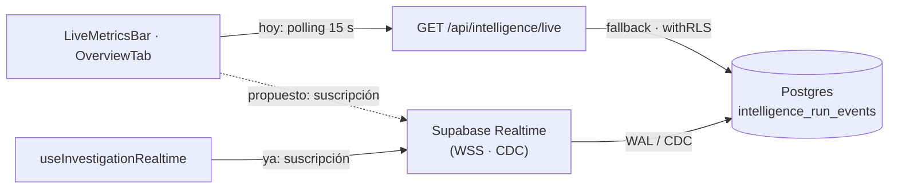

# ADR-004 (Enmienda) — Supabase Realtime para el timeline de inteligencia y la barra de métricas live

> **Aprobada el 2026-10-10.** Esta enmienda **supera parcialmente** el ADR-004
> (estado `Aprobado`, sin modificar): el polling JSON de 15 s deja de ser el
> mecanismo principal en la ruta feliz y pasa a ser **fallback**, mientras que
> **Supabase Realtime** queda como mecanismo principal. Hasta completar las fases
> de §12.3, el polling sigue operando con normalidad. **No se modifica** el
> ADR-004 original.

{: .no_toc }

<details open markdown="block">
  <summary>Tabla de contenidos</summary>
  {: .text-delta }
1. TOC
{:toc}
</details>

---

## 1. Estado

**Aprobado** (2026-10-10).

| Campo | Valor |
|-------|-------|
| Estado | Aprobado |
| Fecha | 2026-10-10 |
| Autor | StrategicConnex Engineering |
| Enmienda a | [ADR-004 — Polling JSON (15 s) en lugar de SSE/WebSocket](./ADR-004-polling-vs-sse.md) |
| Relacionado | [ADR-008 — Caché y cola en Postgres](./ADR-008-postgres-cache-and-queue.md) · `intelligence_run_events` (migración 0022) · CHANGE-003 |

Al aprobarse, esta enmienda **supersede parcialmente** los puntos §3/§5 del
ADR-004 (la renuncia a tiempo real) y **mantiene** el endpoint
`GET /api/intelligence/live` como mecanismo de respaldo.

**Alcance:** `src/features/dashboard/LiveMetricsBar.tsx`,
`src/features/dashboard/tabs/OverviewTab.tsx`,
`src/app/api/intelligence/live/route.ts` (fallback),
`src/features/intelligence/hooks/useInvestigationRealtime.ts` (patrón ya existente)
y la publicación `supabase_realtime`. **Objetivo:** que la ruta feliz de la UI
*no* sondee, sin introducir un servidor persistente que el plan actual no soporta.

## 2. Contexto

El ADR-004 (2026-08-02) adoptó el **polling JSON cada 15 s** y **descartó
SSE/WebSocket** porque en **Vercel serverless** cada invocación tiene un timeout
de **10 s (Hobby) / 60 s (Pro)**: un stream servido *por la propia función*
muere con ella.

Dos hechos cambian el análisis sin invalidar la premisa del timeout:

1. El timeout aplica al **proceso serverless**, no al cliente ni a un servicio
   externo. Un WebSocket **alojado fuera** de la función no consume su ciclo de
   vida.
2. El proyecto **ya adoptó y desplegó Supabase Realtime** (CHANGE-003) sobre
   `intelligence_run_events`, `intelligence_findings`, `intelligence_assets` e
   `intelligence_investigations` [VERIFIED: `drizzle/0022_rls_intelligence_realtime.sql`].

**Estado real del stack (corrige la premisa del borrador v0.1):** Realtime **no**
es una capacidad por adoptar — ya está en producción:

| Evidencia | Detalle | Fuente |
|-----------|---------|--------|
| Publicación | `supabase_realtime` con **4/4 tablas** y `pubinsert/update/delete=true` | Re-verificación prod 2026-10-02 [VERIFIED] |
| RLS | `ENABLE ROW LEVEL SECURITY` + **9 policies** `member_or_owner` (patrón 0016/0017) | `0022_rls_intelligence_realtime.sql` |
| Transporte | CSP permite `wss://*.supabase.co`; handshake **101** + `phx_reply{status:"ok"}` en prod | `src/proxy.ts:45,74` · `src/app/layout.tsx:108` [VERIFIED] |
| Cliente | `useInvestigationRealtime` ya suscribe `intelligence_run_events` (INSERT, filtro `investigation_id=eq.*`) | `useInvestigationRealtime.ts:83-100` |

Por tanto el objeto de esta enmienda **no es habilitar Realtime**, sino
**extender su uso** a la *barra de métricas live* (que hoy sí sondea cada 15 s) y
documentar la retirada del polling de la ruta feliz.



## 3. Requisitos que motivan la decisión

| REQ | Requisito | Criterio de aceptación |
|-----|-----------|------------------------|
| REQ-1 | Timeline y métricas en vivo sin sondeo en la ruta feliz | Cambio visible en **< 1 s** sin `setInterval` |
| REQ-2 | Compatible con Vercel serverless | La conexión persistente no la mantiene la función |
| REQ-3 | Sin proveedor ni credencial nueva | Solo el stack Supabase ya existente (`wss` + anon key de sesión) |
| REQ-4 | Aislamiento multi-tenant | `RLS member_or_owner` en `intelligence_run_events` |
| REQ-5 | Degradación segura | Polling de 15 s como fallback; estado de conexión visible |
| REQ-6 | Rollback sin desplegar | Feature flag (`FEATURE_REALTIME_LIVE[_ROLLOUT]`) |

## 4. Arquitectura — contexto, componentes y dependencias

**Contexto → componentes → dependencias.** El servidor Vercel permanece
**stateless**: sólo inserta filas (vía `withRLS` → `tx.insert(intelligenceRunEvents)`);
la conexión persistente la sostiene el servicio Realtime de Supabase, que observa
el WAL de Postgres (CDC) y empuja los cambios al cliente.

| Componente | Rol | Dependencia |
|------------|-----|-------------|
| `LiveMetricsBar` / `OverviewTab` | Consumidor UI; pasa de `setInterval` a suscripción | `@supabase/supabase-js` (`createClient`) |
| `useInvestigationRealtime` | Suscripción Realtime existente (patrón a **reutilizar**) | Canal `investigation_realtime:<id>` |
| `GET /api/intelligence/live` | Fallback stateless (snapshot con `withRLS`) | Postgres |
| Supabase Realtime | WebSocket gestionado sobre CDC | Publicación `supabase_realtime` + RLS |
| `intelligence_run_events` | Timeline persistido por investigación | Migración 0022 |

**Dependencias:** publicación `supabase_realtime` (existente) · `@supabase/supabase-js`
`^2.105.3` (ya en `package.json`) · CSP `wss://*.supabase.co` (ya aplicada).

## 5. Datos — tabla `intelligence_run_events`

Fuente única de verdad: `src/shared/db/schemas/intelligence.ts:144`. Sin columnas
inventadas; la tabla **no** tiene `project_id` (por eso su policy resuelve la
membresía vía subquery de `intelligence_investigations`).

| Columna | Tipo | Nulo | Notas |
|---------|------|------|-------|
| `id` | uuid | no | PK, `defaultRandom()` |
| `investigation_id` | uuid | no | FK → `intelligence_investigations.id` (`cascade`) — **criterio de filtro Realtime** |
| `tool_run_id` | uuid | sí | FK → `intelligence_tool_runs.id` (`cascade`) |
| `event_type` | text | no | Tipo de evento del timeline |
| `message` | text | no | Mensaje legible |
| `payload` | jsonb | no | `default {}` (sin secretos) |
| `created_at` | timestamptz | no | `defaultNow()`; orden del timeline |

Índice existente: `idx_intel_run_events_investigation_created (investigation_id, created_at)`
— soporta el filtro de suscripción y el `ORDER BY created_at` del fallback.

## 6. Flujos — request/response y proceso

```text
FLOW-01 (ruta feliz, propuesta)
  worker → INSERT intelligence_run_events (withRLS)
         → Publish WAL → Supabase Realtime
         → push WSS a los suscriptores autorizados (RLS)
         → LiveMetricsBar/OverviewTab actualizan estado

FLOW-02 (fallback, hoy)
  cliente → GET /api/intelligence/live?projectId&investigationId  (cada 15 s)
          → withRLS(user.id) → snapshot {uptime, findings, events}
          → 200 {success:true, ts, ...} | 401 | 500
```

`useInvestigationRealtime` ya combina ambos: suscripción Realtime **+** poll corto
de 3 s como red de seguridad mientras la investigación está `running`/`queued`
[VERIFIED: `useInvestigationRealtime.ts:118-150`]. Ese patrón es el que se replica.

## 7. APIs — contrato de `GET /api/intelligence/live`

Método, auth, request, response y errores (contrato **sin cambios**; se conserva
por ser el fallback y el rollback).

| Aspecto | Valor |
|---------|-------|
| Método | `GET` (idempotente, `dynamic = "force-dynamic"`) |
| Auth | Sesión Supabase (`supabase.auth.getUser()`); sin usuario → **401** `{success:false,error:"No autorizado"}` |
| Query | `projectId` (opcional) · `investigationId` (opcional) |
| Response 200 | `{ success:true, ts, uptime:{checks,uptimePercent,avgLatencyMs}, findings:{total,critical,high,latest[]}, events:{total,latest[]} }` |
| Error | **500** `{success:false,error,ts}` (con `withRequestContext`) |
| Rate limit | Sin límite por endpoint; el sondeo lo acota el cliente (15 s) y la caché/rate limit de capas superiores |

## 8. Seguridad — trust boundaries, controles y amenazas

**Trust boundaries:** navegador (no confiable) ↔ Supabase Realtime (autenticado
con JWT de sesión) ↔ Postgres (RLS) ↔ función Vercel (server-only, `directDb`
privilegiado que **bypasea** RLS).

| Amenaza | Control | Evidencia |
|---------|---------|-----------|
| Fuga cross-tenant por suscripción mal acotada | RLS `member_or_owner` + filtro `investigation_id` + guard client-side | `0022:...run_events_select_member_or_owner` · `useInvestigationRealtime.ts:92-94` |
| Suscripción con clave vacía (degradación silenciosa) | Cliente canónico `env.supabaseAnonKey` con fallback `PUBLISHABLE_KEY || ANON_KEY` | CS-301/`env.ts:12-15` |
| Transporte bloqueado por CSP | `wss://*.supabase.co` en `connect-src` (proxy + meta CSP con nonce) | `src/proxy.ts:45,74` · `layout.tsx:108` |
| RLS sin publicar (o al revés) | Orden crítico: RLS **antes** de publicar + verificación `pg_publication_tables`/`pg_policies` | `0022` §4 · CHANGE-003 |

Los payloads de eventos no incluyen secretos (`payload` jsonb de dominio). El
acceso no cambia: Realtime sólo transporta filas que el usuario ya puede leer.

## 9. Testing — estrategia, casos y cobertura

- **Aislamiento (unit/component):** `useInvestigationRealtime.test.tsx` (12 tests)
  ejercen el mock del cliente y verifican que **eventos de otra investigación no
  llegan** al estado (`describe("aislamiento multi-tenant")`).
- **Contrato del fallback:** `src/app/api/intelligence/live/route.test.ts` (tests
  de 401 sin sesión y snapshot con `withRLS`).
- **Guard estático de RLS:** `tests/security/rls-inventory.test.ts` +
  `scripts/db/rls-manifest.json` clasifican las tablas expuestas.
- **Verificación post-push (BD real):** CHANGE-003 aprobado con 4/4 tablas
  publicadas, RLS `true` ×4 y 9 policies; sonda E2E `wss` en prod.
- **Pendiente por fase:** test que compruebe la **publicación** de la tabla y el
  corte del polling en la ruta feliz (ver §12.3/§16).

## 10. Decisión propuesta

**Adoptar Supabase Realtime como mecanismo principal** del timeline
`intelligence_run_events` y de la barra de métricas live, **reutilizando la
infraestructura CHANGE-003 ya desplegada**, y **retirar el polling de 15 s de la
ruta feliz**, conservándolo como *fallback* (flag apagado, Realtime no disponible
o reconexión caída).

| Campo | Valor |
|-------|-------|
| Estado | Accepted |
| Fecha | 2026-10-10 |
| Autor | StrategicConnex Engineering |
| Archivos | `LiveMetricsBar.tsx` · `OverviewTab.tsx` · `useInvestigationRealtime.ts` · `live/route.ts` (fallback) |
| Relacionado | ADR-004 (parcialmente superado) · ADR-008 · CHANGE-003 |

## 11. Justificación técnica

- **El timeout de Vercel deja de aplicar.** La conexión persistente la mantiene
  Realtime, **fuera del ciclo de vida de la función**; era exactamente el motivo
  de la renuncia en el ADR-004.
- **Ya está en el stack y en producción.** Publicación 4/4, RLS y CSP `wss`
  verificados (CHANGE-003); no añade proveedor, credencial ni coste nuevo, y no
  contradice el ADR-008 (que decidió caché/cola en Postgres, no Redis).
- **La tabla correcta ya existe y ya se consume.** `intelligence_run_events` ya
  almacena el timeline y `useInvestigationRealtime` ya lo suscribe: el trabajo se
  reduce a extender ese patrón a la barra de métricas, no a modelar un bus nuevo.
- **Backend sin cambios de lógica.** El flujo de inserción (`withRLS` →
  `tx.insert`) se mantiene; el outbox de eventos salientes (C6) es una
  preocupación distinta (entrega a terceros) y no se ve afectado.
- **Degradación segura.** El contrato de `GET /api/intelligence/live` no se
  elimina, así que el rollback es inmediato y sin migración de datos.

## 12. Impacto y migración — despliegue y rollout

### 12.1 Frontend

- Sustituir el `setInterval(poll, 15000)` de `LiveMetricsBar`/`OverviewTab` por
  una **suscripción Realtime** filtrada por la investigación activa
  (`investigation_id=eq.<id>`), replicando `useInvestigationRealtime`.
- Mantener el polling como **fallback** con reconexión, y exponer estado de
  conexión (conectado / reconectando / degradado) para no mentir al usuario
  (`LiveMetricsBar` ya tiene `metrics.connected`).

### 12.2 Backend

- **Sin cambios en la lógica de inserción**: los endpoints que escriben el
  timeline siguen igual.
- **Publicación y RLS**: ya aplicadas por la migración 0022 (no requiere DDL
  nuevo); sólo verificar que la tabla sigue en `supabase_realtime`.
- **Feature flag**: `isFlagEnabled("realtimeLive", { userId })` sobre
  `src/shared/lib/flags.ts` → `FEATURE_REALTIME_LIVE` /
  `FEATURE_REALTIME_LIVE_ROLLOUT` (canary por usuario, fail-closed).

### 12.3 Migración por fases

```text
Fase 0 (esta enmienda)  → aprobación. Sin código.
Fase 1                  → verificar publicación/RLS de intelligence_run_events (ya 4/4).
Fase 2                  → suscripción en LiveMetricsBar/OverviewTab tras feature flag
                          (canary); polling intacto.
Fase 3                  → Realtime por defecto; polling sólo como fallback/errores.
Rollback                → apagar el flag (o _ROLLOUT=0): la UI vuelve al polling de 15 s.
```

Ambientes: **preview** (flag on) → **producción** (canary → 100 %). CI/CD sin
cambios: el contrato del endpoint y las migraciones no varían.

## 13. Alternativas consideradas

| Alternativa | Descripción | Veredicto |
|-------------|-------------|-----------|
| **Supabase Realtime** | WSS gestionados sobre CDC de Postgres, fuera del timeout de Vercel | **Propuesta** |
| SSE de vida corta con reconexión | `text/event-stream` reabierto antes del timeout (10 s/60 s) | **Descartada:** obliga a gestionar reconexión, reanudación y cursor `Last-Event-ID` en cada cliente, con ventanas de datos perdidos; complejidad alta para el beneficio |
| WebSocket custom servido por la función Vercel | Conexión persistente gestionada por la serverless function | **Descartada:** choca con el límite de 60 s (Pro) que ya motivó el ADR-004; requeriría un runtime persistente aparte |
| Polling 15 s (ADR-004) | `GET /api/intelligence/live` cada 15 s | **Se mantiene como fallback**, no como mecanismo principal |
| Long-polling | Petición abierta hasta que hay cambio | **Descartada:** sigue atada al timeout de la función y complica el fan-out |

## 14. Operaciones — monitoring, runbooks y recovery

- **Monitoring:** estado de la conexión Realtime en la UI (`connected`); logs
  estructurados de los route handlers (`logger` + `withRequestContext`); el
  handshake `phx_reply{status:"ok"}` es la señal de suscripción efectiva.
- **Métrica de éxito:** nº de requests/min a `/api/intelligence/live` debe
  **caer** al activar Realtime (indicador de que la ruta feliz no sondea).
- **Runbook — Realtime caído:** apagar `FEATURE_REALTIME_LIVE` → la UI degrada a
  polling de 15 s (contrato vigente); no requiere despliegue.
- **Recovery:** re-suscribir al recuperar la conexión; si no reconecta, el
  fallback mantiene datos (nunca pantalla vacía).
- **Alertas:** errores 5xx del endpoint de fallback y ausencia de eventos
  Realtime durante una ejecución activa.

## 15. Consecuencias, riesgos y mitigaciones

**Arquitectura:** aparece un camino de datos adicional (cliente ↔ Realtime) y la
función Vercel permanece stateless. **Datos:** sin cambios de esquema. **Datos
por usuario:** Realtime sólo transporta filas autorizadas por RLS.

| Riesgo | Severidad | Mitigación |
|--------|-----------|------------|
| Fuga cross-tenant por suscripción mal acotada | **HIGH** | RLS `member_or_owner` + filtro `investigation_id` + guard client-side; verificación con dos cuentas |
| Realtime no disponible / conexión caída | MEDIUM | Fallback automático al polling de 15 s; estado visible |
| Coste/cuota de conexiones Realtime | MEDIUM | Una suscripción por pestaña activa; cerrar al desmontar; canary por flag |
| Drift de publicación (tabla no publicada) | LOW | Verificar `pg_publication_tables` en despliegue; test de publicación |
| El fallback se vuelve "principal" silenciosamente | LOW | Métrica de requests/min al endpoint; alerta si no baja |

## 16. Criterios de aceptación

1. Un cambio en `intelligence_run_events` aparece en el dashboard en **< 1 s**,
   sin polling en la ruta feliz (REQ-1).
2. Con Realtime deshabilitado (`FEATURE_REALTIME_LIVE=0`), la UI sigue funcionando
   por polling de 15 s (REQ-5).
3. **Aislamiento verificado con dos cuentas**: la cuenta B no recibe eventos de un
   proyecto de la cuenta A (REQ-4).
4. Rollback por feature flag sin desplegar ni migrar datos (REQ-6).

## 17. Trazabilidad — REQ → COMP → TEST → DEP

**MAT-129 — Trazabilidad de la enmienda ADR-004**

| ID | Tipo | Qué cubre | Fuente verificada |
|----|------|-----------|-------------------|
| REQ-1 | Requisito | Timeline < 1 s sin sondeo | REQ table §3 |
| REQ-4 | Requisito | Aislamiento multi-tenant | RLS `member_or_owner` (0022) |
| CMP-1 | Componente | `useInvestigationRealtime` (patrón) | `useInvestigationRealtime.ts:83-150` |
| CMP-2 | Componente | `LiveMetricsBar` / `OverviewTab` | `LiveMetricsBar.tsx:54` · `OverviewTab.tsx:209` |
| TEST-1 | Prueba | Aislamiento de suscripción | `useInvestigationRealtime.test.tsx` |
| TEST-2 | Prueba | Contrato del fallback | `live/route.test.ts` |
| DEP-1 | Despliegue | Publicación 4/4 + RLS + CSP `wss` | CHANGE-003 · `drizzle/0022` |

## 18. Cross-check — inconsistencias detectadas y resueltas

| # | Inconsistencia | Resolución |
|---|----------------|------------|
| 1 | El borrador v0.1 presentaba Realtime como **capacidad por adoptar**, cuando ya está desplegado (CHANGE-003) | Corregido en §2: la enmienda **extiende** un mecanismo existente |
| 2 | El borrador v0.1 atribuía a **ADR-002** la decisión "Postgres cache/queue"; esa decisión es **ADR-008** | Corregido en §1/§11 |
| 3 | `docs/architecture/SYSTEM-MAP.md:364,367` documenta el polling de 15 s como diseño vigente | Consistente con ADR-004; se actualizará al pasar a fase 3 (Realtime por defecto) |
| 4 | `useInvestigationRealtime` mezcla Realtime con un poll de 3 s | **Intencional** (fallback); se replica como patrón, no se considera defecto |

## 19. Unknowns y supuestos

- [ASSUMPTION] Una latencia < 1 s es perceptible como "en vivo" y suficiente para
  métricas de uptime/timeline.
- [ASSUMPTION] El plan de Supabase vigente soporta las conexiones Realtime
  concurrentes del canary inicial.
- [UNKNOWN] Número máximo de suscriptores concurrentes sin degradar la latencia
  no está medido.
- [UNKNOWN] Coste incremental exacto de conexiones Realtime con el canary al
  100 % no está cuantificado.

## 20. Glosario

| Término | Definición |
|---------|------------|
| Realtime | WebSockets gestionados por Supabase sobre CDC de Postgres |
| CDC | Change Data Capture: cambios del WAL publicados a los suscriptores |
| Fallback | Polling de 15 s a `GET /api/intelligence/live` cuando Realtime no está disponible |
| RLS | Row Level Security: policies que acotan las filas visibles por usuario |

## 21. Versionado y verificación

| Versión | Fecha | Cambios | Estado |
|---------|-------|---------|--------|
| 0.1 | 2026-10-10 | Borrador de enmienda (no implementar aún) | Propuesto |
| 1.0 | 2026-10-10 | Enmienda aprobada: adopción de Supabase Realtime (fases §12.3) | Aprobado |
| 1.1 | 2026-10-10 | Corrección verificada: Realtime **ya** desplegado (CHANGE-003), se extiende a la barra live; estructura TDD completa | Aprobado |

**Fuentes primarias:** `docs/architecture/ADR/ADR-004-polling-vs-sse.md` ·
`drizzle/0022_rls_intelligence_realtime.sql` · `src/shared/db/schemas/intelligence.ts:144-158` ·
`src/features/intelligence/hooks/useInvestigationRealtime.ts` ·
`src/features/dashboard/LiveMetricsBar.tsx` · `src/app/api/intelligence/live/route.ts` ·
`src/proxy.ts` · `src/app/layout.tsx` · `src/shared/lib/flags.ts` ·
`docs/database/CHANGE-003-APPROVAL-PACKAGE.md` ·
`docs/database/MAT-505-CHANGE-003-POST-PUSH-REPORT.md` · `docs/architecture/SYSTEM-MAP.md`
