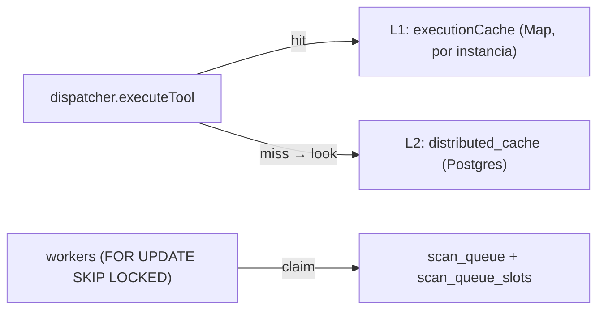

# ADR-008 — Caché distribuida y cola de escaneo en Postgres (no Redis)

{: .no_toc }

<details open markdown="block">
  <summary>Tabla de contenidos</summary>
  {: .text-delta }
1. TOC
{:toc}
</details>

---

## 1. Contexto

Los escenarios **C2** (caché distribuida de resultados de tools) y **C3** (cola de
escaneo con concurrencia por plan) se redactaron contra **Redis**. El proyecto
eliminó Upstash y toda dependencia Redis (ADR-002, enmiendas 14 y 15): hoy no hay
cliente Redis, ni credenciales, ni `UPSTASH_REDIS_REST_*` reales. El rate limit ya
se movió a Postgres (`rate_limit_windows`). **Alcance:** `src/shared/lib/distributed-cache.ts`,
`src/server/intelligence/scan-queue.ts`, `src/shared/db/schemas/{distributed-cache,scan-queue}.ts`.



## 2. Problema

Con la caché sólo en memoria, dos requests del mismo dominio en instancias
serverless distintas re-ejecutaban la herramienta y volvían a gastar cuota. Sin
cola, el escaneo corre dentro del request HTTP y su concurrencia no se puede
acotar por plan. Reintroducir Redis añadiría un servicio externo, credenciales y
coste que el proyecto ya decidió no tener.

## 3. Requisitos que motivan la decisión

| REQ | Requisito | Criterio de aceptación |
|-----|-----------|------------------------|
| REQ-1 | Compartir resultados de tools entre instancias | Dos instancias leen la misma entrada |
| REQ-2 | Cola sin doble entrega con N workers | `FOR UPDATE SKIP LOCKED` |
| REQ-3 | Cupo de concurrencia por plan | Slots atómicos (`scan_queue_slots`) |
| REQ-4 | Sin servicios externos ni credenciales nuevas | Sólo `DATABASE_URL` |
| REQ-5 | La caché nunca bloquea | Fail-open (miss ante error) |

## 4. Opciones consideradas

| Opción | Descripción | Veredicto |
|--------|-------------|-----------|
| Reintroducir Redis (Upstash) | Servicio dedicado | Descartada (ADR-002 §14) |
| Sólo memoria | Estado por instancia | Descartada (no cumple REQ-1/REQ-2) |
| **Postgres** | Mismo `DATABASE_URL`, `SKIP LOCKED` + slots | **Adoptada** |

## 5. Decisión

**Decisión:** C2 y C3 se implementan sobre **Postgres**.

- **C2:** tabla `distributed_cache` (`key` = `cache_key` `toolId::target`, `value`
  jsonb, `expires_at`). El dispatcher mantiene el L1 en memoria y suma un L2 vía
  `cacheGet`/`cacheSet`. Selección `CACHE_STORE=postgres|memory`; por defecto
  `postgres` sólo en producción. **Fail-open**: cualquier error del store es un miss.
- **C3:** tablas `scan_queue` (estados `queued→running→done|failed`, `attempts`,
  `available_at` para backoff) y `scan_queue_slots` (cupo por plan). `claim()` es
  una sola sentencia: candidato con `FOR UPDATE SKIP LOCKED` → reserva atómica de
  slot (`INSERT ... ON CONFLICT ... WHERE active < cupo`) → marca `running`.
  `complete()`/`fail()` liberan slot; el fallo reintenta con backoff exponencial
  hasta `max_attempts`.
- Ambas tablas con **RLS habilitada sin policies** (patrón `rate_limit_windows`):
  sólo el backend (`directDb`) accede.

| Campo | Valor |
|-------|-------|
| Estado | Accepted |
| Fecha | 2026-10-08 |
| Autor | StrategicConnex Engineering |
| Archivos | `distributed-cache.ts` · `scan-queue.ts` · `drizzle/0040_platform_cache_queue.sql` |
| Relacionado | ADR-002 (enmienda 15) · C2/C3 del BRAINSTORM-2026-10 |

## 6. Racional

- Sin servicios externos: la caché y la cola usan el `DATABASE_URL` que la app ya
  necesita; cero credenciales ni coste nuevo [VERIFIED: `createPostgresCacheStore`,
  `createPostgresScanQueue`].
- `FOR UPDATE SKIP LOCKED` es el patrón estándar de colas sobre Postgres: N
  workers reclaman sin pisarse y sin `SELECT`+`UPDATE` racista.
- El cupo por plan con slots atómicos evita el `count(*)` no transaccional: el
  slot se reserva o no con una sola escritura.
- Los identificadores van como parámetros ligados de drizzle; una clave hostil no
  rompe el SQL [VERIFIED: test de inyección].

## 7. Consecuencias — arquitectura, datos, operaciones y seguridad

**Arquitectura:** el L1 en memoria sigue siendo el primero (latencia cero); el L2
sólo se consulta en modo postgres. La cola saca el escaneo del request HTTP.

**Datos:** tres tablas nuevas con RLS sin policy, clasificadas `failClosed` en
`rls-manifest.json` para el guard estático C7.

**Operaciones:** `queueStats()` expone profundidad por estado/plan; `purgeExpired()`
barre la caché vencida y `purgeCompleted()` borra los jobs terminados de
`scan_queue` por retención (14 días), de modo que ninguna de las dos tablas crece
sin límite.

**Seguridad:** la caché comparte por tool+target (dominio/IP público), nunca por
dato de tenant. RLS sin policy deniega a `anon`/`authenticated`.

## 8. Riesgos y mitigaciones

| Riesgo | Severidad | Mitigación |
|--------|-----------|------------|
| La caché filtra datos cross-tenant | LOW | Clave = tool+target público; no incluye datos de tenant |
| Fuga de slots (active sin job running) | LOW | El candidato se bloquea con `FOR UPDATE` antes de reservar el slot |
| Contención de la BD por la cola | MEDIUM | Cupo por plan acota los jobs `running`; índice `(status, available_at)` |
| Cola del proyecto saturada sin aviso | MEDIUM | Contrapresión: `QueueFullError` → **429** accionable antes del INSERT (`concurrencia × 10`, techo 50) |
| `scan_queue` crece sin límite (histórico `done`/`failed`) | LOW | Purga por retención de 14 días (`purgeCompleted`, diaria e idempotente) |

## 9. Migración — pasos y flujo de trabajo

```text
Aplicar drizzle/0040_platform_cache_queue.sql (idempotente, IF NOT EXISTS).
Sin cambio de contrato: `executionCache` (L1) permanece; el L2 es aditivo.
```

## 10. Verificación — quality gate, API y tests

- `pnpm rls:inventory` → sin problemas duros (las tres tablas clasificadas).
- `npx drizzle-kit check` → *Everything's fine*.
- `tests/platform/platform-cache-queue.test.ts` (16 tests) ejercen el SQL real en
  PGlite: caché distribuida entre instancias, TTL, purge, inyección; cola con
  cupo por plan, liberación de slots, backoff, `max_attempts`, prioridad y no
  doble claim.
- Impacto en API: nulo (funciones nuevas).

## 11. Trazabilidad

**MAT-128 — Trazabilidad del ADR-008**

| ID | Tipo | Qué cubre | Fuente verificada |
|----|------|-----------|-------------------|
| MAT-128 | Tabla | C2/C3 en Postgres (no Redis) | `distributed-cache.ts` · `scan-queue.ts` · `0040_platform_cache_queue.sql` |

## 12. Glosario

| Término | Definición |
|---------|------------|
| L1/L2 | Caché en memoria por instancia / caché distribuida compartida |
| Slot | Contador atómico del cupo de jobs `running` por plan |

## 13. Versionado y verificación

| Versión | Fecha | Cambios | Estado |
|---------|-------|---------|--------|
| 1.0 | 2026-10-08 | Re-scope de C2/C3 de Redis a Postgres | Aprobado |
| 1.1 | 2026-10-09 | C3 cerrado: productor (`enqueueScanJob`) + worker (`drainScanQueue`) cableados en la ruta y en Trigger.dev | Aprobado |
| 1.2 | 2026-10-09 | C3 producción: purga por retención (14 d) y contrapresión (429) | Aprobado |

## 14. Nota de cierre — implementación de C3 (2026-10-09)

**Implementado el productor y worker de `scan_queue` con concurrencia por plan,
encolado en `POST /api/intelligence/runs` y drenado por Trigger.dev (2026-10-09).**

| Pieza | Implementación | Dónde |
|-------|----------------|-------|
| Productor | `enqueueScanJob` / `createScanQueueProducer`: estampa el `plan` que resuelve `resolveProjectPlan` (mismo resolvedor que el policy-enforcer) | `src/server/intelligence/scan-queue.ts` |
| Encolado | `POST /api/intelligence/runs` → **202** `{queued:true, job}` tras el gate `FEATURE_SCAN_QUEUE` (fail-closed); si la cola no está disponible, cae al camino síncrono | `src/app/api/intelligence/runs/route.ts` |
| Worker | `drainScanQueue` + `runScanJob`: reclama con `PLAN_CONCURRENCY` (free 1 / pro 4 / team 8 / enterprise 16) y persiste run/findings/outbox con la lógica compartida | `src/server/intelligence/scan-queue-worker.ts` · `tool-run.ts` |
| Drenado | `drain-scan-queue-task` (wakeup al encolar) + schedule `*/5 * * * *` (red de seguridad) | `src/trigger/scan-queue.trigger.ts` |

**Política de reintentos:** solo se reintenta (backoff exponencial de `ScanQueue.fail`)
cuando la ejecución **lanza** (fallos de infraestructura). Un `success: false` de la
tool es un desenlace legítimo: el run queda `failed` y el job `done`, para no
duplicar findings ni volver a consumir cuota.

**Verificación:** `tsc --noEmit` y `eslint` limpios; `pnpm test:coverage` en verde
(266 archivos) con los umbrales 45/35/39/46 superados; 13 tests nuevos en
`tests/platform/scan-queue-producer.test.ts` y `runs/route.test.ts`. El schedule
consume el último hueco del presupuesto del plan gratuito (10/10), guardado por
`cron-dispatchers.trigger.test.ts`.

### 14.1 Purga y contrapresión (mitigación de los dos riesgos bloqueantes, 2026-10-09)

| Riesgo | Mitigación | Dónde |
|--------|-----------|-------|
| `scan_queue` crece sin límite | **Purga por retención de 14 días**: `purgeCompleted` borra los jobs `done`/`failed` con `updated_at` anterior a la retención. La ventana viaja como parámetro ligado (`make_interval(days => $1)`), nunca interpolada. Idempotente y silenciosa: sin nada que purgar devuelve `0`, no escribe y no loguea. Los estados activos (`queued`/`running`) **nunca** se purgan. | `purgeCompleted` en `src/server/intelligence/scan-queue.ts` · task `purgeScanQueueTask` en `src/trigger/scan-queue.trigger.ts` |
| Encolado sin contrapresión | El productor mide la cola **activa** del proyecto (`queued` + `running`) **antes** del INSERT y rechaza con `QueueFullError` al alcanzar el límite del plan: **`concurrencia del plan × 10`** con techo 50 (free 10 · pro 40 · team 50 · enterprise 50). `POST /api/intelligence/runs` responde **429** con mensaje accionable y **no** degrada al camino síncrono (eso volvería a lanzar el trabajo rechazado). Lo terminado no ocupa la cola. | `queueLimitForPlan` / `countActiveScanJobs` en `scan-queue.ts` · 429 en `src/app/api/intelligence/runs/route.ts` |

**Programación de la purga:** no declara cron propio a las 02:00 porque el
presupuesto de 10 schedules del plan gratuito ya está agotado (**10/10**, guardado
por `cron-dispatchers.trigger.test.ts`); cuelga del `daily-operations-dispatcher`
(`0 3 * * *`), que la encola con el resto de la higiene diaria. `legacyCron`
conserva la hora objetivo como documentación.

**Verificación de las mitigaciones:** `tests/platform/scan-queue-producer.test.ts`
ejerce el SQL real en PGlite (límite por plan, rechazo **sin** INSERT, lo terminado
no bloquea, límite por proyecto, purga selectiva de lo viejo y no de lo reciente,
idempotencia) y `runs/route.test.ts` cubre el **429** accionable sin ejecución en
línea.