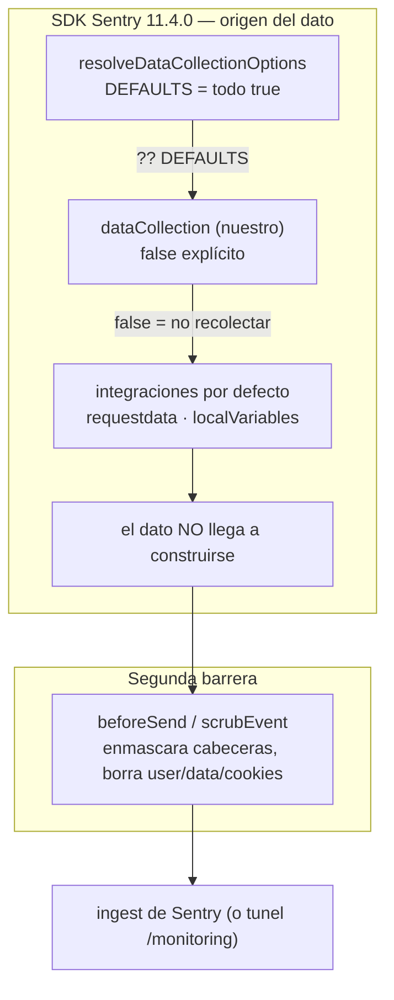

# ADR-009 — Privacidad por defecto en la recolección de datos de Sentry (`dataCollection`)

{: .no_toc }

<details open markdown="block">
  <summary>Tabla de contenidos</summary>
  {: .text-delta }
1. TOC
{:toc}
</details>

---

## 1. Contexto

El escenario **C4** habilitó Sentry como APM de coste cero: inicialización en los
tres procesos (server/edge/cliente), túnel propio `/monitoring` y `beforeSend`
como limpiador de PII. Con el APM ya enviando eventos, quedaba abierto un frente
distinto: **qué construye el SDK antes de que `beforeSend` pueda filtrarlo.**

La restricción de proyecto es doble y ya está escrita en su historial: **coste
cero** (nada que consuma cuota o dinero) y **privacidad por diseño** (mismo
espíritu que el *fail-open* de [ADR-002](./ADR-002-fail-open-rate-limit.md) y la
negativa a sumar proveedores externos de [ADR-007](./ADR-007-app-logs-observability-sink.md)).
El SDK de Sentry v11 recolecta por defecto —cabeceras, cookies, cuerpos, query
string, variables locales de los frames, datos de query de BD e IA— y el
`beforeSend` sólo **enmascara** un dato que ya viajó por el proceso.

**Alcance:** `sentry.server.config.ts` · `sentry.edge.config.ts` ·
`src/instrumentation-client.ts` · `src/sentry-init.test.ts` ·
[docs/observability/OBSERVABILITY-MATRIX.md](../../observability/OBSERVABILITY-MATRIX.md).



---

## 2. Problema

Omitir una clave en `dataCollection` **no equivale a `false`**: el SDK resuelve
cada valor con `?? DEFAULTS` (`resolveDataCollectionOptions.js`), y esos defaults
son *recolectar*. Borrar una clave para "callarla" la **reactiva**. Por tanto la
privacidad no puede depender de que nadie borre una línea, ni de que `beforeSend`
—que sólo actúa **después** de que el dato se construyó— haga su trabajo.

---

## 3. Requisitos que motivan la decisión

| REQ | Requisito | Criterio de aceptación |
|-----|-----------|------------------------|
| REQ-1 | El dato sensible no debe llegar a construirse | `false` explícito en las tres configs |
| REQ-2 | Que omitir una clave no reabra la recolección | Test que fija la **presencia** de la clave, no sólo el valor |
| REQ-3 | Corte activo verificado contra el SDK **instalado** | Cada clave con su consumidor citado por archivo/línea |
| REQ-4 | Sin coste ni dependencias nuevas | Sólo opciones del SDK ya instalado |
| REQ-5 | La documentación refleja la realidad | Matriz de observabilidad actualizada a C4 |

---

## 4. Opciones consideradas

| Opción | Descripción | Veredicto |
|--------|-------------|-----------|
| A | Sólo `beforeSend` (status quo) | Descartada: filtra **después** de construir; no evita el dato en memoria |
| B | `dataCollection` con `false` explícito en origen + `beforeSend` como respaldo | **Adoptada** |
| C | Retirar Sentry | Descartada: C4 ya aporta valor y es de coste cero |

---

## 5. Decisión

**Decisión:** fijar `dataCollection` con `false` explícito en los tres procesos,
conservando `beforeSend` como segunda barrera. Cada clave se clasifica por lo que
**realmente hace** en este stack, no por lo que su nombre sugiere:

| Clave | Valor | Consumidor verificado (SDK 11.4.0) | Clase |
|-------|-------|-----------------------------------|-------|
| `userInfo` | `false` | `requestDataIntegration` → `requestdata.js` (`ip: … ?? dataCollection.userInfo`) | **Corte activo** |
| `httpHeaders` | `false` | `requestdata.js` (`headers.request !== false`) | **Corte activo** |
| `cookies` | `false` | `requestdata.js` (`cookies !== false`) | **Corte activo** |
| `httpBodies` | `[]` | gate de escritura (default: `["incomingRequest","outgoingRequest","incomingResponse","outgoingResponse"]`) | **Corte activo** |
| `urlQueryParams` | `false` | `requestdata.js` + `filterUrlQuery`; tira la **query string**, no la URL | **Corte activo** |
| `stackFrameVariables` | `false` | `local-variables-async.js:36` (`?? true`), vía `localVariablesIntegration()` — **integración por defecto** | **Corte activo** |
| `databaseQueryData` | `false` | Sólo `integrations/supabase.js` de `@sentry/core`, que `@sentry/nextjs` **no** registra | **Profilaxis** |
| `genAI` | `{inputs:false,outputs:false}` | `mcp-server/transport`, `server-utils/ai/core/utils`, `vercel-ai-dc-subscriber` — ninguno registrado por defecto | **Profilaxis** |

`graphQL` y `queues` se dejan en su default (`true`) **a propósito**: gatean
librerías que el proyecto no tiene instaladas (`graphql`, `redis`/`ioredis`,
`kafkajs`, `amqplib`, `bullmq`: ninguna de las 64 dependencias), así que hoy no
tienen consumidor; añadirlas sólo introduciría claves con efecto nulo.

| Campo | Valor |
|-------|-------|
| Estado | Accepted |
| Fecha | 2026-10-10 |
| Autor | StrategicConnex Engineering |
| Commits | `502c2e6` (dataCollection + matriz) · `1dc5794` (túnel sin auth + headers/cookies) · `cfdd8c9` (retira scrub muerto) · `c86087f` (init server/edge) |
| Archivos | `sentry.server.config.ts` · `sentry.edge.config.ts` · `src/instrumentation-client.ts` · `src/sentry-init.test.ts` |
| Relacionado | C4 · REQ-116 · [ADR-007](./ADR-007-app-logs-observability-sink.md) · [OBSERVABILITY-MATRIX.md](../../observability/OBSERVABILITY-MATRIX.md) §2.1 |

---

## 6. Racional

- **`false` es "no recolectes nada"** (`CollectBehavior`): el dato no llega a
  construirse, en vez de construirse y confiar en que el SDK lo filtre
  [VERIFIED] — `resolveDataCollectionOptions.js`: `dc.x ?? DEFAULTS.x`, con DEFAULTS en `true`.
- **`stackFrameVariables` es el corte de mayor valor**: los valores de variables
  locales del frame caen con más facilidad que una cabecera, y su integración
  (`localVariablesIntegration`) **está** en la lista por defecto de
  `@sentry/node` [VERIFIED] — `@sentry/node/build/esm/sdk/index.js:45` y
  `local-variables-async.js:36`.
- **`databaseQueryData` y `genAI` se admiten como profilaxis, no como blindaje**:
  ningún consumidor registrado las lee hoy [VERIFIED] — `databaseQueryData` sólo se lee en
  `integrations/supabase.js`; `genAI` queda fuera de las integraciones por defecto.
  Etiquetarlas como corte real sería vender más de lo que hay.
- **`beforeSend` no se sustituye, se respalda**: si alguien vuelve a activar la
  recolección, el scrub sigue ahí. Es defensa en profundidad, no la única barrera.
- [ASSUMPTION] Un minor de `^11.4.0` no alterará qué integraciones son por
  defecto; mitigado por REQ-2 (si cambia el comportamiento, el test avisa).

---

## 7. Consecuencias — arquitectura, datos, operaciones y seguridad

**Arquitectura:** las tres configs ganan un bloque `dataCollection` idéntico
(el edge y el cliente no tienen la integración de variables locales, pero fijan
la misma clave por coherencia de runtime). El APM queda con **origen** de dato
cortado y con `beforeSend` como segunda capa.

**Datos:** ninguno en BD. El efecto es sobre los envelopes que salen hacia el
ingest; el `pg` sigue enviando el `db.query.text` **saneado** y su metadata
estructural (tabla, operación, resumen) —fuera del alcance de `dataCollection`—,
y no adjunta valores ligados.

**Operaciones:** el túnel `/monitoring` sale por **ruta exacta** en
`updateSession` antes de crear el cliente de Supabase (cero
`supabase.auth.getUser()` por envelope); sigue recibiendo CSP, HSTS y
`x-request-id` del proxy [VERIFIED] — `src/shared/lib/supabase/middleware.ts`.
El flujo de captura del SDK no cambia; sólo se estrecha lo que transporta.

**Seguridad:** los datos de cabeceras, cookies, cuerpos, query string y
variables locales de los frames dejan de salir del proceso. `beforeSend`
mantiene el scrub de `cookie`/`authorization`/`x-api-key`/`user` como respaldo.

---

## 8. Riesgos y mitigaciones

| Riesgo | Severidad | Mitigación |
|--------|-----------|------------|
| Un minor de `^11.4.0` cambia los defaults o la lista de integraciones | MEDIUM | Test que fija presencia **y** valor; falla antes de desplegar (`tsc` vigila el tipo, la suite el comportamiento) |
| Una clave de profilaxis gana consumidor al añadir una librería | LOW | La clave ya está en `false`: el nuevo consumidor nace cortado |
| Alguien "limpia" una clave creyendo que omitir = `false` | MEDIUM | Test de mutación: borrar `urlQueryParams` rompe la suite |
| El SDK deja de leer una clave en un refactor | LOW | Al ser `false` el diseño por defecto no cambia; sólo se pierde la etiqueta de "activo" |
| Escribir "corte activo" donde sólo hay profilaxis | MEDIUM | Bloqueado por revisión: cada clave lleva su consumidor citado |

- [UNKNOWN] No se ha verificado la **recepción real** de un evento en el
  proyecto de Sentry: requiere DSN y despliegue. La verificación es contra el SDK
  instalado y contra la suite, no contra el dashboard.

---

## 9. Migración — pasos y flujo de trabajo

```text
N/A — decisión ya aplicada en `502c2e6`. No hay migración de datos ni cambio
de contrato: el bloque `dataCollection` es aditivo y el fallback del SDK
(`?? DEFAULTS`) queda cubierto por el test de presencia.
```

---

## 10. Verificación — quality gate, API y tests

- `npx tsc --noEmit` → 0 errores.
- `npx eslint` sobre los configs y el test → 0 errores.
- `npx vitest run src/sentry-init.test.ts src/shared/lib/supabase/middleware.test.ts src/app/monitoring/route.test.ts`
  → **3 archivos / 32 tests PASS, exit 0** (2026-10-10). Cubre los casos de
  inicialización (server/edge/cliente), el pase del túnel sin `getUser()` y el
  scrub de PII de `beforeSend`.
- **Pruebas de mutación** (una sola edición, restaurada con `md5sum` idéntico):
  poner `stackFrameVariables: true` → **exit 1**; omitir `urlQueryParams` →
  **exit 1**. La configuración no es decorativa: está protegida por la suite.
- Impacto en API: **ninguno** (no se toca ningún endpoint; el túnel ya existía).
- **Cross-check:** [OBSERVABILITY-MATRIX.md](../../observability/OBSERVABILITY-MATRIX.md)
  §2.1 describe el mismo reparto *activo vs profilaxis*; su fila 11 y el gap G4
  pasaron de "No instalado / abierto" a "Sentry C4 activo / resuelto".
- **Límite declarado:** no se ejecutó la suite completa en esta pasada; el
  alcance de la verificación es el conjunto de suites de observabilidad citado
  arriba más `tsc`/`eslint`.

---

## 11. Trazabilidad

**MAT-130 — Trazabilidad del ADR-009**

| ID | Tipo | Qué cubre | Fuente verificada |
|----|------|-----------|-------------------|
| MAT-130 | Tabla | Privacidad por defecto en `dataCollection` | `502c2e6` · `sentry.server.config.ts` · `sentry-init.test.ts` |
| REQ-116 | Requisito | Observabilidad TSK-020 | `OBSERVABILITY-MATRIX.md` §2.1 |
| C4 | Escenario | APM Sentry de coste cero | `c86087f` · `1dc5794` · `cfdd8c9` |
| ADR-007 | Decisión heredada | Filosofía fail-open y sin proveedores nuevos | `docs/architecture/ADR/ADR-007-app-logs-observability-sink.md` |

---

## 12. Glosario

| Término | Definición |
|---------|------------|
| `CollectBehavior` | Tipo del SDK: `false` = "no recolectes nada"; `true`/objeto = recolecta con filtros |
| Corte activo | Clave con consumidor **registrado** en este stack: cambia el comportamiento real |
| Profilaxis | Clave hoy sin consumidor registrado; se fija para que un consumidor futuro nazca cortado |
| Segunda barrera | `beforeSend`, que filtra **después** de construido el evento; respalda, no sustituye |
| Envelope | Paquete que el SDK del navegador postea al túnel `/monitoring` |

---

## 13. Versionado y verificación

| Versión | Fecha | Cambios | Estado |
|---------|-------|---------|--------|
| 1.0 | 2026-10-10 | Creación: reparto activo vs profilaxis, corte en origen y respaldo `beforeSend` | Aprobado |

**Resultado quality gate:** `node scripts/quality-gate.mjs docs/architecture/ADR/ADR-009-observability-privacy-data-collection.md --min 80` → resultado en §10.

**Fuentes primarias:** `sentry.server.config.ts` · `sentry.edge.config.ts` ·
`src/instrumentation-client.ts` · `src/sentry-init.test.ts` ·
`docs/observability/OBSERVABILITY-MATRIX.md` §2.1 · SDK `@sentry/*` 11.4.0
instalado (`resolveDataCollectionOptions.js`, `requestdata.js`,
`local-variables-async.js`, `integrations/supabase.js`).
