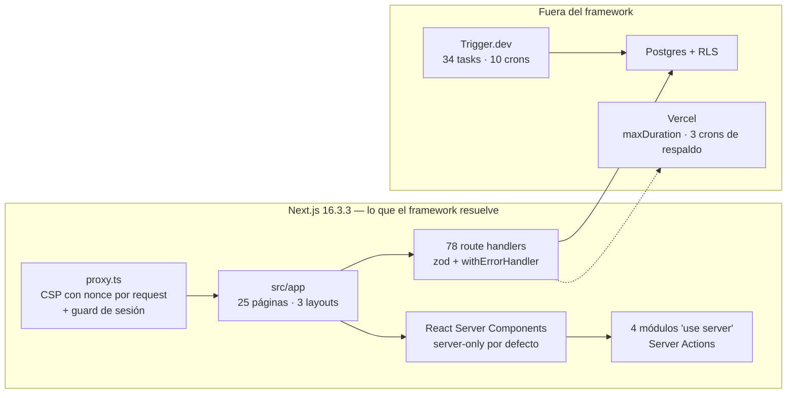

# ADR-011 — Framework de aplicación: mantener Next.js 16 (App Router)

{: .no_toc }

<details open markdown="block">
  <summary>Tabla de contenidos</summary>
  {: .text-delta }
1. TOC
{:toc}
</details>

---

## 1. Contexto

**Propósito:** registrar por escrito una decisión que hasta hoy era **implícita**.
Nadie eligió Next.js en un ADR: se instaló, y el resto del sistema se construyó
encima hasta que cambiarlo dejó de ser gratis. El atlas CAD del repositorio
planteó la pregunta al dibujar la lámina de stack
([lámina 09](../../cad-atlas/README.md)): *si tuviéramos que elegir framework
hoy, ¿sería este?*

**Alcance:** `package.json` · `next.config.ts` · `src/app/**` · `src/proxy.ts` ·
`vercel.json` · `src/shared/**`. La decisión **no** cubre librerías de UI, ORM ni
jobs —cada una tiene su propio registro (`drizzle-orm` en
[ADR-008](./ADR-008-postgres-cache-and-queue.md); Trigger.dev en
[SYSTEM-MAP.md](../SYSTEM-MAP.md) §5)—, sólo el framework que resuelve el
enrutado, el render y el borde.

Estado medido en el build del atlas (`1552e63`, 2026-11-02): **78 route
handlers**, **25 páginas**, **78 tablas**, **835 archivos `.ts`/`.tsx`** en
`src`, **34 tasks** y **10 crons** en **27** archivos de Trigger.dev.



---

## 2. Problema

La pregunta «¿qué framework?» no tenía respuesta escrita, y por tanto se
reabría cada vez que aparece una moda: la discusión vuelve al punto de partida
porque **nadie dejó constancia de las razones**, sólo del resultado.

El coste de reabrirla mal es alto y asimétrico: una migración toca **835
archivos**, cinco librerías de visualización acopladas a React (recharts,
reactflow, react-pdf, leaflet, swagger-ui) y tres contratos que hoy dependen de
primitivas específicas de Next:

1. `src/proxy.ts` implementa la CSP con **nonce por request** y la propaga en
   cabeceras de request y response — un punto que no existe con ese nombre ni
   con esa semántica en otros frameworks.
2. La **i18n por cookie sin reestructurar URLs** ([ADR-003](./ADR-003-i18n-cookie-based.md))
   depende de cómo Next resuelve el segmento raíz.
3. El **PWA** se sirve desde `public/manifest.json` con el árbol de `src/app`.

Sin un ADR, la decisión no tiene dueño ni fecha de caducidad: no hay forma de
saber cuándo debe revisarse ni con qué evidencia se tomó.

---

## 3. Requisitos que motivan la decisión

| REQ | Requisito | Criterio de aceptación |
|-----|-----------|------------------------|
| REQ-1 | Secretos y `service_role` nunca en el cliente | Render en servidor por defecto; sólo lo explícitamente marcado viaja al navegador |
| REQ-2 | API HTTP tipada y validada en el borde | Route handlers con `zod` + `withErrorHandler` + `withPublicApi` |
| REQ-3 | Despliegue serverless sin adaptador propio | `vercel.json` declara `framework: nextjs`; sin Docker ni proceso persistente |
| REQ-4 | Ecosistema React para visualización de datos | recharts, reactflow, react-pdf, leaflet y swagger-ui funcionan sin reescribir |
| REQ-5 | i18n `es/en` sin reestructurar URLs | Cookie, no segmento de ruta ([ADR-003](./ADR-003-i18n-cookie-based.md)) |
| REQ-6 | Borde con CSP, HSTS y sesión | Un único punto ejecutado antes del render y de los handlers |
| REQ-7 | Coste cero de infraestructura adicional | Sólo la plataforma de despliegue; ningún servidor propio |
| REQ-8 | Presión de seguridad por defecto | Server-only por defecto, no opt-in |

---

## 4. Opciones consideradas

| Opción | Descripción | Veredicto |
|--------|-------------|-----------|
| A | **Next.js 16 App Router** (status quo) | **Adoptada** — ya soporta los 8 requisitos |
| B | React Router 7 (ex-Remix, framework mode) | Válida; pierde RSC y obliga a reescribir el proxy y la CSP con nonce |
| C | SvelteKit | Reescritura total de UI y de las cinco librerías de visualización |
| D | Nuxt (Vue) | Reescritura total; el ecosistema de datos del proyecto es React |
| E | Astro | Correcta para el sitio público de marketing; no para un dashboard autenticado con handlers |
| F | NestJS + SPA React | Duplica runtime y obliga a mantener `api/` y servidor: contradice REQ-3 y REQ-7 |
| G | Hono + SPA React | Útil como worker de API aparte; hoy no hay una segunda API que lo justifique |

La matriz de ajuste vive también en el atlas
([lámina 09](../../cad-atlas/SCAUDIT-CAD-09-FRAMEWORK.png)), que lee las
versiones de `package.json` en cada build.

---

## 5. Decisión

**Decisión:** mantener **Next.js 16.3.3 con App Router** como framework de
aplicación, y **no migrar**. La decisión no se reabre por preferencia: se reabre
sólo cuando se cumple uno de los cuatro disparadores de §8.3.

| Campo | Valor |
|-------|-------|
| Estado | Accepted |
| Fecha | 2026-11-02 |
| Autor | StrategicConnex Engineering |
| Commits | `1552e63` (atlas CAD con lámina de selección de framework) |
| Archivos | `package.json` · `next.config.ts` · `src/proxy.ts` · `vercel.json` · `src/app/**` |
| Relacionado | [ADR-003](./ADR-003-i18n-cookie-based.md) · [ADR-004](./ADR-004-polling-vs-sse.md) · [ADR-008](./ADR-008-postgres-cache-and-queue.md) · [SYSTEM-MAP.md](../SYSTEM-MAP.md) · [ENTERPRISE-ARCHITECTURE.md](../ENTERPRISE-ARCHITECTURE.md) |

Versiones medidas: `next 16.3.3` · `react 19.2.4` · `drizzle-orm 0.45.2`.

---

## 6. Racional

- **El framework ya resuelve los 8 requisitos; ninguno de los candidatos
  resuelve más.** Next.js aporta RSC, route handlers, `proxy.ts` y server
  actions en un solo runtime; cada alternativa obliga a recomponer al menos dos
  de esas piezas [VERIFIED] — `package.json`, `src/app`, `src/proxy.ts` (CSP con
  nonce por request en `src/proxy.ts:22-30` y cabecera en `:140`, `:169`, `:217`).
- **El coste de migración es concreto, no teórico: 835 archivos `.ts`/`.tsx`**
  [VERIFIED] — `find src -name "*.ts" -o -name "*.tsx" | wc -l`. La parte peor no
  son los archivos: son **4 módulos `"use server"`** y los componentes de
  servidor que hoy asumen que su código no cruza al cliente (REQ-1).
- **La presión de seguridad viene del default, no de una convención.** Server
  components y server actions permiten que `src/server/**` importe el cliente de
  Supabase con `service_role` sin riesgo de fuga. En un SPA, esa garantía pasa a
  depender de la disciplina de cada import [VERIFIED] —
  `src/shared/lib/supabase/*`, RLS en [ADR-006](./ADR-006-rls-with-set-local-role.md).
- **El despliegue es una sola declaración.** `vercel.json` fija
  `"framework": "nextjs"`, `maxDuration` por ruta y 3 crons de respaldo; sin
  adaptador, sin Docker, sin proceso persistente (REQ-3 y REQ-7) [VERIFIED] —
  `vercel.json`, `regions: ["iad1"]`.
- **Los cinco visualizadores son React puro.** recharts, reactflow, react-pdf,
  leaflet y swagger-ui no tienen equivalente directo en Svelte ni en Vue;
  migrar el framework los arrastra a todos (REQ-4).
- **El «stack moderno» no es un requisito.** Ninguna de las alternativas añade
  una capacidad que el producto necesite hoy: no hay contenido estático
  mayoritario (Astro), ni un dominio de API separado (Hono), ni una necesidad de
  DI contenedores (NestJS).
- [ASSUMPTION] La evaluación de «ajuste» es **cualitativa**: compara contra los
  requisitos que el proyecto exige, no es un benchmark de rendimiento ni de
  precio. Se prioriza encaje arquitectónico sobre preferencia, no sobre latencia.

---

## 7. Consecuencias — arquitectura, datos, operaciones y seguridad

**Arquitectura:** ninguna pieza cambia. Esta decisión **congela** un estado que
ya existía y le da ancla documental; el grafo de dependencias
([DEPENDENCY-GRAPH.md](../DEPENDENCY-GRAPH.md)) sigue igual. Lo que sí cambia es
la doctrina: cualquier propuesta de framework deberá pasar por §8.3 antes de
abrir una rama.

**Datos:** ninguno. El acceso sigue por Drizzle + RLS
([ADR-006](./ADR-006-rls-with-set-local-role.md)); el framework no es dueño del
modelo, y esa separación es deliberada: 78 tablas sobreviven a cualquier
migración de UI.

**Operaciones:** `vercel.json` mantiene los 3 crons de respaldo y `maxDuration`
por ruta; Trigger.dev sigue siendo el mecanismo garantizado (34 tasks, 10
crons, 27 archivos). El framework no participa del ciclo de vida de los jobs
salvo como disparador HTTP.

**Seguridad:** se conserva el modelo de fronteras: el borde (`src/proxy.ts`)
aplica CSP con nonce, HSTS y guard de sesión antes de que exista render; los
handlers validan con `zod`; `src/server/**` nunca se importa desde un componente
de cliente. Cambiar de framework reabriría las tres cosas a la vez.

---

## 8. Riesgos y mitigaciones

### 8.1 Riesgos de mantener

| Riesgo | Severidad | Mitigación |
|--------|-----------|------------|
| Next 16 introduce cambios incompatibles en APIs que ya usamos (`proxy.ts` sustituyó a `middleware.ts`) | MEDIUM | `AGENTS.md` obliga a leer `node_modules/next/dist/docs/` antes de escribir código; el bloque de reglas lo regenera `next dev` |
| Acoplamiento a Vercel por `maxDuration` y crons | MEDIUM | Los route handlers usan `Request`/`Response` estándar; el cron tiene respaldo en Trigger.dev |
| React 19 + cinco librerías de visualización: una actualización puede romper alguna | LOW | Versiones fijadas en `pnpm-lock.yaml`; CI con `--frozen-lockfile` |
| Envejecimiento del stack por no migrar | LOW | Disparadores de §8.3 con umbral medible, no con opinión |

### 8.2 Riesgos de migrar (motivo para no hacerlo ahora)

| Riesgo | Severidad | Mitigación |
|--------|-----------|------------|
| 835 archivos y 5 librerías de UI en una sola operación | HIGH | No se hace sin un disparador de §8.3 y sin presupuesto de 6 meses |
| Pérdida de la garantía server-only → fuga de `service_role` | HIGH | Sólo un framework con RSC explícito la conserva |
| Reescritura de la CSP con nonce y del guard de sesión | MEDIUM | Requiere pruebas de seguridad nuevas; las actuales dejarían de aplicar |

- [UNKNOWN] No se ha medido el rendimiento comparado entre candidatos con una
  carga real: la decisión **no** se apoya en benchmarks, sino en requisitos y
  coste de migración. Un benchmark aislado tampoco representaría la mezcla real
  (RSC + handlers + IA).
- [UNKNOWN] El coste real de una migración a React Router 7 no se ha estimado
  línea a línea; la cifra de 835 archivos es el techo, no el trabajo efectivo.

### 8.3 Disparadores para reabrir esta decisión

La decisión se revisa **sólo** si se cumple uno de estos cuatro, con evidencia
medida:

| # | Disparador | Qué se haría |
|---|------------|--------------|
| D1 | Más del 50 % del tráfico es contenido estático (páginas públicas, blog, docs) | Astro para el **sitio público**; el dashboard sigue en Next |
| D2 | Un job supera los 120 s de cómputo o necesita binarios nativos | Contenedor para **ese** worker; la app no cambia |
| D3 | El copiloto necesita streaming token a token | Vercel AI SDK **dentro** del router actual, no un framework nuevo |
| D4 | Aparece una API pública estable para terceros | Worker Hono aparte, con su propio contrato |

### 8.4 Qué no añadir, y por qué

| Tentación | Motivo para descartarla |
|-----------|-------------------------|
| NestJS / Express | Duplica el runtime y crea un segundo punto de entrada; contradice REQ-3 y REQ-7 |
| Redis / BullMQ | Cola y caché L2 ya viven en Postgres ([ADR-008](./ADR-008-postgres-cache-and-queue.md)); sería un servicio más que operar |
| LangChain / LangGraph | El pool de IA ya resuelve routing, failover y presupuesto por tarea (`src/server/ai/ai-router.ts`) |
| Docker / Kubernetes | El despliegue es serverless; no hay proceso persistente que empaquetar |

---

## 9. Migración — pasos y flujo de trabajo

```text
N/A — decisión ya aplicada: no hay migración, se documenta el estado existente.
```

Si algún día se cumple un disparador de §8.3, el orden mínimo sería:

```text
PASO 1 → medir el disparador y adjuntar la evidencia al nuevo ADR
PASO 2 → aislar la parte afectada (sitio público, worker o ruta), nunca la app entera
PASO 3 → escribir la prueba de seguridad que debe seguir pasando (server-only + CSP)
PASO 4 → migrar con la suite en verde y comparar contratos de API antes/después
```

---

## 10. Verificación — quality gate, API y tests

- `node scripts/quality-gate.mjs docs/architecture/ADR/ADR-011-framework-nextjs-16.md --min 80` → resultado en §13.
- **Impacto en API:** ninguno. No se toca ningún endpoint; el ADR describe el
  estado actual de los 78 route handlers.
- **Impacto en tests:** ninguno. La suite no cambia.
- **Cross-check con el artefacto:** la lámina 09 del atlas se genera leyendo
  `package.json` y la introspección del repo, así que la tabla de versiones del
  ADR y la del plano no pueden divergir sin que el build lo note
  [VERIFIED] — `scripts/cad-atlas/introspect.mjs`, `sheets-stack.mjs`.

### 10.1 Estrategia de pruebas que sostiene la decisión

Este ADR no añade código y por tanto **no añade casos nuevos**, pero la
decisión se apoya en pruebas que ya existen y que habría que reescribir en
cualquier migración. Eso es, en sí, parte del coste:

| Nivel | Qué prueba | Por qué se rompería al migrar |
|-------|------------|-------------------------------|
| Unit (`vitest`) | Contratos de `src/server/**`, routing de IA, uso de presupuesto | Asumen imports server-only y el ciclo de vida de RSC |
| Integración (Postgres real) | Aislamiento por tenant con RLS y `SET LOCAL ROLE` | El bootstrap de test depende del runtime de Next |
| Contrato de API | Forma de request/response de los endpoints del copiloto | Los route handlers son `Request`/`Response` estándar, pero su registro no |
| E2E (`playwright`) | Flujos autenticados y a11y con axe | Los selectores y el enrutado por archivos cambian con el framework |
| Seguridad | CSP con nonce, guard de sesión, 401 sin sesión | Reimplementación completa del borde |

Criterio de aceptación para una futura migración (si se cumple un disparador de
§8.3): la suite existente debe seguir en verde **sin debilitar aserciones**, y la
prueba de CSP debe verificar el nonce en la cabecera real de respuesta.

---

## 11. Trazabilidad

**MAT-121 — Trazabilidad del ADR-011**

| ID | Tipo | Qué cubre | Fuente verificada |
|----|------|-----------|-------------------|
| MAT-121 | Tabla | Stack en uso y versiones | `package.json` (`next 16.3.3`, `react 19.2.4`, `drizzle-orm 0.45.2`) |
| MAT-122 | Métrica | Superficie acoplada al framework | 78 route handlers · 25 páginas · 835 archivos `.ts`/`.tsx` |
| MAT-123 | Métrica | Trabajo fuera del framework | 34 tasks · 10 crons · 27 archivos `.trigger.ts` |
| MAT-124 | Decisión | Matriz de candidatos y veredictos | [SCAUDIT-CAD-09-FRAMEWORK.png](../../cad-atlas/SCAUDIT-CAD-09-FRAMEWORK.png) |
| MAT-125 | Control | CSP con nonce y guard de sesión en el borde | `src/proxy.ts` |

---

## 12. Glosario

| Término | Definición |
|---------|------------|
| ADR | Architecture Decision Record: registro de una decisión arquitectónica con su razonamiento |
| App Router | Enrutado por sistema de archivos de Next.js, con layouts anidados y RSC |
| RSC | React Server Component: componente que se ejecuta sólo en el servidor y no envía su código al cliente |
| Route handler | Archivo `route.ts`/`route.tsx` que expone HTTP (`GET`, `POST`…) dentro de `src/app` |
| Server Action | Función `"use server"` invocable desde el cliente que se ejecuta en el servidor |
| RLS | Row Level Security de Postgres: la política se aplica en la base, no en la aplicación |
| Disparador | Condición medible que obliga a revisar una decisión ya tomada |
| Superficie | Cantidad de código acoplada a una tecnología; mide el coste de cambiarla |

---

## 13. Versionado y verificación

| Versión | Fecha | Cambios | Estado |
|---------|-------|---------|--------|
| 1.0 | 2026-11-02 | Creación: decisión de framework, alternativas, disparadores y qué no añadir | Aprobado |

**Resultado quality gate:** 100/100 (PASS, `--min 80`, 2026-11-02). Ejecutado con
`node scripts/quality-gate.mjs docs/architecture/ADR/ADR-011-framework-nextjs-16.md --min 80`;
lo mismo que corre el job `docs-quality-gate` del CI sobre `docs/architecture`.

---

**Convención:** este ADR sigue el [template obligatorio](./ADR-000-template.md).
Cualquier propuesta futura de cambio de framework debe presentarse como
`ADR-0XX`, citar el disparador de §8.3 que la habilita y adjuntar la evidencia
medida.
