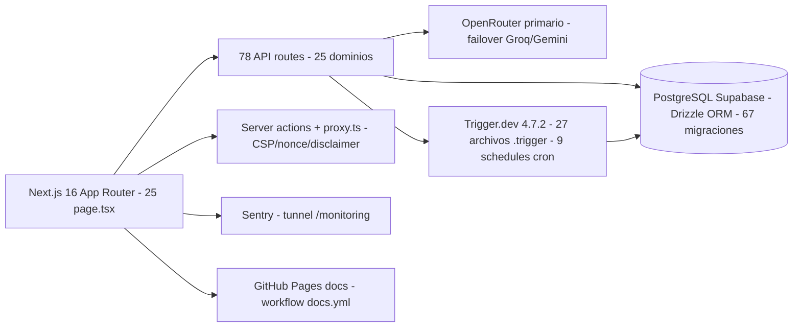
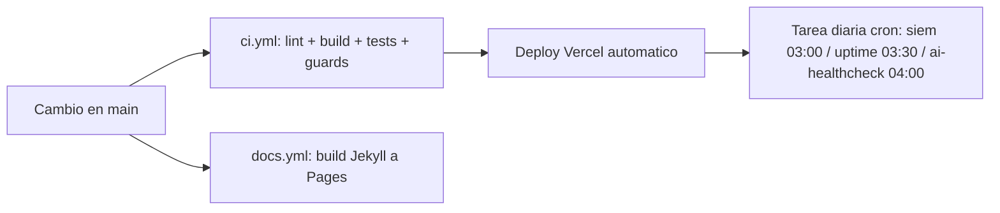

# Estado Actual del Sistema (CURRENT-STATE)

{: .no_toc }

  
Table of Contents

  {: .text-delta }
1. TOC
{:toc}

---

## Alcance y objetivos

Esta página documenta el **estado verificado del producto** a fecha 2026-11-01, sustituyendo a los documentos históricos SRS-V2 y Master-Database-V2 (mayo-2026, archivados en `docs/archive/legacy-root-docs/`). Objetivos: (1) describir el stack y las métricas reales del código, (2) indicar la fuente autoritativa de cada dato, (3) servir de punto de partida para agentes y humanos. Los documentos históricos de creación del producto **no son especificación vigente**.

---

## Requisitos

| REQ | Requisito | Verificación |
|-----|-----------|--------------|
| REQ-101 | Stack y métricas corresponden al código real | `package.json`, `drizzle/`, `src/` [VERIFIED] |
| REQ-102 | Cada afirmación tiene fuente citada | Tablas de este documento [VERIFIED] |
| REQ-103 | No duplicar detalle de otros docs (enlazar) | §Mapa documental [VERIFIED] |

---

## Arquitectura

Monolito modular desplegado en Vercel (región `iad1`), sin Docker/Kubernetes por diseño.

Componentes verificados en código: `src/app/` (rutas), `src/server/` (14 dominios de servicio), `src/trigger/` (tareas), `drizzle/` (esquema SQL canónico), `src/proxy.ts` (barreras de seguridad), `src/shared/lib/disclaimer.ts` (gate legal).

---

## Datos

Métricas medidas sobre el repositorio (fecha de medida 2026-11-01):

| Métrica | Valor | Fuente |
|---------|-------|--------|
| Migraciones SQL | 67 (`drizzle/*.sql`, journal 67 entradas) | `drizzle/`, `drizzle/meta/_journal.json` [VERIFIED] |
| Tablas declaradas | 78 `pgTable` en schema; paridad 78/78 con migraciones | TD-19 en `docs/technical-debt/TECH-DEBT-REGISTER.md` [VERIFIED] |
| API routes | 78 `route.ts` en 25 dominios + 3 `route.tsx` PDF | `GCI src/app/api` [VERIFIED] |
| Tareas Trigger.dev | 27 archivos `.trigger.ts` / 34 task IDs / 9 schedules | `EXECUTIVO_TRIGGER_GAPS.md` (18-oct) [OBSERVED] |
| Tests | 333 archivos (292 co-ubicados + 31 `tests/` + 9 `e2e/` + sdk) | `GCI -Recurse *.test.*` [OBSERVED] |
| Rutas de página | 25 `page.tsx` / 3 `layout.tsx` en 22 grupos | `GCI src/app` [VERIFIED] |
| Git | `main` sincronizada con `origin/main`; árbol limpio | `git status` [VERIFIED] |

Detalle de esquema, políticas RLS e índices: ver ADR-006 y el registro de deuda (TD-19).

---

## Flujos

### FIG-101 — Flujo de refresco del estado

El refresco de este documento es **manual**: cualquier cambio arquitectónico relevante debe actualizarlo (o su PATCH en §Versionado).

---

## APIs

Superficie documentada en [API Reference](/docs/api.md). Resumen verificado: 4 endpoints públicos v1 (health, intelligence, ai/report, monitoring) bajo `src/app/api/public/v1/` con API key obligatoria; el resto del catálogo es interna (auth principal vía sesión Supabase; webhooks firma HMAC). Contrato automatizado pendiente de entorno no-prod (ver TD-20).

---

## Seguridad

Verificada en código: CSP con nonce por request y HSTS en `src/proxy.ts`; rate limiting fail-closed con fallback Postgres/memoria; egress guard anti-SSRF (ADR-005); RLS con rol embebido `SET LOCAL` (ADR-006); autorización owner-only (ADR-010, migración 0052). Toasts de deuda viva: TD-17 (cobertura de tareas async), TD-24 (copilot del dashboard), TD-29 (suite de integración real).

---

## Testing

| Suite | Config | Ejecución |
|-------|--------|-----------|
| Unitaria (vitest) | `vitest.config.ts`, umbrales duros 45/35/39/46 | `pnpm test` / `test:coverage` |
| Integración (Postgres real) | `vitest.integration.config.ts` | job CI `Integration` — suite bloqueada, ver TD-29 |
| E2E (Playwright) | `playwright.config.ts` + `playwright.csp.config.ts` | `pnpm test:e2e` (+ variantes csp/a11y) |
| Garantías (guards) | `guard:secrets`, `guard:cdn`, `guard:i18n`, `check:entrypoint`, `check:cascade-drop`… | CI y local |

Estado de la deuda de testing: TD-08, TD-17, TD-20, TD-27, TD-29 en `docs/technical-debt/TECH-DEBT-REGISTER.md`.

---

## Operaciones

Monitoreo verificado: Sentry con tunnel `/monitoring`, health endpoint `/api/public/v1/health`, Vercel monitors y 3 crons (SIEM 03:00, uptime 03:30, AI healthcheck 04:00). La sanidad de Trigger.dev la mide la tarea `dispatcher:status` con verificador de hijos en sensibilidad al incidente del 12–18 oct (TD-16): una run FAILED de retención marca `problem` aunque el dispatcher COMPLETE. Runbooks en `docs/runbook/`; incidentes registrados en `docs/CHANGELOG.md`. Recovery: reintentos con backoff en las tasks y journal idempotente de Drizzle como base de la recuperación de esquema.

---

## Deployment

Producto en Vercel (`scaudit.vercel.app`) con deploy automático por push a `main`; 3 crons en `vercel.json`. Sitio de docs en GitHub Pages (Jekyll, `docs.yml`). Informe del último cierre: `FINAL-SUMMARY.md` (2026-10-18, "LISTO PARA PRODUCCIÓN").

---

## Trazabilidad

| REQ | Componente | Test | Deploy |
|-----|-----------|------|--------|
| REQ-101 | `docs/architecture/CURRENT-STATE.md` | TEST-101: `quality-gate.mjs --min 80` | DEP-101: repo + GitHub Pages |
| REQ-102 | Tablas con fuentes (§Datos, §Testing) | TEST-102: revisión manual con citas | repo |
| REQ-103 | Enlaces a ADRs y TDs (§Arquitectura, §Seguridad) | TEST-103: revisión manual de enlaces | repo |

---

## Validación cruzada (inconsistencias resueltas)

- **Stack**: contrastado contra `package.json`, `next.config.ts` y `vercel.json` [VERIFIED].
- **Nº de tablas**: el README antiguo decía 67 y la auditoría 79; la paridad verificada en TD-19 es **78 `pgTable` = 78 CREATE TABLE** en migraciones (incluidas variantes `CREATE TABLE IF NOT EXISTS`; única SQL sin schema = `project_members`, dropeada por diseño) [VERIFIED].
- **Métricas del sitio vs de código**: `docs/index.md` contiene métricas vintage 2026-08-01 (17 docs / 198 tests de la suite documental); las métricas del código vivo viven aquí y en `MASTER-REPORT-2026-11-01.md` §5 — no se mezclan [VERIFIED].

---

## Unknowns y supuestos

- [ASSUMPTION] Los 34 task IDs de Trigger.dev provienen de `EXECUTIVO_TRIGGER_GAPS.md` (2026-10-18); el recuento de ficheros (27) sí es de hoy [OBSERVED].
- [UNKNOWN] Corridas Trigger.dev post-incidente no re-auditadas en esta exploración (solo se verificó el verificador TD-16 en repo).
- [ASSUMPTION] Región única `iad1` según `vercel.json`; no se contrastó contra el dashboard de Vercel.

---

## Glosario

| Término | Definición |
|---------|-----------|
| RLS | Row Level Security de Postgres, aplicada vía rol embebido `SET LOCAL` |
| ADR | Architecture Decision Record (`docs/architecture/ADR-*.md`) |
| TD | Deuda técnica registrada (`docs/technical-debt/TECH-DEBT-REGISTER.md`) |
| Guard | Test de garantía estructural que aborta CI ante regresión |

---

## Versionado

| Campo | Valor |
|-------|-------|
| Versión | 1.0 |
| Fecha | 2026-11-01 |
| Autor | Consolidación documental SCAUDIT |
| Estado | Aprobado |

Changelog de esta página: **v1.0** (2026-11-01) — primer snapshot consolidado; sustituye a SRS-V2 y Master-Database-V2 (archivados) como referencia de estado.
