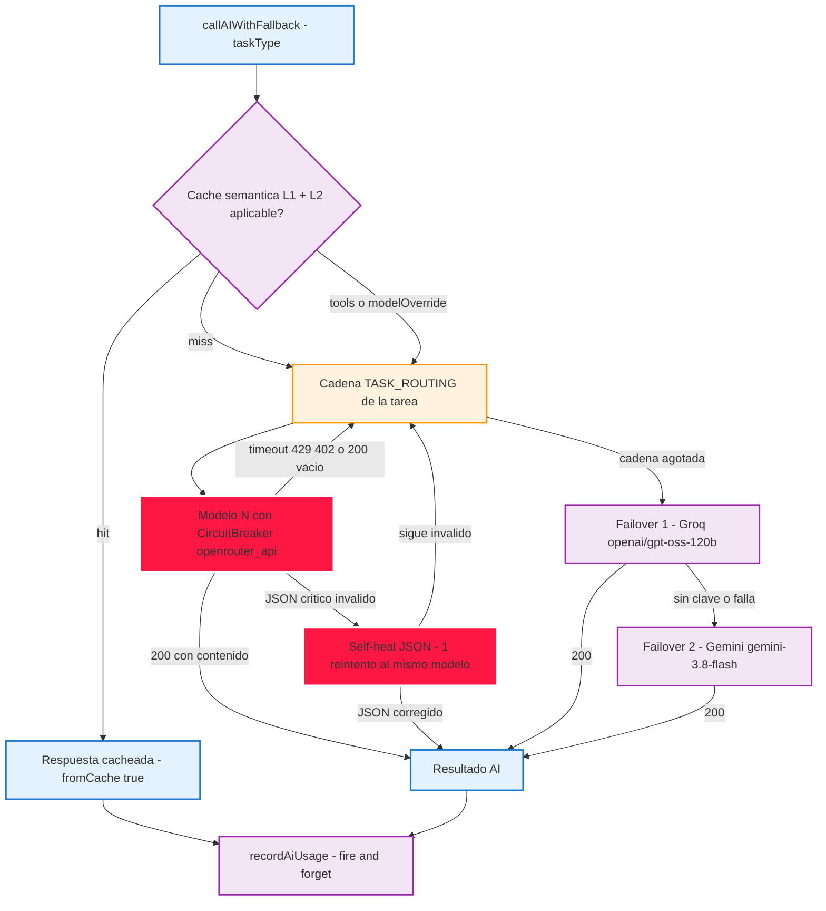
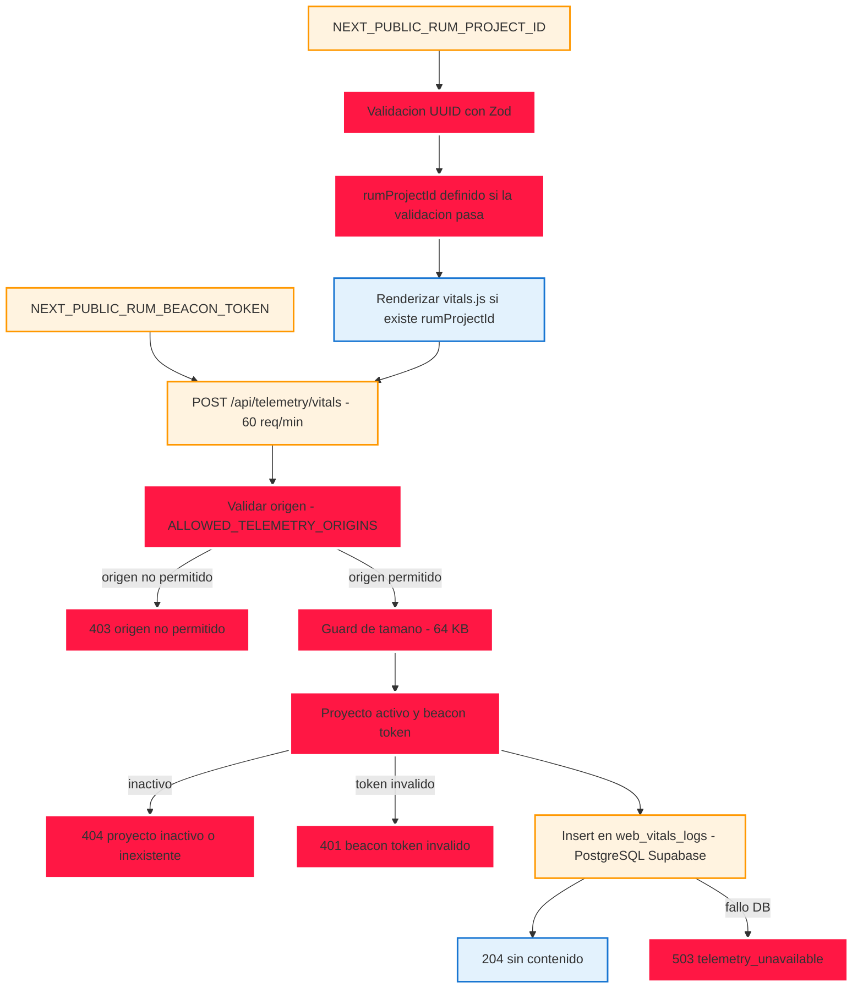
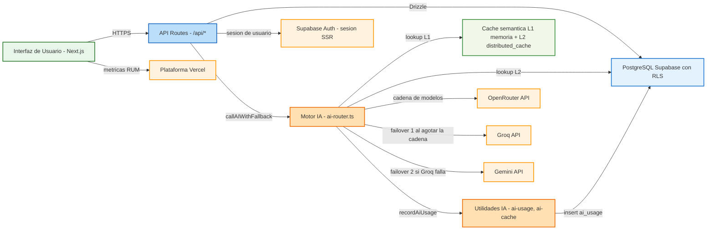
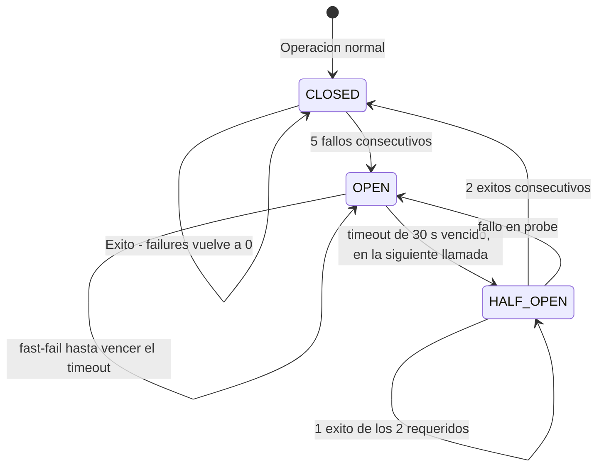
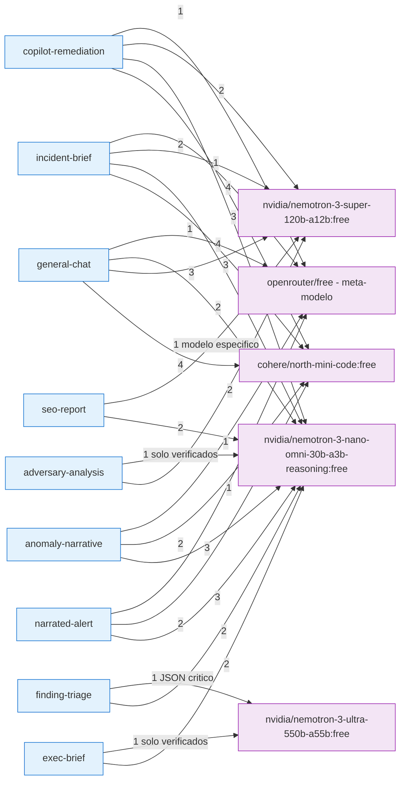

# Diagramas Arquitectónicos - StrategicAudit Pro

## 1. Scope y objetivos

Este documento reúne cinco vistas de arquitectura: ruteo de IA, instrumentación RUM, capas del sistema, estados del circuit breaker y asociación de tareas IA con modelos. El objetivo es ofrecer diagramas Mermaid legibles y un preview independiente; no sustituye los contratos de API ni el esquema de datos físico.

**Fuente y límites:** los nombres de tareas, modelos y umbrales provienen de los diagramas aportados por el owner [SOURCE: USER]; en la versión 1.1 cada asociación se contrastó con el código y se corrigió lo que no coincidía (ver §13). Las citas de archivo indican el punto exacto que respalda cada afirmación; las conexiones siguen siendo un modelo conceptual del flujo, no una traza de runtime.

## 2. Requisitos documentados

| REQ | Requisito | Criterio de aceptación |
|-----|-----------|------------------------|
| REQ-001 | Documentar los cinco diagramas arquitectónicos | Cinco bloques Mermaid cerrados y parseables |
| REQ-002 | Incluir un preview visual de los diagramas principales | HTML con dos diagramas y enlace al documento completo |
| REQ-003 | Mantener los diagramas fieles al código | Cada cadena de modelos, umbral y destino de persistencia citado con archivo y línea |

## 3. Arquitectura y componentes

Las vistas representan UI, rutas API, servicios de IA, proveedores externos, utilidades, almacenamiento y controles de circuito. El sistema usa Next.js 16, Vercel como plataforma, Supabase (Auth + PostgreSQL con RLS) y Drizzle como capa de acceso [VERIFIED — `package.json:57-71`, `src/shared/lib/supabase/client.ts`]. No hay Cloudflare D1 en el proyecto: la telemetría RUM se persiste en `web_vitals_logs` de PostgreSQL [VERIFIED — `src/app/api/telemetry/vitals/route.ts`]. Las flechas ilustran relaciones conceptuales, no una prueba de ejecución.

## 4. Datos representados (inventario conceptual)

Esta documentación no define un ERD ni columnas de tablas. El siguiente inventario limita sus afirmaciones a nombres que aparecen en las vistas y al destino real de cada escritura:

| Vista | Elementos de datos etiquetados | Destino verificado |
|-------|-------------------------------|--------------------|
| FIG-001 | `openrouter/free`, slugs `:free`, `groq:*`, `gemini:*` | `src/server/ai/ai-router.ts` |
| FIG-002 | `NEXT_PUBLIC_RUM_PROJECT_ID`, `NEXT_PUBLIC_RUM_BEACON_TOKEN`, `web_vitals_logs` | PostgreSQL (Supabase) vía Drizzle |
| FIG-003 | `PostgreSQL`, `Supabase Auth`, `distributed_cache`, `ai_usage` | PostgreSQL / Supabase Auth |
| FIG-004 | CLOSED, OPEN, HALF_OPEN y sus umbrales | `src/shared/lib/circuit-breaker.ts` |
| FIG-005 | Tareas IA y slugs de modelo `:free` | `TASK_ROUTING` en `ai-router.ts` |

## 5. Flujos documentados

El flujo de IA muestra caché semántica, cadena de modelos por tarea, circuit breaker, self-heal de JSON, failover inter-proveedor y registro de uso; el de RUM muestra variables, validación, envío al endpoint, controles y persistencia. Los estados del circuit breaker aparecen en FIG-004. Las relaciones están detalladas en los bloques Mermaid de §16-§20.

## 6. API y límites de confianza

La vista RUM nombra `POST /api/telemetry/vitals`. Contrato verificado: cuerpo validado con Zod (UUID de proyecto, `beaconToken` opcional, métricas), límite de 64 KB, rate limit de 60 req/60 s y CORS por `ALLOWED_TELEMETRY_ORIGINS` con `403` fuera de la lista [VERIFIED — `src/app/api/telemetry/vitals/route.ts`]. Respuestas: `401` si el beacon token no coincide con `beaconSecret`, `404` si el proyecto está borrado/oculto/inexistente, `503` si la capa DB falla, `204` en éxito. El diagrama de capas identifica Supabase Auth y RLS como límites de confianza representados, no como una auditoría de implementación.

## 7. Seguridad documentada

Los límites representados son cliente/UI frente a rutas de servidor, APIs externas de IA y almacenamiento. Los controles etiquetados incluyen validación UUID, beacon token, validación del origen, Supabase Auth y RLS. Supabase Auth se usa con `@supabase/ssr` (cliente y middleware) [VERIFIED — `src/shared/lib/supabase/`]; RLS está cubierto por pruebas dedicadas (`orchestrator.rls.test.ts`, `workflow.rls.test.ts`). Supabase **Storage no aparece referenciado en `src`**: el diagrama de origen lo muestra, pero no hay llamadas de subida/descarga que lo respalden (§13). Esta vista no reemplaza un análisis de amenazas ni verifica la configuración desplegada.

## 8. Testing y validación

**Casos de prueba de documentación:** (1) comprobar cinco bloques Mermaid en este archivo; (2) comprobar dos diagramas en el preview HTML; (3) parsear los bloques con Mermaid (`mermaid` es devDependency del proyecto); (4) comprobar fences Markdown cerrados y `git diff --check` limpio. La cobertura de ejecución del sistema productivo no se infiere de estas pruebas.

**Resultado 1.1:** parseo de los siete bloques (5 en este documento + 2 en el preview) con `mermaid` 11.17.2 instalado en el proyecto: 7/7 sin error; `git diff --check` limpio [VERIFIED — 2026-10-31]. El contraste con `ai-router.ts`, `circuit-breaker.ts` y `telemetry/vitals/route.ts` está en §13.

## 9. Deployment

El diagrama de capas etiqueta Vercel como plataforma y el preview es HTML estático para abrir en navegador. Esta documentación no ejecuta ni solicita un despliegue; el despliegue y sus ambientes no están descritos por estos diagramas.

## 10. Operaciones y observabilidad

La vista RUM representa envío de telemetría y persistencia en `web_vitals_logs`; no define una política de retención, alertas o runbook. La telemetría de IA escribe una fila en `ai_usage` por llamada, fire-and-forget, sin atribución cuando no hay usuario (crons) [VERIFIED — `src/server/ai/ai-usage.ts`]. El circuito de estados conserva el umbral de cinco errores, timeout de 30 segundos y dos éxitos para cerrar, valores confirmados en la configuración de `ai-router.ts` (breakers `openrouter_api`, `groq_api`, `gemini_api`). El estado del breaker es **en memoria por instancia** serverless, no global [VERIFIED — `circuit-breaker.ts`].

## 11. Inventario visual

| ID | Tipo | Descripción | Nivel |
|----|------|-------------|-------|
| FIG-001 | Flowchart | Ruteo, caché y fallback de IA | L2 |
| FIG-002 | Flowchart | Flujo de RUM self-instrumentation | L2 |
| FIG-003 | Flowchart | Arquitectura de capas | L2 |
| FIG-004 | State diagram | Estados de circuit breaker | L2 |
| FIG-005 | Flowchart | Tareas IA y cadena de modelos | L2 |

## 12. Trazabilidad

| REQ | Componente | Test | Deploy |
|-----|-----------|------|--------|
| REQ-001 | `docs/architecture/MERMAID-DIAGRAMS.md` | Parseo Mermaid de cinco bloques | Documentación en el repositorio |
| REQ-002 | `docs/architecture/diagram-preview.html` | Comprobación de dos diagramas | Preview HTML local |
| REQ-003 | Ambos archivos | Contraste con `ai-router.ts`, `circuit-breaker.ts`, `telemetry/vitals/route.ts` | Commit solicitado, sujeto al quality gate |

## 13. Cross-check contra el código

| Punto de las imágenes / v1.0 | Código real | Corrección aplicada |
|------------------------------|-------------|---------------------|
| "PostgreSQL D1 con RLS" (FIG-003) | PostgreSQL de Supabase con Drizzle; no existe D1 en el repo | Etiqueta corregida a PostgreSQL con RLS |
| "Persistir en `web_vitals_logs` de D1" (FIG-002) | `db.insert(webVitalsLogs)` sobre PostgreSQL | Destino corregido a PostgreSQL (Supabase) |
| `OPENROUTER → fallback → GROQ / GEMINI` (FIG-003) | El failover lo ejecuta `ai-router` al agotar la cadena de la tarea; nunca se delega a OpenRouter | Flechas salen del motor IA |
| `API → telemetría → Supabase Auth/Storage` (FIG-003) | La telemetría IA va a `ai_usage` en PostgreSQL; Supabase se usa para sesión | Arista corregida: `recordAiUsage → ai_usage` |
| "Cache distribuido" como servicio aparte (FIG-003) | L1 `Map` en memoria + L2 tabla `distributed_cache` | Nodo reubicado en el motor IA |
| 8 cajas de tarea en FIG-005 | `AITaskType` tiene 9 (`anomaly-narrative` ausente en la imagen) | Añadida con su cadena |
| Etiquetas `FREE_META_MODEL` sueltas (FIG-005) | `openrouter/free` es el **primer** eslabón de copilot, incident-brief, general-chat, anomaly-narrative y narrated-alert | Aristas numeradas por orden de intento |
| `cohere/north-mini-code:free` sin arista desde copilot/incident (FIG-005) | Es el 4º eslabón de ambas cadenas | Añadidas las aristas |
| Índices FIG de §4 desalineados con §11 (v1.0) | — | Tabla reindexada |
| "Siete bloques" en §8 (v1.0) | El documento tiene cinco diagramas | Corregido a cinco |
| `Supabase Auth/Storage` (FIG-003) | Auth sí (`@supabase/ssr`); Storage sin referencias en `src` | Nodo renombrado a Supabase Auth y deuda declarada en §14 |

## 14. Unknowns y assumptions

- [UNKNOWN] No hay evidencia en este commit sobre disponibilidad o latencia actual de los slugs `:free`; las capacidades citadas son las verificadas en vivo por el router (comentarios de `ai-router.ts`, agosto/septiembre 2026).
- [UNKNOWN] Supabase Storage se muestra en el diagrama de origen pero no tiene llamadas en `src`; si se adopta, este documento debe actualizarse con el bucket y sus políticas.
- [ASSUMPTION] Las relaciones de flecha muestran el flujo previsto del sistema y no todas las interacciones posibles.
- [VERIFIED] Umbrales del breaker (5 / 30 s / 2), cadenas por tarea, timeouts por intento y destinos de persistencia son los del código citado.

## 15. Glosario

| Término | Definición |
|---------|------------|
| RUM | Real User Monitoring; en esta vista, recepción de métricas web vitals |
| Fallback | Intento de proveedor o modelo alternativo cuando falla el anterior |
| Circuit breaker | Control de estados CLOSED, OPEN y HALF_OPEN representado en FIG-004 |
| Meta-modelo | `openrouter/free`, router aleatorio de OpenRouter usado como primer eslabón de las cadenas de texto libre |
| Self-heal JSON | Reintento único al mismo modelo inyectando el error de parseo |

## 16. FIG-001 — Ruteo, caché y fallback de IA

## 17. FIG-002 — RUM self-instrumentation

## 18. FIG-003 — Arquitectura de capas

## 19. FIG-004 — Circuit breaker

## 20. FIG-005 — Tareas IA y cadena de modelos

**Cadenas y presupuesto por intento** [VERIFIED — `TASK_ROUTING` y `MODEL_TIMEOUTS` en `ai-router.ts`]:

| Tarea | Orden de intento | Timeout por modelo | Ejecuta en |
|-------|------------------|--------------------|------------|
| `copilot-remediation` | `openrouter/free` → super → nano → cohere | 20 s | Route Vercel |
| `incident-brief` | `openrouter/free` → super → nano → cohere | 20 s | Route Vercel |
| `general-chat` | `openrouter/free` → nano → super → cohere | 20 s | Route Vercel |
| `anomaly-narrative` | `openrouter/free` → cohere → nano | 20 s | Route Vercel |
| `narrated-alert` | `openrouter/free` → cohere → nano | 20 s | Trigger.dev |
| `seo-report` | super → nano | 50 s | Route Vercel |
| `adversary-analysis` | nano → super | 60 s | Trigger.dev |
| `finding-triage` | ultra → nano | 60 s | Trigger.dev |
| `exec-brief` | ultra → nano | 60 s | Trigger.dev |

Agotada la cadena, el router recorre `FALLBACK_PROVIDERS` (Groq `openai/gpt-oss-120b` → Gemini `gemini-3.8-flash`), saltando el proveedor sin clave y respetando el deadline de 115 s en las tareas que corren en rutas Vercel. Los evals con `modelOverride` no entran al failover.
