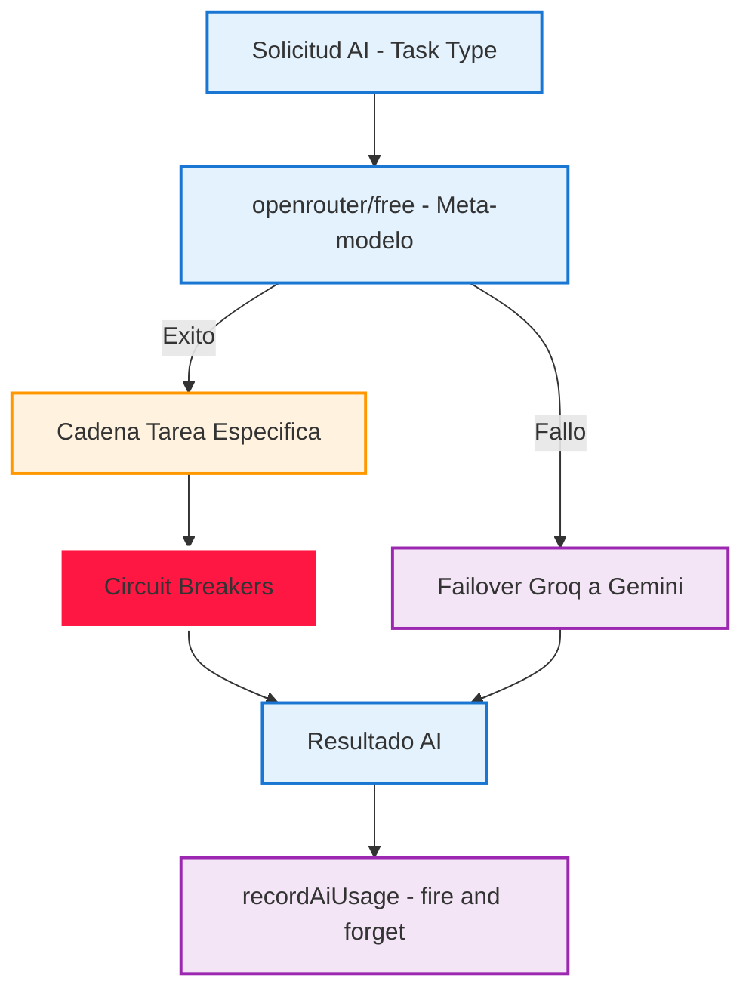
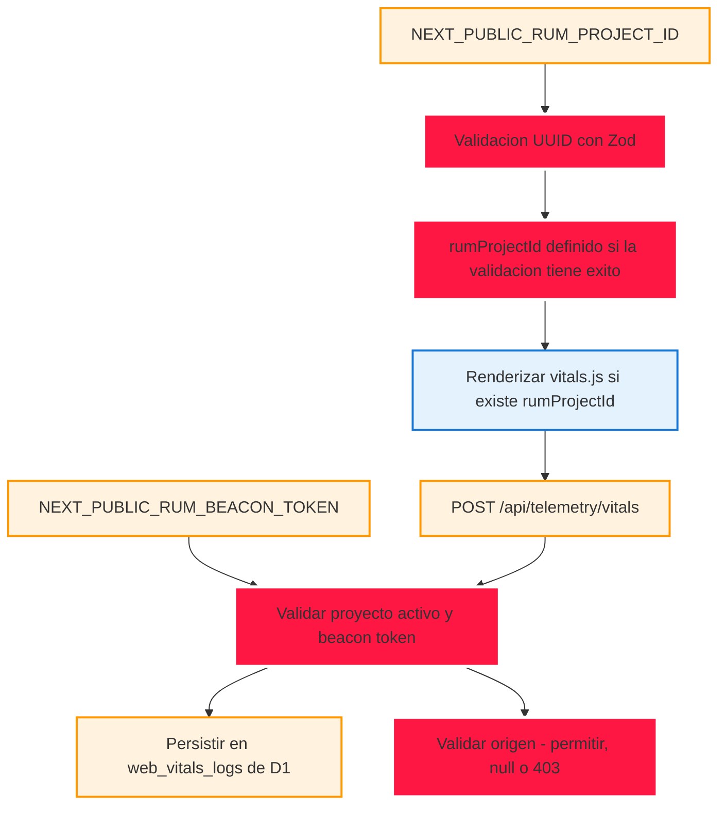
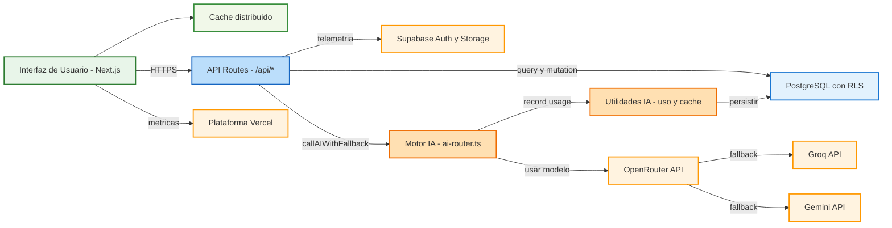
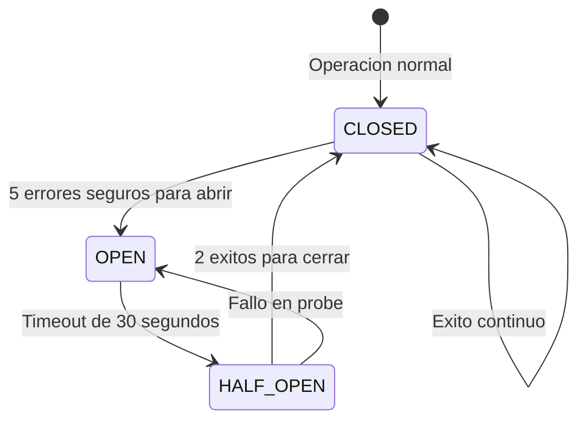
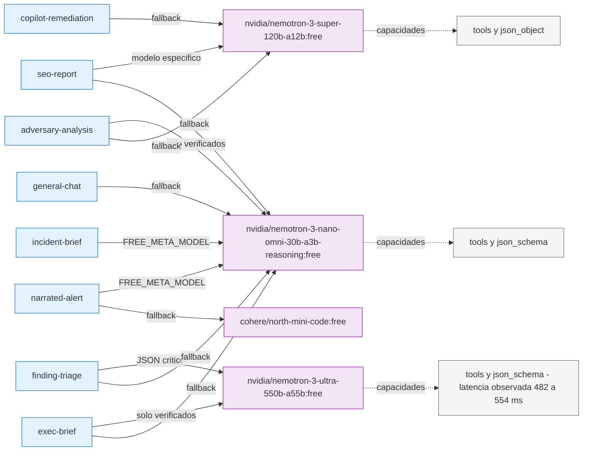

# Diagramas Arquitectónicos - StrategicAudit Pro

## 1. Scope y objetivos

Este documento reúne cinco vistas de arquitectura: ruteo de IA, instrumentación RUM, capas del sistema, estados del circuit breaker y asociación de tareas IA con modelos. El objetivo es ofrecer diagramas Mermaid legibles y un preview independiente; no sustituye los contratos de API ni el esquema de datos físico.

**Fuente y límites:** los nombres y asociaciones visibles se transcriben de los diagramas y las imágenes proporcionados por el owner [SOURCE: USER]. Las etiquetas de componentes son descriptivas; no implican que se hayan verificado en runtime las conexiones o capacidades de proveedores.

## 2. Requisitos documentados

| REQ | Requisito | Criterio de aceptación |
|-----|-----------|------------------------|
| REQ-001 | Documentar los cinco diagramas arquitectónicos | Cinco bloques Mermaid cerrados y parseables |
| REQ-002 | Incluir un preview visual de los diagramas principales | HTML con dos diagramas y enlace al documento completo |
| REQ-003 | Mantener los diagramas sin errores de sintaxis | Validar todos los bloques con Mermaid antes del commit |

## 3. Arquitectura y componentes

Las vistas representan UI, rutas API, servicios de IA, proveedores externos, utilidades, almacenamiento y controles de circuito. El sistema concreto del proyecto usa Next.js, Vercel, Supabase y PostgreSQL; los diagramas de origen se han depurado para distinguir PostgreSQL del almacenamiento de telemetría RUM identificado como D1 [DOCUMENTED]. Las flechas ilustran relaciones conceptuales, no una prueba de ejecución.

## 4. Datos representados (inventario conceptual)

Esta documentación no define un ERD ni columnas de tablas. El siguiente inventario limita sus afirmaciones a nombres que aparecen en las vistas:

| Vista | Elementos de datos etiquetados | Fuente |
|-------|-------------------------------|--------|
| FIG-001 | `NEXT_PUBLIC_RUM_PROJECT_ID`, `NEXT_PUBLIC_RUM_BEACON_TOKEN`, `web_vitals_logs` | Diagrama RUM proporcionado |
| FIG-002 | `PostgreSQL`, `Supabase Auth/Storage`, `ai-usage cache` | Diagrama de capas proporcionado |
| FIG-003 | Tareas IA y slugs de modelo `:free` | Imagen de tareas y modelos proporcionada |

## 5. Flujos documentados

El flujo de IA muestra meta-modelo, cadena específica, fallback y registro de uso; el de RUM muestra variables, validación, envío al endpoint y persistencia. Los estados del circuit breaker aparecen en FIG-004. Las relaciones están detalladas en los bloques Mermaid posteriores.

## 6. API y límites de confianza

La vista RUM nombra `POST /api/telemetry/vitals`. Este documento no especifica su autenticación, forma completa de request/response ni rate limit: deben confirmarse en el contrato del endpoint antes de usarse como referencia de integración. La vista identifica la validación del proyecto, beacon token y origen como controles; el diagrama de capas identifica autenticación Supabase y RLS como límites/controles representados, no como una auditoría de implementación.

## 7. Seguridad documentada

Los límites representados son cliente/UI frente a rutas de servidor, APIs externas de IA y almacenamiento. Los controles etiquetados incluyen validación UUID, beacon token, validación del origen, Supabase Auth y RLS. Esta vista arquitectónica no reemplaza un análisis de amenazas ni verifica por sí misma la configuración desplegada [SOURCE: USER].

## 8. Testing y validación

**Casos de prueba de documentación:** (1) comprobar cinco bloques Mermaid en este archivo; (2) comprobar dos diagramas en el preview HTML; (3) parsear los siete bloques con Mermaid; (4) comprobar fences Markdown cerrados y ausencia del atributo mal escrito `ologica`. La cobertura de ejecución del sistema productivo no se infiere de estas pruebas.

**Resultado:** parseo local de Mermaid 7/7 bloques y revisión de whitespace limpia [VERIFIED — validación de este cambio, 2026-10-28].

## 9. Deployment

El diagrama de capas etiqueta Vercel como plataforma y el preview es HTML estático para abrir en navegador. Esta documentación no ejecuta ni solicita un despliegue; el despliegue y sus ambientes no están descritos por estos diagramas.

## 10. Operaciones y observabilidad

La vista RUM representa envío de telemetría y persistencia de `web_vitals_logs`; no define una política de retención, alertas o runbook. El circuito de estados representa el umbral de cinco errores, timeout de 30 segundos y dos éxitos para cerrar tal como aparece en el material de origen. Los valores se conservan como contenido documentado, no como verificación del comportamiento en producción [SOURCE: USER].

## 11. Inventario visual

| ID | Tipo | Descripción | Nivel |
|----|------|-------------|-------|
| FIG-001 | Flowchart | Ruteo y fallback de IA | L2 |
| FIG-002 | Flowchart | Flujo de RUM self-instrumentation | L2 |
| FIG-003 | Flowchart | Arquitectura de capas | L2 |
| FIG-004 | State diagram | Estados de circuit breaker | L2 |
| FIG-005 | Flowchart | Tareas IA y modelos disponibles | L2 |

## 12. Trazabilidad

| REQ | Componente | Test | Deploy |
|-----|-----------|------|--------|
| REQ-001 | `docs/architecture/MERMAID-DIAGRAMS.md` | Parseo Mermaid de cinco bloques | Documentación en el repositorio |
| REQ-002 | `docs/architecture/diagram-preview.html` | Comprobación de dos diagramas | Preview HTML local |
| REQ-003 | Ambos archivos | Parseo Mermaid y `git diff --check` | Commit solicitado, sujeto al quality gate |

## 13. Cross-check e inconsistencias

| Revisión | Resultado |
|----------|-----------|
| Fences Mermaid | Los cinco bloques están cerrados |
| Atributo de estilo del diagrama 5 | Se usa `stroke`, no `ologica` |
| Diagramas del preview | Se limitan a dos flujos y enlazan al documento completo |
| Almacenamiento RUM | El bloque lo rotula D1; el diagrama de capas indica PostgreSQL con RLS. Se documentan como etiquetas de sus ámbitos respectivos, no como equivalencia de motores |

## 14. Unknowns y assumptions

- [UNKNOWN] No se adjuntó un contrato de `/api/telemetry/vitals`; autenticación, esquema exacto y rate limit quedan sin verificar.
- [UNKNOWN] No se proporciona evidencia de capacidades o disponibilidad actual de los slugs `:free`.
- [ASSUMPTION] Las relaciones de flecha muestran el flujo previsto del sistema y no todas las interacciones posibles.
- [DOCUMENTED] Los nombres de modelos, variables y umbrales se mantienen como aparecen en el contenido/imágenes de entrada del owner.

## 15. Glosario

| Término | Definición |
|---------|------------|
| RUM | Real User Monitoring; en esta vista, recepción de métricas web vitals |
| Fallback | Intento de proveedor o modelo alternativo cuando falla el anterior |
| Circuit breaker | Control de estados CLOSED, OPEN y HALF_OPEN representado en FIG-004 |
| Meta-modelo | Etiqueta `openrouter/free` usada por el material de origen |

## 16. Flujos de Ruteo y Fallback de IA

## 2. Flujo de RUM Self-Instrumentation - H-09

## 3. Arquitectura de Capas Completa

## 4. Circuit Breaker States

## 5. Tareas IA y Modelos Disponibles

