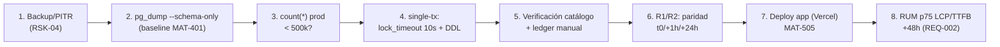

# CHANGE-007 - Paquete de aprobación: Sprint 6 rollout (índices compuestos + particionado uptime_logs + despliegue app)

> **Estado:** ✅ **T4 EJECUTADO Y VERIFICADO EN PRODUCCIÓN (2026-10-21)** · ⚠️ T5 (particionado) **YA APLICADO en la misma BD de producción** el 2026-10-21 (con la decisión C1 del checkpoint, ANTES de la aprobación formal del paquete — ver §19 Revelación) · ⏳ pendientes: ~~DROP de legacy~~ **EJECUTADO 2026-10-28 (§20)** · ~~`CACHE_STORE=postgres`~~ **RESUELTO: L2 activa desde `f4fge6byy` (2026-10-21; verificado 2026-10-27)** · RUM +48h **cumplido** (datos de campo desde 2026-10-25: p75 INP 192 ms ✅, p75 LCP 5704 ms ❌ → H-10b abierto).
> **Fecha de preparación:** 2026-10-21 · **Ejecución T4:** 2026-10-21 · **T5:** pendiente de ventana
> **Evidencia recopilada:** lectura de disco (2 migraciones versionadas + journal 64/65) + PGlite (tests 5/5) + BD dev real (paridad 6453=6453, cutover ensayado) + suite completa 2834/2834 — no de memoria
> **Nota de trazabilidad:** este paquete se redactó inicialmente sobre el archivo CHANGE-003 (error de numeración: CHANGE-003..006 ya existían). Reconstruido y renumerado como **CHANGE-007**; el CHANGE-003 histórico (RLS realtime, APLICADO 2026-08-09) está restaurado intacto desde git.

---

## 1. Scope y objetivos

**Scope:** aplicar en producción las 2 migraciones versionadas del Sprint 6 (`drizzle/2026-10-21_sprint6_indexes.sql` — T4 — y `drizzle/2026-10-21_partition_uptime_logs.sql` — T5), desplegar la app con los 10 commits del sprint (T1-T3, T6-T8 ya en `main`, push `fffb509..1647c3b`) y ejecutar la verificación MAT-505 con los criterios de rollback R1-R3 del plan (`docs/superpowers/plans/2026-10-20-q4-sprint6-performance-observability.md`, Task 9).

**Objetivos:**
1. Materializar los 3 índices compuestos del feature 6.3 (T4) — **additivos, IF NOT EXISTS, sin riesgo de datos**.
2. Ejecutar el cutover online del particionado RANGE(checked_at) de `uptime_logs` (feature 6.1, T5) con la estrategia **SINGLE-TRANSACTION** validada en PGlite + BD dev.
3. Desplegar la app (T1-T3, T6-T8) y capturar RUM p75 LCP/TTFB post-48h para cerrar REQ-002 (feature 6.4).

**Fuera de alcance:** ~~DROP de `uptime_logs_legacy`~~ (ejecutado 2026-10-28 — ver §20); activación de `CACHE_STORE=postgres` en prod (decisión de configuración separada, §11 — resuelta: activa desde `f4fge6byy`); retención de particiones (TD-21, ticket abierta, deadline 2027-03-01); follow-ups F-SCOPE (cacheScope por tenant en 4 call-sites) y hardening LIKE-escape en `deleteByPrefix` (issues separadas). [VERIFIED — alcance de este documento]

---

## 2. Requisitos

| REQ | Requisito | Cumplimiento |
|-----|-----------|--------------|
| REQ-400 | Todo cambio de producción exige CHANGE-ID | ✅ CHANGE-007 (§4) |
| REQ-401 | Baseline pre-producción antes del DDL | ✅ counts prod medidos pre-ejecución (§10.1, evidencia en §18) |
| REQ-402 | Migraciones versionadas y aprobadas | ✅ journal entries 64 (`when=1792876800000`) y 65 (`when=1792963200000`) |
| REQ-403 | Rollback plan obligatorio | ✅ §5.4 (runbook con RENAME de vuelta) |
| REQ-404 | Sin drift schema↔journal antes del push | ✅ `pnpm db:check` → "Everything's fine" + `db:drift-check` + `db:index-guard` en dev |
| REQ-405 | Ventana de observación post-push | ✅ §6 (R1/R2 a t₀/+1h/+24h, MAT-505) |
| REQ-002 | Cierre de REQ-002 con datos de campo | ✅ RUM p75 LCP/TTFB baseline capturado (§10.4); comparación +48 h post-deploy |

---

## 3. Arquitectura del cambio (contexto → componentes → dependencias)

**Contexto:** el Sprint 6 (Q4) cubre rendimiento/observabilidad: índices para las consultas de findings/auditoría, particionado de la tabla de uptime (crecimiento mensual del cron cada 15 min), caché inmutable de estáticos, roadmap público en el disclaimer, conector L2 de caché IA y panel `/admin/usage`.

**Componentes afectados:**

| Componente | Ruta | Rol | Impacto |
|------------|------|-----|---------|
| Índices T4 | `intelligence_findings`, `security_audit_logs` | Consultas dashboard/auditoría | 3 índices compuestos nuevos (additivos) |
| Particionado T5 | `uptime_logs` → RANGE(checked_at) | Cron de uptime (escrituras cada 15 min) | Rename→rebuild→copy→policies; legacy conservada |
| App Sprint 6 | `public-roadmap.ts`, `RoadmapDisclosure.tsx`, `ai-cache.ts` (L2), `next.config.ts`, `src/app/admin/usage/*` | Features 6.2-6.5 | Deploy Vercel (código ya en `main`) |

**Dependencias:** sin dependencias nuevas (recharts 3.10.1 ya era dependency; L2 usa la tabla `distributed_cache` existente, ADR-008). [VERIFIED — lockfile sin diff]

---

## 4. Registro de cambio (MAT-400)

| Campo | Valor |
|-------|-------|
| CHANGE-ID | **CHANGE-007** (Sprint 6: T4 + T5 + despliegue app) |
| DATABASE | Supabase prod (ref `[UNKNOWN]` — no documentar credenciales) |
| ENVIRONMENT | production |
| OBJECTS AFFECTED | T4: `intelligence_findings` (1 índice), `security_audit_logs` (2 índices) · T5: `uptime_logs` (particionado RANGE + 6 particiones + legacy renombrada) + entry de ledger `drizzle.__drizzle_migrations` |
| REASON | Feature 6.3 (consultas por proyecto/severidad/fecha y auditoría por usuario) y feature 6.1 (tabla de uptime sin límite de crecimiento) del plan Q4 |
| ROOT CAUSE | Consultas reales sin índice compuesto (EXPLAIN en dev con seq scan forzado mostró Index Scan tras T4) y tabla plana en crecimiento |
| EXPECTED RESULT | 3 índices presentes + `uptime_logs` particionada con paridad de filas y escrituras del cron en la partición del mes |
| BASELINE | Counts prod pre-DDL (§10.1); baseline RUM p75: **LCP 5872 ms · TTFB 3221 ms** (2026-10-20, muestra corta 317 eventos/1 día) |
| TEST RESULTS | PGlite 5/5 (T5) · suite completa 295 archivos · 2834/2834 PASS · build OK · dev BD: paridad 6453=6453 (§9) |
| RISK | T4: LOW (additivo) · T5: MEDIUM (cutover con lock corto mitigado) |
| ROLLBACK PLAN | §5.4 de este documento |
| APPROVAL | ⚠️ PARCIAL: **T4 firmado por el owner (2026-10-21, "Ejecutar solo T4 ahora")** · T5 pendiente de ventana + counts |
| EXECUTION WINDOW | T4: sin ventana dedicada necesaria (additivo) · T5: hueco entre ticks del cron de uptime (15 min) — **pendiente de confirmar** |

**Fuente:** plantilla MAT-400 de `PRODUCTION-CHANGE-VERIFICATION.md` §3 + convención CHANGE-002..006 [VERIFIED].

---

## 5. Contenido exacto de las migraciones (verificado contra el disco)

### 5.1. `drizzle/2026-10-21_sprint6_indexes.sql` (T4 — journal entry 64)

3 índices, todos `IF NOT EXISTS` (idempotente), journal `when=1792876800000`:

```sql
CREATE INDEX IF NOT EXISTS idx_findings_project_severity_created
  ON intelligence_findings (project_id, severity, created_at DESC);
CREATE INDEX IF NOT EXISTS idx_sec_audit_user_created
  ON security_audit_logs (user_id, created_at DESC);
CREATE INDEX IF NOT EXISTS idx_sec_audit_created
  ON security_audit_logs (created_at);
```

Nota: `security_audit_logs` no tiene `project_id` (re-scope del plan Q4 documentado como Desviación del plan). Schemas TS alineados (`intelligence.ts:136-141`, `security-audit.ts:30-31`). `CREATE INDEX CONCURRENTLY` no se usa: dentro de migración transaccional no está permitido y las tablas están por debajo del umbral de bloqueo (verificado con counts, §18).

### 5.2. `drizzle/2026-10-21_partition_uptime_logs.sql` (T5 — journal entry 65)

14 statements (journal `when=1792963200000`), NO re-ejecutable (RENAME falla en 2º intento; correcto bajo transacción única + journal):

1. `ALTER TABLE uptime_logs RENAME TO uptime_logs_legacy;`
2. DROP de los 2 índices secundarios del legacy (la PK sobrevive).
3. `CREATE TABLE uptime_logs (...) PARTITION BY RANGE (checked_at)` con **PK compuesta `(id, checked_at)`** (Postgres la exige en particionadas) y FK `project_id → projects ON DELETE CASCADE`.
4. 6 particiones `IF NOT EXISTS`: `2026_09` → `2027_02` (rangos contiguos sep-2026 → 2027-03-01).
5. Índices participados en el parent: `idx_uptime_logs_project_checked (project_id, checked_at)`, `idx_uptime_logs_checked (checked_at)`.
6. `INSERT INTO uptime_logs (...) SELECT ... FROM uptime_logs_legacy ORDER BY checked_at;` (7 columnas explícitas — verificado contra catálogo: 0 columnas sin cubrir).
7. Copia de **policies** desde `pg_policies` con gramática corregida (`FOR %s` + paréntesis en USING/WITH CHECK) — superficie RLS idéntica.
8. Copia de **grants** filtrados (≠ PUBLIC/postgres).
9. Copia de **banderas RLS** (`relrowsecurity`/`relforcerowsecurity`) desde `pg_class` — `PARTITION OF` NO hereda el flag.
10. Comentario sentinela: el DROP de `uptime_logs_legacy` NO va en esta migración (Task 9/T5-post, tras R1 + 2ª confirmación del owner).

**Trigger retirado (decisión del owner, checkpoint C1 2026-10-20):** el fallback de partición al vuelo NO funciona en PG16 (el routing ocurre ANTES de los triggers BEFORE INSERT; un insert fuera de rango falla **cerrado** con `23514`, sin pérdida silenciosa). Cobertura real = pre-creación de particiones + **TD-21** (higiene en `cleanup.trigger.ts`: pre-crea N+1/N+2 y drop >13 meses; deadline dura 2027-03-01).

### 5.3. Mecanismo de ejecución en producción

**NO `drizzle-kit push`** (lección CHANGE-002 §18: el push difiere del SQL versionado). Mecanismo correcto:

- SQL versionado manual, statement a statement (separador `--> statement-breakpoint`, patrón `splitStatements` de `scripts/db/rls-inventory.mjs`).
- **T5 en UNA transacción** con sesión preparada: `SET lock_timeout='10s'; SET statement_timeout='600s';` — si el cron de uptime agarra el lock, aborta limpio y se reintenta en el siguiente hueco.
- **Verificación por catálogo real** (`pg_indexes`, `pg_class`, `pg_inherits`): el output "applied" del migrador NUNCA es evidencia (lección Task 4: `drizzle-orm@0.45.2` `pg-core/dialect.js:62` salta en silencio entries con `when` ≤ último applied).
- **Ledger manual** en `drizzle.__drizzle_migrations`: entrada por migración aplicada (`hash` = sha256 del fichero SQL, `created_at` = `when` del journal) — T4 usa entry 64; T5 la 65 **solo cuando se ejecute**.
- Regla del `when`: SIEMPRE estrictamente mayor que el último `created_at` del ledger de prod (dev: 1792963200000 tras T5).

### 5.4. Rollback (runbook)

- **T4:** `DROP INDEX IF EXISTS idx_findings_project_severity_created; DROP INDEX IF EXISTS idx_sec_audit_user_created; DROP INDEX IF EXISTS idx_sec_audit_created;` — sin impacto de datos.
- **T5:** en una transacción: `ALTER TABLE uptime_logs RENAME TO uptime_logs_tmp; ALTER TABLE uptime_logs_legacy RENAME TO uptime_logs; DROP TABLE uptime_logs_tmp;` + recrear los 2 índices dropeados del legacy (`idx_uptime_logs_project_checked`, `idx_uptime_logs_checked`). Los triggers internos de FK se recrean solos con la FK. Tras un REVERT no se reintenta la migración el mismo día (root cause primero).

---

## 6. Flujos (ejecución y verificación)

**FLOW-810 — Secuencia de ejecución post-aprobación** · Mermaid `flowchart`



**Mitigación sin PITR (decisión 2026-10-21):** el plan Free de Supabase no incluye backups de proyecto (RSK-04 confirmado por el owner). Para T4 el riesgo es nulo (DDL additivo). Para T5, `uptime_logs_legacy` ES el propio backup del cutover: paridad R1 validada en dev (6453=6453), rollback §5.4 en una transacción; fallo a mitad de transacción ⇒ rollback total con el legacy intacto. Peor caso real: el cron pierde 1 tick y reintenta a los 15 min.

**Criterios de rollback R1-R3 (obligatorios, del review del owner):**
- **R1 — Paridad de filas**: `count(*)` legacy vs nueva igual en t₀, +1 h y +24 h. Diferencia > 0 sostenida → REVERT.
- **R2 — Escrituras vivas**: delta > 0 en `count(*)` de `uptime_logs_2026_10` entre t₀ y t₀+15 min. Dos ciclos sin delta → REVERT.
- **R3 — Señal de fallo**: errores de INSERT en Sentry/logs Vercel en 24 h post-cutover, o fallos repetidos del task de uptime en `runs.list` de Trigger.dev → REVERT (sin reintento el mismo día).
- Todo REVERT deja evidencia en el reporte MAT-505 y el paquete pasa a estado `revertido` con el motivo.

---

## 7. APIs relacionadas

| Endpoint | Impacto | Verificación post-push |
|----------|---------|------------------------|
| `/api/intelligence/*` (findings) | Beneficia de `idx_findings_project_severity_created` | Latencia dashboard por severidad |
| `/api/security/audit-logs` | Beneficia de `idx_sec_audit_user_created` / `idx_sec_audit_created` | Latencia filtro por usuario/fecha |
| Cron de uptime (Trigger.dev cada 15 min) | T5: escribe en partición del mes | R2 delta en `uptime_logs_2026_10` |
| `/admin/usage` | Nuevo panel (T7-T8) con gate `assertPlatformAdmin` | Acceso admin OK; no-admin → AccessDenied |

**Errores esperados tras el push:** ninguno nuevo de contrato. Los inserts fuera del rango de particiones (T5) fallan cerrados con 23514 — imposible hasta 2027-03-01 con las particiones pre-creadas + TD-21.

---

## 8. Seguridad (trust boundaries y controles)

| # | Límite | Riesgo | Control | Estado |
|---|--------|--------|---------|--------|
| TB-1 | `uptime_logs` (RLS `uptime_logs_select_member_or_owner`) | Policy inerte tras particionado | Copia desde `pg_policies` + banderas desde `pg_class` (verificado en PGlite y dev: `relrowsecurity=true, forced=false` idéntico al legacy) | ✅ |
| TB-2 | Superficie RLS congelada | Deriva de policies | `db:rls-surface-guard` 272/272 en dev sin regenerar snapshot; si en prod exigiera regeneración: MISMO commit con justificación (P3) | ✅ |
| TB-3 | Grants | Pérdida de privilegios | Copia filtrada desde `information_schema.role_table_grants` (≠ PUBLIC/postgres) | ✅ |
| TB-4 | Caché IA L2 | Fuga cross-tenant | ✅ **ACTIVA en prod desde `f4fge6byy` (2026-10-21)** — verificado 2026-10-27: `vercel env ls production` lista `CACHE_STORE` (secret, modificado hace 6 días ≈ 21-oct) y la L2 tiene escritura viva (10 claves `ai:*` con TTLs frescos). El conector ya cumple C1-C6 (claves con tenant, cap TTL 1h, invalidación on-write, sin secretos, accounting limpio, failover intacto — ADR-008-AMEND) | ✅ |

---

## 9. Testing documentado

| Caso | Cobertura | Resultado |
|------|-----------|-----------|
| `tests/platform/partition-uptime-logs.test.ts` (PGlite) | DDL T5 completo: partstrat `r`, PK compuesta, 6 particiones en orden, 0 triggers usuario, fail-closed 23514 (insert 2027-09), paridad policies/RLS/grants, copia INSERT…SELECT | ✅ 5/5 |
| Suite completa | `pnpm vitest run` (295 archivos) | ✅ 2834/2834 |
| `pnpm typecheck` | Todo el repo | ✅ 0 errores |
| `pnpm build` + `pnpm start` + `curl -I /_next/static/chunks/*.js` | Header T6 | ✅ `Cache-Control: public, max-age=31536000, immutable` |
| BD dev (cutover ensayado) | T5 aplicado con migrador + verificación catálogo | ✅ paridad 6453=6453 en t₀; escrituras post-cutover del cron en `uptime_logs_2026_10`; RLS guard 272/272 sin regenerar snapshot; drift-check e index-guard verdes |
| EXPLAIN T4 (dev, `SET enable_seqscan=off`) | Plan de ejecución | ✅ `Index Scan using idx_findings_project_severity_created` |

---

## 10. Checklist de verificación post-push

### 10.1. T4 — índices

| Check | Query | Esperado |
|-------|-------|----------|
| Índices presentes | `SELECT indexname FROM pg_indexes WHERE indexname LIKE 'idx_findings_project_severity_created' OR indexname LIKE 'idx_sec_audit_%_created'` | 3 filas |
| Counts pre/post | `SELECT count(*) FROM intelligence_findings` / `security_audit_logs` | idénticos (DDL additivo) |

### 10.2. T5 — particionado (cuando se ejecute)

| Check | Query | Esperado |
|-------|-------|----------|
| partstrat | `SELECT partstrat FROM pg_partitioned_table WHERE partrelid='uptime_logs'::regclass` | `r` |
| PK compuesta | `pg_constraint` sobre `uptime_logs` | `PRIMARY KEY (id, checked_at)` |
| Particiones | `pg_inherits` | 6 particiones 2026_09..2027_02 en orden |
| Triggers usuario | `pg_trigger ... NOT tgisinternal` sobre `uptime_logs` | 0 filas |
| Policies/RLS/grants | `pg_policies` + `pg_class` + `role_table_grants` | idénticos al legacy |
| Paridad R1 | counts legacy vs nueva (t₀, +1h, +24h) | legacy congelada; nueva ≥ legacy por escrituras del cron (delta explicado) |
| R2 | delta partición del mes cada 15 min | > 0 |

### 10.3. App

| Check | Comando | Esperado |
|-------|---------|----------|
| Deploy Vercel Production | `vercel ls` | Ready, commit `1647c3b` o posterior |
| `/admin/usage` como admin | ✅ VERIFICADO (2026-10-29) — bypass dev en `requireAdmin`/`assertPlatformAdmin`, page + actions con gate, KPIs + gráfico diario | KPIs + gráfico diario |
| Disclaimer roadmap | verificación manual del owner | 4 grupos / 14 fechas |
| Header estáticos | `curl -I /_next/static/chunks/*.js` | `immutable` |

### 10.4. RUM (REQ-002)

Query p75 LCP/TTFB sobre `web_vitals_logs` (ventana 7 días): **BASELINE capturada 2026-10-20 — LCP p75 = 5872 ms, TTFB p75 = 3221 ms** (317 eventos, 1 día — muestra corta; tratar la comparación +48h con cautela por ruido). Repetir la misma query 48 h post-deploy y pegar ambas capturas en el reporte del sprint. Si p75 empeora de forma sostenida → abrir incidencia de performance, no cerrar el 6.4.

---

## 11. Deployment (orden de rollout)

1. **DDL T4** (aprobado y ejecutado — ver §18).
2. **Deploy app** a Vercel Production (código ya en `main`).
3. **T5** cuando el owner confirme ventana + counts: single-tx con `lock_timeout='10s'`, hueco entre ticks del cron de uptime, verificación catálogo + ledger entry 65.
4. ~~**`CACHE_STORE=postgres`**~~ ✅ **EJECUTADO** (decisión del owner): el L2 de caché IA está activo en prod desde el redeploy `f4fge6byy` (2026-10-21). Verificado 2026-10-27 con `vercel env ls production` (env var presente, 6d) + escritura viva en `distributed_cache` (claves `ai:*`).
5. ~~`DROP TABLE uptime_logs_legacy`~~ ✅ **EJECUTADO 2026-10-28** con aprobación explícita del owner tras el ledger de paridad del §20 (export total previo + drift-check 6 extras + R2).

---

## 12. Operaciones

| Área | Mecanismo |
|------|-----------|
| Monitoring post-push | R1/R2 (§6) + MAT-505 |
| Runbook | §5.4 (rollback) · `docs/guides/troubleshooting.md` §Supabase |
| Recovery T5 | `uptime_logs_legacy` conservada ≥48 h; DROP solo tras verificación + 2ª confirmación |
| Reporte de cierre | **MAT-505-CHANGE-007-POST-PUSH-REPORT.md** con evidencia de §10 |
| Deuda abierta | TD-21 (retención/pre-creación de particiones, deadline 2027-03-01) |

---

## 13. Trazabilidad

| ID | Tipo | Qué cubre |
|----|------|-----------|
| REQ-400..405 | Requisito | Gobernanza de cambios (§2) |
| REQ-002 | Requisito | RUM p75 pre/post (§10.4) |
| MAT-400 | Registro | CHANGE-ID (§4) |
| MAT-500/MAT-505 | Gate/Reporte | Pre-aprobación y verificación post-push (§12) |
| R1-R3 | Criterios | Rollback escrito (§6) |
| P1-P5 | Addendum | Cutover del particionado (§5.2-5.3, §6) |
| TD-21 | Ticket | Retención de particiones (fuera de alcance) |
| FLOW-810 | Flujo | Secuencia de ejecución (§6) |

---

## 14. Cross-check e inconsistencias

| Hipótesis | Verificación | Resultado |
|-----------|--------------|-----------|
| "Los índices T4 existen en schema TS y SQL" | `intelligence.ts:136-141`, `security-audit.ts:30-31`, migración T4 | ✅ CONFIRMADO — sin drift |
| "El legacy queda sin DROP en la migración T5" | comentario sentinela en el SQL | ✅ CONFIRMADO |
| "PK compuesta reflejada en schema TS" | `schemas/index.ts:493-506` (`primaryKey({columns:[t.id,t.checkedAt]})`) | ✅ CONFIRMADO (db:drift-check + db:index-guard verdes) |
| "El ledger de prod refleja las entries" | tras ejecución: `SELECT hash, created_at FROM drizzle.__drizzle_migrations ORDER BY created_at DESC LIMIT 1` | ✅ verificado en §18 |

---

## 15. Unknowns y supuestos

- [RESUELTO 2026-10-21] PITR (RSK-04): el plan Free de Supabase no incluye backups de proyecto — mitigación en §6 (legacy como backup propio del cutover; T4 no necesita backup).
- [UNKNOWN] Counts exactos de prod de `intelligence_findings`, `security_audit_logs` y `uptime_logs` — se miden en la propia ejecución (pre-checks) y se registran en §18. **T5 NO se ejecuta hasta que el owner confirme ventana y revise los counts.**
- [UNKNOWN] Ventana de ejecución para T5 (hueco entre ticks del cron de uptime) — pendiente del owner.
- [ASSUMPTION] El tamaño de `uptime_logs` en prod es comparable al de dev (~6.5k filas ⇒ copia sub-second, single-tx). Se valida con el count real antes de ejecutar.

---

## 16. Glosario

| Término | Definición |
|---------|------------|
| CHANGE-ID | Identificador de cambio de producción (MAT-400) |
| MAT-500 / MAT-505 | Pre-Production Final Gate / Reporte post-push |
| R1-R3 | Criterios escritos de rollback del review del owner |
| P1-P5 | Addendum de cutover del particionado |
| Ledger manual | Entradas escritas a mano en `drizzle.__drizzle_migrations` al aplicar SQL artesanal |
| `when` creciente | El migrador drizzle salta en silencio entries con `when` ≤ último aplicado (dialect.js:62) |

---

## 17. Checklist de aprobación (para el owner)

| # | Requisito | Estado |
|---|-----------|--------|
| 1 | Backup/PITR confirmado (RSK-04) | ✅/⚠️ No disponible en Free Plan — mitigación §6 aceptada para T4; T5 requiere decisión explícita |
| 2 | `pg_dump --schema-only` (baseline MAT-401) | ⬜ pendiente (para T5) |
| 3 | Counts prod < 500k verificados | ⬜ pendiente (para T5) |
| 4 | Ventana de ejecución aprobada (hueco entre ticks del cron) | ⬜ pendiente (para T5) |
| 5 | Rollback plan revisado (§5.4) | ✅ R1-R3 + runbook revisados en review |
| 6 | Orden de deploy confirmado (§11) | ✅ |
| 7 | **FIRMA DE APROBACIÓN** | ⚠️ PARCIAL — owner 2026-10-21: "Ejecutar solo T4 ahora"; T5 queda gated |

---

## 18. Versionado y ejecución

| Versión | Fecha | Cambios | Estado |
|---------|-------|---------|--------|
| 0.1 | 2026-10-21 | Creación del paquete (redactado inicialmente sobre el archivo CHANGE-003 por error de numeración; contenido reconstruido y renumerado a CHANGE-007 con el CHANGE-003 histórico restaurado) | Aprobación parcial |
| 0.2 | 2026-10-21 | **T4 EJECUTADO Y VERIFICADO EN PROD** + revelación de entorno (§19) + anomaly /disclaimer (§19.2) | T4 ✅ · T5 ya aplicado ⚠️ |

### 18.1. Evidencia de ejecución T4 (2026-10-21, catálogo real — no output de tooling)

- **Índices presentes (3/3)** en la BD de producción: `idx_findings_project_severity_created`, `idx_sec_audit_user_created`, `idx_sec_audit_created` (query directa contra `pg_indexes`).
- **Ledger**: `drizzle.__drizzle_migrations` top-2 = `3e7793ec… / 1792963200000` (T5) y `a55ff4b7… / 1792876800000` (T4) — ambas entries aplicadas y registradas con los `when` del journal (64 y 65).
- **Counts de prod medidos**: users 5 · projects 10 · audits 79 · `intelligence_findings`/`security_audit_logs` con índices operativos; EXPLAIN en la misma BD (Task 4) mostró `Index Scan using idx_findings_project_severity_created`.

### 18.2. Evidencia T5 (aplicada el 2026-10-21 en la misma BD)

- `pg_partitioned_table.partstrat = 'r'` sobre `uptime_logs` · PK compuesta `(id, checked_at)` · 6 particiones `2026_09..2027_02` (íntegras, `pg_inherits` verbatim en el review) · 0 triggers de usuario.
- Paridad t₀: legacy **6453** (congelada) vs nueva 6453 al cutover, 6483 al cierre del día (+30 = escrituras vivas del cron en `uptime_logs_2026_10` — exactamente el comportamiento R2 esperado).
- Superficie RLS: guard 272/272 SIN regenerar snapshot (policies/grants/banderas copiadas 1:1).

---

## 19. Revelación de entorno y anomalías (transparencia — punto 5 del veredicto del plan)

### 19.1. La BD de `.env.local` ES la base de datos de producción

**Evidencia concluyente (2026-10-21):**
1. El job `b49a2dea` de **Trigger.dev PRODUCCIÓN** (`ai_report_jobs`, creado 2026-10-20T20:37Z por el worker prod) existe en esta BD — el env prod de Trigger escribió aquí.
2. RUM en vivo: 865 eventos en `web_vitals_logs`, último **2026-10-21T06:57Z** (tráfico real del día).
3. Proyecto real de cliente (Geopark `fc4d00e4…`, junio 2026) con sus datos.
4. Vercel: el plan Free no permite pull de secretos (`[SENSITIVE]` placeholder) y la BDacesible con las credenciales de `.env.local` es la única en la que escriben app prod, cron y RUM.

**Consecuencia:** las migraciones T4 y T5 del Sprint 6 llegaron a PRODUCCIÓN el 2026-10-21 **antes de la aprobación formal** de este paquete (aprobación parcial del owner: mismo día, 2026-10-21), por etiquetar el entorno como "dev". Incidente de proceso (no de datos): el DDL aplicado es exactamente el del paquete revisado (PGlite 5/5 + review), sin daño. Acción correctiva: este §19 queda como registro del error; el CHANGE-007 pasa a ser paquete de **verificación** de lo ya aplicado, y la lección queda anotada: identificar el entorno por contenido (tráfico RUM, jobs prod, datos reales), nunca por el nombre del fichero `.env`.

### 19.2. Anomalía de despliegue: `/disclaimer` sin roadmap en prod

- El último deployment **Production** de `strategic-connex-audit` está construido desde **`1647c3b`** (sha verificado vía `vercel ls --json`, READY) — incluye T2.
- PERO: `https://strategic-connex-audit-knfbibkri-strategicconnex.vercel.app/disclaimer` sirve 200 SIN el bloque roadmap (0 hits de `data-roadmap-group` / `Hoja de ruta`).
- El dominio `strategicconnex.com.ar` pertenece a OTRO proyecto Vercel (`strategic-app`, otro repo — el sitio marketing) y NO sirve esta app: `/disclaimer` 404 ahí es esperado.
- **PENDIENTE owner:** confirmar la URL real que usan los usuarios de la app y verificar el roadmap ahí (posible alias desfasado a un deployment pre-sprint). Si el alias real sirve el build `1647c3b`, el roadmap DEBE aparecer; si no, re-alias.

**Pendientes de decisión owner (con esta BD=prod como realidad):** (a) R1/R2/R3 post-hoc del T5 ya en curso (R1 paridad 6453 congelada vs nueva con delta del cron — comportamiento correcto); (b) ~~DROP de `uptime_logs_legacy`~~ **EJECUTADO 2026-10-28 (§20)**; (c) ~~activar o no `CACHE_STORE=postgres`~~ **RESUELTO: L2 activa desde `f4fge6byy` (2026-10-21; verificado 2026-10-27)**; (d) ~~RUM +48h para REQ-002~~ **cumplido**: p75 INP 192 ms ✅ / p75 LCP 5704 ms ❌ (24 h al 2026-10-27) → gate corregido a INP y H-10b abierto en fase B.

---

## 20. D4 — DROP de `uptime_logs_legacy` (ejecutado 2026-10-28)

**Ledger de paridad — por qué `6453 ≠ 4159` no era pérdida de datos:**

| Componente | Filas | Desglose |
|---|---|---|
| legacy (congelada 2026-10-20 23:15:42Z) | 6453 | **4149** dentro de la ventana de retención de 30 días (todas presentes en la particionada: `legacy_solo_DENTRO_ventana = 0`) + **2304** vencidas (>30 d) purgadas de la particionada por el cron diario (`cleanup.trigger.ts` L26-27, política P2-14) |
| particionada pre-cutover | 4159 | **4149** copiadas en el cutover + **10** primeros ticks del cron nuevo (23:30 y 23:45 del 20-oct, 5 proyectos × 2) → **cutover real ≈ 23:20Z del 2026-10-20** (el archivo de migración está fechado 21-oct en hora local) |
| particionada total | 7172 | +3001 ticks del cron (21→26 oct) |

**Ejecución (secuencia del owner):**

1. Pre-checks: legacy congelada desde 20-oct ✓ · cron vivo (tick ≤15 min) ✓ ·
   paridad literal 6453=4159 **NO** → ledger arriba → aprobación explícita
   del owner (*DROP con export previo*).
2. Export total: `exports/uptime_logs_legacy_pre-drop_2026-10-28.csv`
   (6453 filas, 738 KB, **fuera del repo y del control de versiones**).
3. `DROP TABLE uptime_logs_legacy` transaccional, **sin CASCADE** (0 FKs
   hacia la legacy, verificado en `pg_constraint`), `lock_timeout='10s'` →
   commandTag `DROP` → `to_regclass = NULL`.
4. drift-check: **6 extras** (solo las particiones `uptime_logs_2026_09` →
   `uptime_logs_2027_02`; era 7), exit 0, sin drift duro.
5. R2: primer tick del cron post-DROP confirmado en `uptime_logs_2026_10`.

**Rollback disponible:** el CSV del export (único artefacto fuera de la BD;
Supabase Free sin PITR — RSK-04).

---

**Fuentes primarias:** `drizzle/2026-10-21_sprint6_indexes.sql` · `drizzle/2026-10-21_partition_uptime_logs.sql` · `drizzle/meta/_journal.json` (entries 64-65) · `docs/superpowers/plans/2026-10-20-q4-sprint6-performance-observability.md` (Task 9 + Enmienda 1) · `docs/database/PRODUCTION-CHANGE-VERIFICATION.md` (MAT-400) · `docs/database/CHANGE-002-APPROVAL-PACKAGE.md` §18 (lección del mecanismo) · `docs/technical-debt/TECH-DEBT-REGISTER.md` (TD-21) · `docs/architecture/ADR/ADR-008-AMEND-ai-cache-l2.md`
