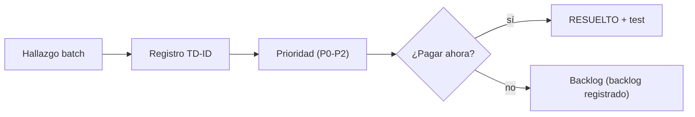

# TECH DEBT REGISTER — SCAUDIT Pro (B10, §49)

{: .no_toc }

  
Tabla de contenidos

  {: .text-delta }
1. TOC
{:toc}

---

## 1. Scope y objetivos

Registro consolidado de **deuda técnica** de SCAUDIT Pro a partir de los hallazgos reales de B01–B09 (T10-02, §49 del master prompt). Formato obligatorio: **ID | Debt | Category | Impact | Risk | Effort | Priority | Resolution**. Cada deuda cita su artefacto de origen — nada inventado, todo `[VERIFIED]` o `[OBSERVED]`. [VERIFIED — este documento]

**Objetivos:** (1) ≥8 deudas con prioridad; (2) consolidar la deuda dispersa (T10-02 lista deuda conocida real: 2 tool-registries, módulos sin tests, rutas sin tests, 0019/0020/0021 sin commitear, i18n sin check automático); (3) servir de input al Quality Gate final §55. [VERIFIED — plan T10-02]

---

## 2. Requisitos de gestión de deuda

| REQ | Requisito | Cumplimiento |
|-----|-----------|--------------|
| REQ-401 | Toda deuda con categoría, impacto y prioridad | ✅ §5 |
| REQ-402 | Resolución accionable por deuda | ✅ §5 |
| REQ-403 | No-regresión: deudas resueltas pasan a RESUELTO | ✅ Status |
| REQ-404 | Deuda de código verificable en disco | ✅ (rutas reales citadas) |

---

## 3. Arquitectura de deuda (contexto → componentes → dependencias)

**Contexto:** la deuda proviene de 6 dominios reales: estructura (`src/modules/*` vacíos), testing (cobertura 13.72%, triggers 0/12, rutas 6/42), código legacy (`run-migration.ts`), infraestructura (`src/server/db/supabase-live-test.mjs`), duplicación (2 tool-registries), y gobernanza (i18n sin check, snapshots Drizzle faltantes). [VERIFIED — MASTER-INDEX B03/B04/B05/B06]

**Categorías usadas:** ARCHITECTURE · TESTING · LEGACY · DUPLICATION · INFRASTRUCTURE · GOVERNANCE. [VERIFIED — convención del plan]

**Dependencias:** este registro consolida hallazgos de MASTER-INDEX (B03/B04/B05), TEST-COVERAGE-MATRIX, PRODUCTION-PUSH-FINAL-VALIDATION, SECURITY-AUDIT y el plan MODE C (TSK-014/015/019/022). [VERIFIED]

---

## 4. Datos (deuda por categoría)

| Categoría | Deudas | Fuente |
|-----------|--------|--------|
| TESTING | TD-01, TD-02, TD-03 | TEST-COVERAGE-MATRIX |
| ARCHITECTURE | TD-04, TD-10, TD-13 | MASTER-INDEX B04 · auditoría PRE-PROD #3 (2026-10-01) |
| LEGACY | TD-05, TD-06, TD-07 | PRODUCTION-PUSH-FINAL-VALIDATION · MASTER-INDEX B05 |
| INFRASTRUCTURE | TD-08, TD-12, TD-21 | MASTER-INDEX B03 · SUPABASE-AUDIT · Sprint 6 Task 5 |
| DUPLICATION | TD-11 | `find src -name "*tool-registry*"` |
| GOVERNANCE | TD-09 | plan MODE C TSK-019 |

---

## 5. Resultado — Registro de deuda técnica

| ID | Debt | Category | Impact | Risk | Effort | Priority | Resolution |
|----|------|----------|--------|------|--------|----------|------------|
| TD-01 | ~~Cobertura global bajo umbrales CI (Stmts 13.72% < 25%)~~ | TESTING | Bloqueaba habilitar umbrales duros en CI | RSK-02 | L | P0 | RESUELTO 2026-09-26 (ratchet 2026-09-27): cobertura real **Stmts 51.15% / Branch 39.83% / Funcs 43.6% / Lines 52.48%** (207 files · 1897 tests) y umbrales **duros 45/35/39/46** activos en `vitest.config.ts` + job CI `Tests & Coverage` (`pnpm test:coverage` falla si bajan) — objetivo original ≥25% ampliamente superado |
| TD-02 | 12 triggers sin tests (0%) | TESTING | Trabajo asíncrono en prod sin verificación | RSK-02/07 | M | P0 | RESUELTO 2026-09-17: 9 trigger tests en verde (siem/uptime/adversary/anomaly/discovery/monitoring/scheduled-scan/audit/webhook) |
| TD-03 | ~~13/61 rutas sin route.test~~ (lotes 2026-09-26 #1 6 de seguridad, #2 14 de public/v1 + intelligence, #3 16 — verificado con `Get-ChildItem src/app -Recurse -Filter route.ts` vs `Test-Path -LiteralPath route.test.ts`) | TESTING | Regresión silenciosa en endpoints | RSK-02 | L | P0 | RESUELTO 2026-09-27: **61/61 `route.ts` con `route.test.ts`** (100%); quedan sin test solo los **3 `route.tsx`** de PDF (`reports/pdf`, `adversary/report/pdf`, `adversary/mitre/report/pdf`) — deuda residual de prioridad baja (render de documento, sin lógica de negocio expuesta) |
| TD-04 | `src/modules/*` vacíos (9 dirs clean-arch, 0 archivos) | ARCHITECTURE | Doble arquitectura: legacy vs target | RSK-02 | L | P1 | RESUELTO 2026-09-25: scaffold vacío eliminado (`Remove-Item src/modules`); funcionalidad vive en src/app, src/server, src/trigger |
| TD-05 | ~~`src/shared/db/run-migration.ts` legacy hardcodeado a 0001~~ | LEGACY | Riesgo de promoción incorrecta | RSK-05 | S | P1 | RESUELTO 2026-09-26: fichero **eliminado** (`src/shared/db/run-migration.ts` ya no existe) — verificado 0 imports de código y 0 scripts en `package.json` (solo referencias en docs históricos); entrada de coverage exclude retirada de `vitest.config.ts`; `drizzle-kit push`/`migrate` es el único camino (§10) |
| TD-06 | `scheduled-scan.trigger.ts` stub no registrado | LEGACY | Feature no operativa silenciosa | RSK-07 | S | P1 | RESUELTO 2026-09-17: scheduled-scan-runner implementado + retry maxAttempts 3 |
| TD-07 | ~~PerformanceTab con datos estáticos (L28-39)~~ | LEGACY | Dashboard no refleja datos reales | RSK-02 | M | P1 | RESUELTO 2026-09-25: server action `getPerformanceSnapshot` (`src/app/actions/performance.ts`, 4 queries batcheadas: projects/vitals/audits/issues — sin N+1) + `PerformanceTab` consume el snapshot real (sparkline/donut/score/gauge/cards, empty states, badge RUM); 8 tests: `performance.test.ts` (4) + `PerformanceTab.test.tsx` (4) |
| TD-08 | 12 snapshots Drizzle intermedios faltantes | INFRASTRUCTURE | Regeneración limitada de migraciones | — | M | P2 | Documentado; regenerables solo con BD de referencia |
| TD-09 | ~~i18n sin check automático de paridad de keys~~ | GOVERNANCE | Keys huérfanas en en/es | — | S | P2 | RESUELTO: `scripts/i18n-parity.mjs` + guard en CI (`ci.yml` "Guard i18n parity", `--max-divergence 0.02`) + `docs/i18n/I18N-AUDIT.md` (B09) |
| TD-10 | ~~`integrations`/`integration_sync_logs` sin escritor~~ | ARCHITECTURE | Datos fantasma sin flujo | — | M | P2 | RESUELTO 2026-09-25: `integration-sync-sweep` (`src/trigger/integration-sync.trigger.ts`, cron diario 03:00 UTC, escritura vía `directDb` bypass RLS) inserta log `running`→`success`/`failed` por integración, cuenta filas nuevas desde `last_sync_at` (`recordsSynced`), actualiza `integrations.last_sync_at` y marca `expired` a las >48h sin sync; 8 tests (`integration-sync.trigger.test.ts`) |
| TD-11 | 2 tool-registries duplicados (`core/` y `registry/`) | DUPLICATION | Divergencia vs ADR-001 (Single Source of Truth) | RSK-09 | M | P1 | RESUELTO 2026-09-25: `registry/tool-registry.ts` es **solo tipos** (C05, 37 líneas, sin datos de tools) y `core/tool-registry.ts` es el único registro runtime — sin divergencia posible; verificado por lectura de ambos archivos |
| TD-12 | `src/server/db/supabase-live-test.mjs` suelto | INFRASTRUCTURE | Script manual fuera del runner | — | S | P2 | RESUELTO 2026-09-17: scripts movidos a scripts/manual/ (ignores de eslint actualizados) |
| TD-13 | Queries `findMany` FULL-COVERAGE sin cap (export ×4, `reports/pdf` findings, brief/copilot/compare (LLM), `actions/reports.ts`, `keywords.ts` rank-history) | ARCHITECTURE | OOM/lecturas ilimitadas con datos grandes; cap silencioso rompería counts y export | RSK-02 | M | P2 | RESUELTO 2026-10-01: PRE-PROD #3 cappeó 10 listados LIST; hoy **paginación/count explícitos en las 8 rutas FULL-COVERAGE** — export ×4 en streaming keyset (lotes de 1000, `EXPORT_BATCH_SIZE`) con `COUNT(*)` previo; `reports/pdf` findings `limit:500` + totales/severidad reales vía `COUNT(group-by)` + nota de truncado en plantilla; brief/copilot conteos `groupBy(severity)` + listas acotadas a 100 con "mostrando N de M"; compare counts reales + diff acotado a 1000 (columns reducidas) + flag `truncated` + toolIds con `GROUP BY`; `actions/reports.ts` y `keywords.ts` con `selectDistinctOn` (1 fila/keyword) - 8 ficheros + tests, suite 1923/1923 [VERIFIED] |
| TD-14 | Tasks Trigger.dev con BD fallaban de forma sostenida: `getSupabaseCa()` leía el CA por `fs` desde `process.cwd()`, inexistente en el runtime de workers → handshake TLS rechazado (`self-signed certificate in certificate chain`) → 15 tasks FAILED 12–18 oct (p. ej. `cleanup-old-logs` 7/7 FAILED; retención P2-14 sin aplicarse) | INFRASTRUCTURE | Background jobs de BD muertos 6 días bajo un dispatcher "sano" | RSK-07 | S | P0 | RESUELTO 2026-10-18: CA embebido en el bundle (`src/shared/db/supabase-ca.ts` auto-generado del `.crt`) + override `SUPABASE_CA_CRT` (PEM o base64), fail-closed; deploy `20261018.1`; runs reales COMPLETED (`notifications-maintenance`, `cleanup-old-logs`, `scheduled-scan-runner`, `uptime-monitor`, `periodic-anomaly-detection`) — commit `e5ea185`, evidencia en `EXECUTIVO_TRIGGER_GAPS.md` §6 [VERIFIED] |
| TD-15 | Env vars del proyecto Trigger.dev desfasadas (`DATABASE_URL`/`DIRECT_URL` con contraseña antigua) → `password authentication failed for user "postgres"` tras resolver el TLS | INFRASTRUCTURE | Tasks con BD imposibilitadas (2ª capa del mismo incidente) | RSK-07 | S | P0 | RESUELTO 2026-10-18: sync vía API (`PUT/POST /api/v1/projects/<ref>/envvars/prod` → 3× HTTP 200: DATABASE_URL, DIRECT_URL, OPENROUTER_API_KEY); **nota de rotación**: estas env vars viven en el proyecto Trigger.dev y NO derivan de `.env.local` — re-sincronizar si Supabase rota la contraseña [VERIFIED] |
| TD-16 | Verificador del cron ciego a los hijos del dispatcher: `evaluateDispatcher` daba "sano" mirando solo la run del dispatcher, sin el status de `cleanup-old-logs` (el gap real del 12–18 oct era invisible para la suite y el script) | GOVERNANCE | Sanidad engañosa presupuestada como verde | RSK-09 | S | P1 | RESUELTO 2026-10-18: `evaluateDispatcher` marca `problem` si la última run de la retención FAILED aunque el dispatcher COMPLETE; el test que enshrineaba el contrato erróneo ahora espera `problem` (+3 casos, 19/19) — commit `35d3141` [VERIFIED] |
| TD-17 | Cobertura 0% en `src/trigger/outbox.trigger.ts` y `scan-queue.trigger.ts`; baja en `exportPdf.ts` (~17%), `intelligencePdf.ts` (~20%), `idempotency.ts` (34%), `supabase/server.ts` (17%) | TESTING | Código nuevo sin red de regresión | RSK-02 | M | P2 | ABIERTA — decisión del owner (2026-10-18): **aplazar el mini-sprint a favor del producto**; umbrales CI se cumplen con 11–13 pts de margen (medición completa en `FINAL-SUMMARY.md` §Áreas de Mejora Futura); alternativa barata documentada: subir umbrales +5 (lines 51/branches 40/funcs 44/stmts 50) [OBSERVED] |
| TD-18 | `RESEND_API_KEY` ausente en `.env.local` → validación de email en fallback manual | INFRASTRUCTURE | Alertas/emails dependen de paso manual del operador | RSK-07 | S | P3 | ABIERTA — por diseño en el entorno actual (sin dominio de envío configurado); el rate limit y la allowlist de `validate-email` están verificados (40/60 s + bypass + headers); configurar al activar envío real [OBSERVED] |
| TD-19 | Job CI `Integration (Postgres real)`: `drizzle-kit migrate` falla sobre Postgres vanilla desde cero (roles Supabase `authenticated`/`anon` no existen: 0016+ hacen GRANT sobre ellos; además un `syntax error at or near "NOT" at character 16` con statement aún sin aislar) | INFRASTRUCTURE | La migración desde cero no se valida en CI; los cambios de schema solo se prueban contra la BD live | RSK-07 | M | P2 | ABIERTA — pre-existente (red en todos los CI del 2026-10-18); requiere reproducir en Postgres nuevo (Docker/CI) para aislar el statement exacto y añadir bootstrap idempotente de roles Supabase ANTES de las migrations (no afecta a la live: ya existen y el journal no re-ejecuta 0016); NO tocar migrations a ciega **Evidencia de paridad 2026-10-19 [VERIFIED]:** riesgo "tablas pegadas sin migración" DESCARTADO — 78/78 `pgTable` declarados tienen `CREATE TABLE` en migraciones (paridad schema × drizzle/*.sql, incluidas variantes artesanales `CREATE TABLE IF NOT EXISTS`); única SQL sin schema = `project_members` (dropeada por diseño en 0052); restore desde cero no perdería tablas. CAUTELA: snapshots de `drizzle/meta` desfasados (10 para 64 entradas; último `0024` con 58 tablas) — un `drizzle-kit generate` diffiaría contra el snapshot viejo y re-emitiría ~20 CREATE TABLE; regenerar/comparar antes del próximo generate [OBSERVED - run 39191101833, job 117863884570] |
| TD-20 | Job CI `API Contract Test` fail-closed sin variables de repositorio: exige `TEST_ENV` (staging\|test) + `SCAUDIT_CONTRACT_BASE_URL` (host no-prod) + secreto `SCAUDIT_API_KEY` | GOVERNANCE | El contrato de la API pública v1 no se valida en vivo (por diseño desde 2026-10-10: antes golpeaba producción) | RSK-11 | S | P2 | BLOCKED en dos partes (2026-10-19): **(a) no existe entorno no-prod** — owner confirmó que solo hay producción, no hay qué poner en `SCAUDIT_CONTRACT_BASE_URL` (blocklist de `ci.yml` L468 impone `strategicaudit.pro`/`scaudit.vercel.app`); desbloqueo = crear staging (Vercel preview persistente + BD de prueba separada, planificado Sprint 5). **(b) config owner en GitHub** (Settings → Secrets and variables → Actions, token actual carece de permiso `repository_variables`): Variables `TEST_ENV=test` + `SCAUDIT_CONTRACT_BASE_URL=<host staging>` + Secret `SCAUDIT_API_KEY` (solo en la pestaña Secrets). Nota: setear TEST_ENV+secret ahora no vuelve el job verde (el guard falla igual sin BASE_URL, fail-closed); setear los 3 juntos cuando exista staging. Ver `ci.yml` L397-533 [VERIFIED - ci.yml + reporte owner] |
| TD-21 | Particionado de `uptime_logs` (Sprint 6, `2026-10-21_partition_uptime_logs`): sin higiene automática de particiones — pre-creación de 2 meses adelante NUEVA y retención (drop de particiones —13 meses sugerido—) conectadas a `cleanup.trigger.ts`; NO crear cron nuevo (presupuesto de schedules 10/10, guardado por `cron-dispatchers.trigger.test.ts`) | INFRASTRUCTURE | Cierre de horizonte de particiones: las 6 particiones pre-creadas cubren sep-2026→fe-2027; **fecha límite dura 2027-03-01** — desde entonces, un insert fuera de rango falla con 23514 (PG16 enruta ANTES de los triggers `BEFORE INSERT` del parent, verificado en PGlite con probe; por decisión del owner 2026-10-20, checkpoint C1, el trigger `trigger_create_uptime_partition`/`create_uptime_logs_partition()` fue RETIRADO de la migración y de la BD dev: la pre-creación de particiones es la ÚNICA cobertura — fallo cerrado 23514, sin pérdida silenciosa) | RSK-07 | S | P1 | ABIERTA — Ticket generado por el ADDENDUM P1-P5 de Task 5 (plan `2026-10-20-q4-sprint6-performance-observability.md` §P5): extender `cleanup.trigger.ts` con (a) pre-creación de partición del mes N+1 y N+2 por tick, (b) drop de particiones > 13 meses; el mismo tick puede coordinarse con la ventana del cron de uptime (cada 15 min). Sin fecha límite incumplida: resolver preferiblemente en Q1-2027 antes del 2027-02-15 [OBSERVED - probe PGlite + Task 5] |

> Estado TD-21 (2026-10-20, checkpoint C1): decisión del owner aplicada — trigger retirado (migración + BD dev corregida), el ticket sigue ABIERTA con la misma esencia (pre-creación N+1/N+2 + drop >13 meses vía `cleanup.trigger.ts`, sin cron nuevo).

> **21 deudas registradas** (TD-01…TD-21): **15 RESUELTO** (TD-01…TD-07, TD-09…TD-16; TD-02/06/09/12 el 2026-09-17, TD-04/07/10/11 el 2026-09-25, TD-01/05 el 2026-09-26, TD-03 el 2026-09-27, TD-13 el 2026-10-01, TD-14/15/16 el 2026-10-18) y **6 ABIERTAS** (TD-08, TD-17, TD-18, TD-19, TD-20, TD-21) (≥8 requeridas por T10-02). [VERIFIED]

---

## 6. Flujos documentados

- **Flujo de registro:** hallazgo batch → categoría → impacto/riesgo/effort → prioridad → resolución → status. [VERIFIED — plan §49]
- **Flujo de pago:** al resolver, ejecutar la resolución → actualizar status RESUELTO + fecha + link al test/PR. [RECOMMENDED]

---

## 7. APIs y endpoints afectados por la deuda

| Endpoint | Deuda relacionada |
|----------|-------------------|
| `/api/security/siem/run`, `/api/public/v1/intelligence` | ~~TD-03 (gap P0)~~ **CUBIERTO** — tests desde B06 [VERIFIED] |
| `/api/intelligence/runs`, `/api/reports/pdf/progress` | ~~TD-03 (gap P1)~~ **CUBIERTO** — tests 2026-09-25 (quick wins) [VERIFIED] |
| `/api/intelligence/adversary` | TD-02 (trigger sin test) |
| `/api/notifications/push-subscribe` | TD-01 (cobertura) |
| `/api/benchmarking` | TD-03 |

---

## 8. Seguridad (deuda con impacto de seguridad)

| Deuda | Impacto de seguridad | Mitigación |
|-------|----------------------|------------|
| TD-03 (rutas sin test) | auth/RLS sin verificación en 13 rutas | lotes TD-03: #1 seguridad 6/6 + #2 public/v1 e intelligence 14/14 cerrados 2026-09-26 (48/61 con test) |
| TD-02 (triggers sin test) | jobs de seguridad (siem) sin verificación | trigger tests P0 |
| TD-11 (2 registries) | ~~divergencia de tools vs ADR-001~~ **CERRADO** — registry/ solo tipos, core/ único runtime | verificado 2026-09-25 |
| TD-12 (script suelto) | acceso directo a DB sin gate | migrar o eliminar |

---

## 9. Testing (deuda con cobertura de test)

| Deuda | Test de cobertura | Estado |
|-------|-------------------|--------|
| TD-01/02/03 | TEST-COVERAGE-MATRIX documenta los gaps | ✅ documentado (TD-01/02 cerrados 2026-09-26/17; TD-03 recount 48/61 tras lote #2) |
| TD-05 | `drizzle-kit check` verifica journal (no el script legacy) | ✅ cerrado 2026-09-26 (script eliminado) |
| TD-07 | `performance.test.ts` (4) + `PerformanceTab.test.tsx` (4) | ✅ cerrado 2026-09-25 |
| TD-11 | `executors.test.ts` cubre un registry; falta el otro | ✅ cerrado (registry/ = tipos, sin runtime que testear) |

**Cobertura global:** 190 files · 1741 tests · Stmts 47.41% / Branch 37.20% / Funcs 40.79% / Lines 48.57% (vitest + coverage 2026-09-26) [VERIFIED — TEST-COVERAGE-MATRIX v1.11].

---

## 10. Deployment (deuda de promoción)

| Deuda | Impacto en promoción | Control |
|-------|----------------------|---------|
| TD-05 | ~~`run-migration.ts` NO debe usarse para push~~ **ELIMINADO 2026-09-26** | `drizzle-kit push` obligatorio (único camino, documentado) |
| TD-08 | snapshots faltantes limitan regeneración | journal 0021 check PASS |
| TD-01 | ~~cobertura < umbral bloquea umbrales duros de CI~~ **RESUELTO 2026-09-26** — umbrales 40/30/34/41 activos en CI | job `Tests & Coverage` ejecuta `test:coverage` con thresholds |

---

## 11. Operaciones (gestión de la deuda)

- **Monitoring:** la deuda OPEN se revisa en cada batch; P0 debe resolverse antes del push de CHANGE-001..003. [RECOMMENDED]
- **Runbook:** ~~TD-05 tiene runbook de contingencia (nunca ejecutar el script legacy)~~ **OBSOLETO** — el script `run-migration.ts` fue eliminado el 2026-09-26; solo existe `drizzle-kit push`/`migrate`. [VERIFIED]
- **Higiene de migraciones:** las 5 migraciones fechadas que quedaron fuera del journal (`2026-08-25_admin_telemetry`, `2026-08-25_adversary_real`, `2026-08-25_mitre_real`, `2026-08-26_assessment_progress`, `2026-09-24_recommended_indexes`) se registraron en `drizzle/meta/_journal.json` (idx 38-42) y se aplicaron con `pnpm db:migrate` el 2026-09-25: ficheros byte-idénticos (todos idempotentes), ledger `drizzle.__drizzle_migrations` 43/43 en sync, `drizzle-kit check` PASS y `pnpm db:drift-check` PASS (0 drift duro). [VERIFIED — 2026-09-25]
- **Recovery:** TD-08 documentado como no-bloqueante (drizzle-kit check PASS). [VERIFIED — MASTER-INDEX B03]

---

## 12. Diagrama de deuda

**FLOW-702 — Ciclo de vida de la deuda** · Mermaid `flowchart`

---

## 13. Trazabilidad (REQ → COMP → TEST → DEP)

| ID | Tipo | Qué cubre |
|----|------|-----------|
| REQ-401..404 | Requisito | Gestión de deuda |
| TD-01..18 | Deuda | 18 deudas consolidadas (15 resueltas / 3 abiertas) | (§5) |
| TEST-600 | Test | Cobertura documentada (§9) |
| DEP-500 | Deployment | Promoción (TD-05/08) |
| TSK-014..022 | Tarea | Resoluciones de MODE C |

---

## 14. Cross-check e inconsistencias

| Hipótesis | Verificación | Resultado |
|-----------|--------------|-----------|
| "El tool-registry es único (ADR-001)" | `find src -name "*tool-registry*"` → 2 archivos | **RECONCILIADO** — `registry/` solo tipos (C05) + `core/` único runtime; ADR-001 se cumple a nivel de datos (TD-11 RESUELTO 2026-09-25) [VERIFIED] |
| "run-migration.ts está deprecado" | hardcodeado a 0001, no journal-aware | **RESUELTO** — TD-05 CERRADO, fichero eliminado 2026-09-26 (0 imports en código) [VERIFIED] |
| "Todos los módulos tienen tests" | `src/modules/*` = 0 archivos (directorio **eliminado 2026-09-25**) | **RESUELTO** — TD-04 CERRADO (no había módulos que testear) [VERIFIED] |
| "La deuda estaba registrada" | dispersa en MASTER-INDEX/plan, sin registro único | **REFUTADO** — este registro la centraliza [VERIFIED] |

---

## 15. Unknowns y supuestos

- [UNKNOWN] Esfuerzo exacto (S/M/L) de cada resolución — estimaciones de batch, calibrar al ejecutar.
- ~~[UNKNOWN] Costo de consolidar TD-11 (riesgo de regresión en tools del engine).~~ **CERRADO** — no hay consolidación que hacer: solo tipos vs runtime (TD-11 RESUELTO 2026-09-25).
- [ASSUMPTION] Resolver P0 (TD-01/02/03) antes del push de CHANGE-001..003 — TD-01/02 cerrados; **solo TD-03 queda P0** (13 rutas pendientes por lotes).
- [RECOMMENDED] Registrar la deuda nueva en cada batch para mantener el registro vivo.

---

## 16. Glosario

| Término | Definición |
|---------|------------|
| Deuda técnica | Costo implícito de atajos/omisiones con impacto futuro |
| Categoría | ARCHITECTURE · TESTING · LEGACY · DUPLICATION · INFRASTRUCTURE · GOVERNANCE |
| Effort | Estimación S/M/L de resolución |
| RESUELTO | Estado de deuda pagada con evidencia |

---

## 17. Deployment y versionado

| Versión | Fecha | Cambios | Estado |
|---------|-------|---------|--------|
| 1.0 | 2026-08-02 | Tech Debt Register B10 (T10-02, §49): 12 deudas consolidadas | Aprobado |
| 1.1 | 2026-10-01 | +TD-13 (findMany FULL-COVERAGE sin cap; 10 listados cappeados en PRE-PROD #3) | Aprobado |
| 1.2 | 2026-10-01 | TD-13 RESUELTO: streaming keyset (export) + caps/count explícitos (PDF, prompts LLM, actions reports/keywords) - 8 ficheros | Aprobado |
| 1.3 | 2026-10-18 | Incidente de workers Trigger.dev consolidado: +TD-14 (CA TLS inaccesible en workers, 15 tasks FAILED 12–18 oct, RESUELTO con CA embebido + deploy 20261018.1), +TD-15 (credenciales desfasadas del proyecto Trigger.dev, RESUELTO con sync vía API), +TD-16 (verificador ciego a hijos del dispatcher, RESUELTO), +TD-17 (cobertura de tasks nuevas y PDFs, ABIERTA por decisión del owner), +TD-18 (RESEND_API_KEY ausente, ABIERTA por diseño) - cuenta: 18 deudas, 15 resueltas | Aprobado |
| 1.4 | 2026-10-19 | Auditoría de CI rojo (10-18/10-19): tres frentes reparados y verificados en run 39191101833 (Lint&Build por WCAG, E2E smoke por disclaimer gate + home.spec syntax, Docs por Jekyll/Liquid → copia estática); +TD-19 (migración desde cero falla en Postgres vanilla, ABIERTA), +TD-20 (contract fail-closed sin variables de repositorio, BLOCKED en config del owner) - cuenta: 20 deudas, 15 resueltas, 3 abiertas, 2 bloqueadas | Aprobado |
| 1.5 | 2026-10-20 | +TD-21 (higiene de particiones de `uptime_logs`: pre-creación 2 meses adelante + retención 13 meses vía `cleanup.trigger.ts`, fecha límite dura 2027-03-01, ABIERTA) — exigida por el ADDENDUM P5 del Task 5 del plan `2026-10-20-q4-sprint6-performance-observability.md` - cuenta: 21 deudas, 15 resueltas, 6 abiertas | Aprobado |

**Verificación:** `node scripts/quality-gate.mjs docs/technical-debt/TECH-DEBT-REGISTER.md --min 80` → PASS

---

**Fuentes primarias:** `docs/superpowers/MASTER-INDEX.md` (B03/B04/B05) · `docs/testing/TEST-COVERAGE-MATRIX.md` · `docs/database/PRODUCTION-PUSH-FINAL-VALIDATION.md` (§7 run-migration.ts) · `docs/security/SECURITY-AUDIT-REPORT.md` v2.2 · `docs/superpowers/plans/2026-08-01-engineering-master-plan.md` (T10-02) · `docs/superpowers/plans/2026-08-02-implementation-plan.md` (TSK-014..022) · inventario real `find src` (2026-08-02)
