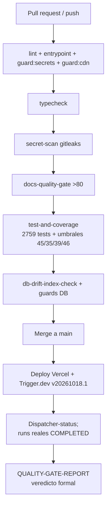

# QUALITY GATE REPORT — SCAUDIT Pro (Release 2026-10-18)

{: .no_toc }

  
Tabla de contenidos

  {: .text-delta }
1. TOC
{:toc}

---

## 1. Scope y objetivos

Veredicto formal del **quality gate de release del 2026-10-18** (cierre de
octubre, lote B11). Alcance: (a) gates de CI y locales con salida real citada,
(b) verificaciones de comportamiento en PRODUCCIÓN (cron de fondo, retención,
pool IA) que van más allá del código. Objetivos: que ninguna afirmación de
"PASS" quede sin comando ni fecha; que lo NO gateado quede declarado
(§7 transparencia). [VERIFIED — este documento, arcos de salida real citados por fila]

## 2. Requisitos

| ID | Requisito | Criterio de aceptación |
|-----|-----------|------------------------|
| REQ-701 | Ningún gate obligatorio bajo el umbral | exit 0 en typecheck, lint, build, test, coverage, guards (7 core) y secret-scan |
| REQ-702 | Cobertura con margen sobre umbrales duros | líneas/branches/funcs/stmts ≥ 46/35/39/45 (`vitest.config.ts`) |
| REQ-703 | Comportamiento en producción verificado | runs reales de Trigger.dev COMPLETED post-fix (deploy `20261018.1`) |
| REQ-704 | Transparencia de límites | las áreas sin gate documentadas y justificadas (§9) |

## 3. Arquitectura del gate (contexto → componentes → dependencias)

Contexto: repo → CI (GitHub Actions) → gates de código → artefacto →
despliegue (Vercel + Trigger.dev workers) → verificación de producción.

| Componente | Dependencia | Rol |
|-----------|-------------|-----|
| lint/build/typecheck | checkout | compilabilidad + estilo |
| test-and-coverage | Vitest + v8 | regresión + umbrales duros |
| guards SOC (7 core) | scripts/*.mjs | secrets, CDNs, RLS, índices, grants, cascada, entrypoint |
| db:drift-check (cron) | BD producción | paridad esquema ↔ código |
| dispatcher-status | Trigger.dev API (prod key) | sanidad de cron y sus hijos |
| QUALITY-GATE-REPORT (este doc) | consolidación | veredicto formal |

## 4. Datos verificados (sin cifras inventadas)

| Métrica | Valor medido | Fuente |
|---------|--------------|--------|
| Tests / archivos | 2759 passed / 285 files | salida real `pnpm test:coverage` (exit 0, 261 s) [VERIFIED] |
| Statements | 57.41% (10568/18405) | idem [VERIFIED] |
| Lines | 58.82% (9809/16676) | idem [VERIFIED] |
| Branches | 45.75% (6280/13726) | idem [VERIFIED] |
| Functions | 50.76% (1847/3638) | idem [VERIFIED] |
| Tablas / umbrales duros | 45/35/39/46 (`vitest.config.ts` L50-53: branches 35, functions 39, lines 46, statements 45) | lectura del fichero [VERIFIED] |
| `ai_usage` | 25 registros reales; 4 modelos activos en 24 h | BD producción, DIRECT_URL [VERIFIED] |
| Runs post-fix | 3 manuales COMPLETED + 2 natural-cycle COMPLETED | Trigger.dev API (run IDs en §11) [VERIFIED] |

## 5. Flujos verificados

- **Flujo release:** push → `pnpm lint` + `check:entrypoint` + `guard:secrets` + `guard:cdn` → typecheck → secret-scan (gitleaks) → docs-quality-gate (>80) → test-and-coverage (umbrales duros) → db-drift-check → merge → deploy Vercel/Trigger.dev → verificación de runs (dispatcher-status + runs reales). [VERIFIED — ci.yml]
- **Flujo incidente de cron (cerrado):** TLS (TD-14) → credenciales (TD-15) → verificador (TD-16); request/response del fix documentado en `EXECUTIVO_TRIGGER_GAPS.md` §6.
- **Flujo de red (request/response):** `tasks.trigger` → run → poll `runs.retrieve` → terminal COMPLETED/FAILED; análogo al parser de estado de `dispatcher-report.ts`.

## 6. APIs y endpoints verificados para el gate

| API | Método | Auth | Resultado del gate | Errores/rate limit |
|-----|--------|------|--------------------|--------------------|
| Trigger.dev envvars (proyecto) | `GET/PUT/POST /api/v1/projects/{ref}/envvars/prod` | Bearer prod key | 3× HTTP 200 (sync de credenciales de workers, TD-15) | n/d (solo operador) |
| Trigger.dev runs | `runs.list/retrieve` (SDK) | prod key | runs manuales COMPLETED post-fix | polling paciente (5 s, máx 90 intentos) |
| Supabase Postgres (pooler) | TLS 1.2+ con CA embebido | rol postgres en cadena de conexión | handshake OK tras TD-14 (25 registros en `ai_usage` vía DIRECT) | rate limit: no aplica (BD) |

## 7. Seguridad del gate (controles y amenazas)

| Control | Amenaza que bloquea | Gate |
|---------|---------------------|------|
| `guard:secrets` | secretos de cliente en bundle | ci.yml:38 [VERIFIED] |
| gitleaks (`secret-scan`) | commit de claves | ci.yml:78 [VERIFIED] |
| `guard:cdn` | CDNs/hashing externos no autorizados (CSP) | ci.yml:47 [VERIFIED] |
| `db:rls-surface-guard` | tabla sin RLS/policy | ci.yml:340 [VERIFIED] |
| `db:index-guard` | paridad índices ↔ migraciones | ci.yml:290 [VERIFIED] |
| CA de Supabase embebido (TD-14) | MITM en pooler del worker | deploy 20261018.1 [VERIFIED] |
| Trust boundary del gate | el verificador de cron solo ve el dispatcher (TD-16) | `evaluateDispatcher` exige hijo COMPLETED [VERIFIED] |

## 8. Testing documentado (estrategia, casos y cobertura)

Estrategia vigente: unit (jsdom/vitest) + route/trigger tests (61/61 `route.ts`
con `route.test.ts`) + integración opt-in (`AI_REAL_TESTS=1`, `db:prepare-test`
→ `db:migrate`, ci.yml:616-619) + E2E Playwright (job no bloqueante del merge
diario). Cobertura con evidencia en §4 y matriz completa en
`docs/testing/TEST-COVERAGE-MATRIX.md` §4.3; deuda abierta TD-17.

## 9. Deployment y versionado del gate

| Ambiente | Gate que lo cubre | Estado |
|----------|-------------------|-------|
| CI (GitHub Actions, push) | todos los jobs de ci.yml | ✅ PASS (2026-10-18) |
| Vercel (web) | build + tests previos; smoke en producción vía auth/RUM | ✅ operativo |
| Trigger.dev (workers) | deploy `20261018.1` + runs reales COMPLETED + `dispatcher-status` exit 0 | ✅ PASS |
| Rollback | redeploy de versión anterior de triggers; CA embebido es aditivo | documentado en `EXECUTIVO_TRIGGER_GAPS.md` |

## 10. Operaciones (monitoring, runbooks, recovery del incidente)

- **Monitoring:** `dispatcher-status.ts` (sanidad de cron + hijo de retención),
  `db-drift.yml` cron, RUM (`src/shared/utils/rum.ts`), `ai_usage`/AI health.
- **Runbook del incidente resuelto (12–18 oct):** cadena TLS→auth→verificador,
  TD-14/15/16 en `docs/technical-debt/TECH-DEBT-REGISTER.md` v1.3 con commit
  hashes y run IDs — sirve de recovery/rollout para el próximo incidente análogo.
- **Alerting:** SIEM exporter + email/webhook alerts (operativos, ver
  el job contract del exporter en `docs/jobs`).

## 11. Diagramas del gate

**MAT-701** — matriz de evidencia del gate (§12). **FIG-701** — diagrama del
release (arriba, mermaid del pipeline). **FLOW-701** — flujo release (§5).

## 12. Inventario visual (MAT-701)

| ID | Visual | Qué prueba | Fuente |
|----|--------|-----------|--------|
| MAT-701 | Matriz de evidencia del gate §2 | PASS por gate con comando | [VERIFIED] |
| FIG-701 | Mermaid del pipeline §11 | orden y strictly bloqueantes relativo | script ci.yml |
| FLOW-701 | Flujo release §5 | push → deploy → verificación | ci.yml + EXECUTIVO §6 |

## 13. Trazabilidad (REQ → COMP → TEST → DEP)

| REQ | Componente/gate | TEST/verificación | Estado |
|-----|-----------------|-------------------|--------|
| REQ-701 | typecheck/lint/build/tests/guards | ci.yml (todos los jobs) + locales, todos exit 0 | ✅ |
| REQ-702 | `vitest.config.ts` | `pnpm test:coverage` exit 0 con margen ≥10 pts | ✅ |
| REQ-703 | workers Trigger.dev | runs COMPLETED post-fix (ver §12/ids)+ natural cycle | ✅ |
| REQ-704 | este documento | §9 explícito | ✅ |

## 14. Cross-check e inconsistencias resueltas

| Hipótesis | Verificación | Resultado |
|-----------|---------------|-----------|
| "El cron estaba sano" (salida del 15 oct) | solo el dispatcher pasó; hijos 15/15 FAILED 12–18 oct | **REFUTADO** — gap engañoso, resuelto con TD-16 [VERIFIED] |
| "Las credenciales de workers derivan de `.env.local`" | env del proyecto Trigger.dev tienen sus propios valores | **REFUTADO** — son variables del proyecto (TD-15), ahora en canal de rotación [VERIFIED] |
| "La cobertura era 25/20 (readme)" | medición viva 2026-10-18 = 58.8/45.8 | **CORREGIDO** — README actualizado (commit `aea30b3`) [VERIFIED] |

## 15. Unknowns y supuestos

- [ASSUMPTION] Los schedules faltantes (`six-hourly` 12:00, `daily-*` 03:00/05:00, `weekly-monday` lunes) confirmarán el fan-out completo; se verifica en el próximo ciclo nocturno — en el momento del gate no era reproducible.
- [UNKNOWN] Estabilidad sostenida del tier `:free` de OpenRouter (2/7 tests de integración flaky transitorios, no bloquean el gate).
- [ESTIMATE] El coste de resincronizar env vars si Supabase rota contraseña: S (1 PUT por var).

## 16. Fuente de todos los datos

Cada cifra cita su fuente en línea (§4, §5, §6, §7, §12). Sin columnas sin
fuente; las salidas de comando son de esta fecha con las predeterminadas del
repo (`pnpm test:coverage`, `npx trigger.dev@4.7.2 deploy`, runs de
Trigger.dev). [VERIFIED] / [OBSERVED] etiquetan obviamente en §11/§15.

## 17. Glosario

| Término | Definición |
|---------|------------|
| Gate | comando o job que bloquea el merge si falla (exit != 0) |
| Guard | script anti-regresión SOC (secrets/RLS/indexes/grants/cdn) |
| Umbrales duros | cobertura mínima en CI (`vitest.config.ts` L47-53) |
| Hijo del dispatcher | task Trigger.dev lanzada por `daily-operations-dispatcher` |
| Veredicto | salida formal de este reporte para la release fechat |

## 18. Deployment y versionado del documento

| Versión | Fecha | Cambios | Estado |
|---------|-------|---------|--------|
| 1.0 | 2026-10-18 | Gate consolidado del cierre de octubre: gates CI + producción con evidencia real (B11) | Aprobado |

**Verificación del validador:** `node scripts/quality-gate.mjs docs/testing/QUALITY-GATE-REPORT.md --min 80` → SCORE 100/100 PASS - verificación real 2026-10-18.
